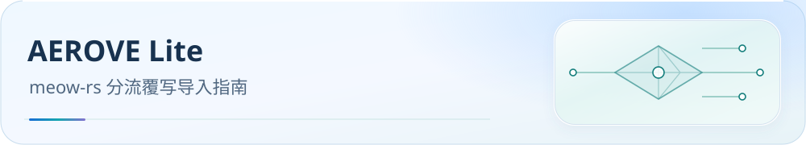

<picture>
  <source media="(max-width: 600px)" srcset="../../docs/assets/readme/page-aerove-lite-mobile.svg">
  
</picture>

# AEROVE Lite 导入指南

为 AEROVE Lite 的 `main(config)` 脚本宿主提供 Meow 分流 JS，并按 Lite 的单资源安全预算生成专版 MRS 分片；当前仍是待 App 重验的配置候选。

[内核家族入口](../README.md) · [下载脚本](AeroveLite%28meow%29.js) · [资源分片与证据](RESOURCE-SPLITTING.md) · [联调核查](VALIDATION.md) · [接口依据](REFERENCE-AEROVE-Lite.md) · [变更日志](CHANGELOG.md) · [支持队列](../../docs/support-queue.md#aerove-lite-meow)


[可选业务方案与本地参数](../../docs/configuration.md)：完整配置继续作为默认；可选投影输出到独立目录，运行时参数支持范围见统一指南。

## 开始前

本仓库不提供节点或订阅。先在 Lite 导入节点订阅，确认配置包含已展开的 `proxies`。纯远程 `proxy-providers` 须先经 [Sub-Store](../../SubStore/README.md) 展平；脚本不能代替宿主下载订阅。

输入的 DNS、hosts、嗅探、IPv6、端口、模式、控制器和 TUN 应已兼容 Lite。JS 保留这些字段，仅维护节点清洗、地区/家宽与业务组、rule-providers 和 rules，不注入 Smart/LightGBM、Mihomo 全局参数或 TLS 指纹。

标准版 AEROVE 使用 Mihomo；本页对应 AEROVE Lite 的 Meow 接入。官方 meow-rs 核心及官方 Android/iOS 的原生配置入口见[官方 Meow](../Meow/README.md)。

## 导入与关联

1. 下载 [AeroveLite(meow).js](AeroveLite%28meow%29.js)。
2. 在 Lite 的覆写管理中添加脚本，关联需要处理的节点订阅并刷新。具体界面以验收 APK 为准。
3. 确认宿主通过 `OverridePipeline` 将 YAML 转为 JSON，调用 `main(config)` 后再转回 YAML。该接口使用 QuickJS；[接口快照](REFERENCE-AEROVE-Lite.md)记录已核对的源码位置。
4. 通过宿主配置准入、资源准备与运行装配，读回最终 YAML，核对节点、业务组、有序规则和 MRS/residual 资源引用。
5. 等待资源更新与健康检查，再验收 Android VPN、广告拦截、直连、国外网站和各业务出口。

JS 只创建实际有节点的地区组，因此地区与业务组总数可能少于 55。输入为空、节点未展开或配置不兼容时应先处理明确报错，再刷新覆写。

## 失败行为与待验项目

生产 Meow 校验器、三阶段资源校验与 prepared JNI 链路已接通；固定 beta16 的真实 Android 用例已通过 QuickJS 失败原子性及命名 HTTP 代理/取消检查。完整记录见[联调核查](VALIDATION.md)。自定义 header 实传和完整配置验收仍待完成。

脚本在副本上处理配置，失败抛错，原输入保持不变。若 DNS 引用将被重建的订阅 rule-set，脚本会明确拒绝；先改用独立 DNS 策略，再应用覆写。

固定 beta18 的真实 Smart 用例拒绝了旧广告分片。当前本地候选保留每资源 250,000 条及 500,000 点分标签上限，将广告资源拆为四片、国内站点资源拆为两片；同目标 RULE-SET 在原位置连续展开，其他 147 个规则源复用。脚本和资源必须来自同一发布批次，身份及预算见[资源清单](rule-assets/manifest.json)。

固定 Rust reader 和 App 原样头部/条目预算已通过全部 111 个投影 MRS 的本地检查，不能替代 App 验收。在目标 APK 中仍须执行当前脚本、下载并预检全部资源、读回最终 YAML、通过完整 prepared 校验，再验收 VPN 与真实路由。App 自有的 Geo、订阅及派生资源还要计入最终 bundle 的 256 资源/256 MiB 预算；规则资源的静态合计不能替代该检查。完整范围见[分片依据](RESOURCE-SPLITTING.md)及[支持队列](../../docs/support-queue.md#aerove-lite-meow)。

共享 JS 的本地行为检查与官方核心原生 YAML 校验各有独立证据，均不能替代 Lite 的最终配置和实际连接验收。官方核心验证范围见[官方依据](../Meow/REFERENCE-meow-rs.md)。

## 维护与生成

唯一规则权威源为 `rulesets/source/routing-graph.js`。JS 复用维护中的共享分流实现，由仓库根目录的生成器统一输出；不手工编辑生成脚本。

```bash
node tools/generate-aerove-rule-assets.js
node tools/generate-meow.js
node tools/generate-aerove-rule-assets.js --check
node tools/generate-meow.js --check
```

生成与检查需要 Node.js ≥ 22.15、Ruby ≥ 3.0 和 Mihomo v1.19.32；通过 `AEROVE_MIHOMO_BIN` 或 `MIHOMO_BIN` 指定该转换器，Windows 也可复用仓库缓存。客户端运行无需这些生成工具。共享[适配清单](../adapter-manifest.json)记录脚本与独立资源清单；官方 Meow YAML 保留原生入口，客户端接线在 AEROVE 仓库独立维护。
