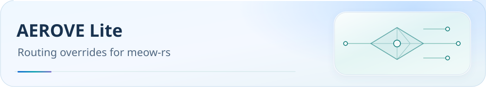

[**English**](README.md) | [中文](README.zh-CN.md)

<picture>
  <source media="(max-width: 600px)" srcset="../../docs/assets/readme/page-aerove-lite-mobile.svg">
  
</picture>

# AEROVE Lite import guide

Meow routing JavaScript for the AEROVE Lite `main(config)` host, with dedicated MRS shards generated within Lite's per-resource safety budget. This remains a configuration candidate awaiting application revalidation.

[Core family](../README.md) · [Download script](AeroveLite%28meow%29.js) · [Resource splitting and evidence](RESOURCE-SPLITTING.md) · [Integration validation](VALIDATION.md) · [Interface reference](REFERENCE-AEROVE-Lite.md) · [Changelog](CHANGELOG.md) · [Support queue](../../docs/support-queue.md#aerove-lite-meow)

[Optional service profiles and local parameters](../../docs/configuration.md): the complete profile remains the default. Optional projections are written to separate directories; see the shared guide for supported runtime parameters.

## Before you start

This repository does not provide nodes or subscriptions. Import your node subscription into Lite first and confirm that the configuration contains expanded `proxies`. Remote-only `proxy-providers` must first be flattened with [Sub-Store](../../SubStore/README.md); the script cannot download subscriptions on behalf of the host.

Input DNS, hosts, sniffing, IPv6, ports, mode, controller and TUN settings must already be compatible with Lite. The script preserves these fields and maintains only node cleanup, regional/residential and service groups, rule-providers and rules. It does not inject Smart/LightGBM, Mihomo global settings or TLS fingerprints.

Standard AEROVE uses Mihomo. This page covers AEROVE Lite's Meow integration. For the official meow-rs core and native configuration entry points in the official Android/iOS applications, see [official Meow](../Meow/README.md).

## Import and association

### Online selection and local import

Open the [configuration page](https://ivansolis1989.github.io/Smart-Config-Kit/), select the AEROVE Lite JS candidate, Full / Lite / Custom, and supported latency-test, QUIC, multiplier or ZeroTier parameters. Download and fully extract the ZIP. Add `Meow内核系/Aerove Lite/AeroveLite(meow).js` as an override using the steps below and associate it with a subscription whose nodes are expanded. Keep `rule-assets/` and the manifest as same-release resource and budget evidence; the ZIP is not a directly importable configuration. Leave DNS off so the application manages it. The page does not read or upload subscriptions or personal configurations.

To update, refresh the page, select the same profile and parameters, and download a new package. Back up and replace your local copy, then update the associated JS override. The script, resources and budget manifest must come from the same release. Complete resource preparation, final-configuration checks and connection acceptance below. Do not use the official full-script URL to automatically update a customized copy. Generating or downloading does not remove candidate status or replace target-APK acceptance. See the [configuration guide](../../docs/configuration.md) for service scope.

1. Download [AeroveLite(meow).js](AeroveLite%28meow%29.js).
2. Add the script in Lite's override manager, associate it with the node subscription to process, and refresh. Exact controls depend on the APK under test.
3. Confirm that the host uses `OverridePipeline` to convert YAML to JSON, call `main(config)`, and convert the result back to YAML. This interface uses QuickJS; the [interface snapshot](REFERENCE-AEROVE-Lite.md) records the verified source locations.
4. Complete host configuration admission, resource preparation and runtime assembly. Read back the final YAML and check nodes, service groups, ordered rules and MRS/residual resource references.
5. Wait for resource updates and health checks, then test Android VPN, ad blocking, direct routing, international websites and service exits.

The script creates regional groups only where matching nodes exist, so the combined regional/service group count can be below 55. Resolve explicit errors for empty input, unexpanded nodes or incompatible configuration before refreshing the override.

## Failure behavior and pending acceptance

The production Meow validator, three-stage resource validation and prepared JNI pipeline are connected. Real Android cases on pinned beta16 passed QuickJS failure atomicity and named HTTP-proxy/cancellation checks. See [integration validation](VALIDATION.md) for the complete record. Actual custom-header transmission and full-configuration acceptance remain pending.

The script operates on a copy, throws on failure and leaves the original input unchanged. If DNS references a subscription rule-set that would be rebuilt, it explicitly rejects the configuration. Use an independent DNS policy before applying the override.

A real Smart case on pinned beta18 rejected the old ad shards. The current local candidate keeps limits of 250,000 entries and 500,000 dot-separated labels per resource, splitting ads into four resources and China-site rules into two. Consecutive same-target RULE-SET entries replace the original position; the other 147 rule sources are reused. Script and resources must share a release. See the [resource manifest](rule-assets/manifest.json) for identities and budgets.

All 111 projected MRS assets passed local checks using the pinned Rust reader and the application's unchanged header/entry budgets. This does not replace application acceptance. In the target APK, run the current script, download and preflight every resource, read back final YAML, pass full prepared validation, and test VPN and real routing. Application-owned Geo, subscription and derived resources also count toward the final bundle limits of 256 resources / 256 MiB. Static rule-resource totals do not replace that check. See [splitting evidence](RESOURCE-SPLITTING.md) and the [support queue](../../docs/support-queue.md#aerove-lite-meow).

Shared-JS behavior checks and official-core native YAML validation have separate evidence; neither replaces Lite final-configuration and real-connection acceptance. See the [official-core reference](../Meow/REFERENCE-meow-rs.md).

## Maintenance and generation

The sole routing authority is `rulesets/source/routing-graph.js`. JavaScript reuses the maintained shared routing implementation and is generated from the repository root. Do not hand-edit generated scripts.

```bash
node tools/generate-aerove-rule-assets.js
node tools/generate-meow.js
node tools/generate-aerove-rule-assets.js --check
node tools/generate-meow.js --check
```

Generation and checks require Node.js ≥ 22.15, Ruby ≥ 3.0 and Mihomo v1.19.32. Set `AEROVE_MIHOMO_BIN` or `MIHOMO_BIN` to the converter; Windows can also reuse the repository cache. Clients do not need these generation tools. The shared [adapter manifest](../adapter-manifest.json) records scripts and separate resource manifests. Official Meow YAML retains its native entry point; client wiring is maintained separately in the AEROVE repository.
