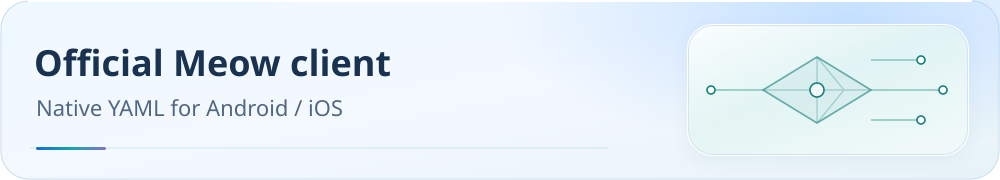

[**English**](README.md) | [中文](README.zh-CN.md)

<picture>
  <source media="(max-width: 600px)" srcset="../../docs/assets/readme/page-meow-mobile.svg">
  
</picture>

# Official Meow client import guide

Native YAML routing configuration for official Meow Android, meow iOS and the meow-rs core.

Official projects: [meow-rs core](https://github.com/meow-rs/meow-rs) · [Android Meow](https://github.com/meow-rs/meow-android) · [iOS meow](https://github.com/meow-rs/meow-ios). This repository supplies routing configurations. Follow each application's instructions for installation and system permissions.

[Core family](../README.md) · [Downloads](../../docs/guide/downloads.md#meow) · [Support queue](../../docs/support-queue.md#meow-official-apps) · [Changelog](CHANGELOG.md)

[Optional service profiles and local parameters](../../docs/configuration.md): the complete profile remains the default. Optional projections use separate directories; see the shared guide for runtime parameter support.

## Preparation and file selection

### Online selection and local import

Open the [configuration page](https://ivansolis1989.github.io/Smart-Config-Kit/), select native Meow YAML, Full / Lite / Custom and available latency-test and QUIC parameters. If the download is a ZIP, extract it and keep the manifest; use the YAML under `Meow内核系/Meow/`. A single YAML can be used directly below. Replace the node-subscription placeholder locally, then import the YAML using the official application's local import entry point. The page does not read or upload subscriptions or personal configurations. Do not put your subscription into the page URL.

To update, refresh the page, select the same profile and parameters, and download a new copy. Back up the old configuration, enter your subscription again, and import it. The official template URL contains an unusable placeholder and targets the full default profile; it is not an automatic-update source for a personal configuration. See the [configuration guide](../../docs/configuration.md) for service scope. DNS, platform settings and real connections still require the application checks below.

Download [Meow(meow).yaml](Meow%28meow%29.yaml). Official clients use native YAML in this directory. AEROVE Lite's JS override and instructions are in the adjacent [Aerove Lite directory](../Aerove%20Lite/README.md).

This repository does not provide nodes or subscriptions. `proxy-providers.Subscribe.url` is an unusable placeholder; replace it with your own Clash-format node subscription. The original file cannot start as-is, and the repository template URL is not a runnable personal configuration.

Official Android stable v1.0.8 pins core v0.20.2. iOS stable v2.0.0 pins core a663364469b3b7dc2b46d2e0f4530e50a54108ee. Source evidence exists for key older-core fields, but complete-template acceptance in these applications remains pending. See [REFERENCE](REFERENCE-meow-rs.md).

## Import steps

1. Download the YAML. Replace `https://example.invalid/replace-with-your-subscription-url` in `proxy-providers.Subscribe.url`, and save your personal configuration.
2. In official Android/iOS, import local YAML or a configuration URL. URL import requires private hosting of your configuration with the subscription already replaced; do not expose your personal subscription publicly.
3. Wait for the node subscription, MRS / residual YAML and initial regional health checks. Select regional/service exits with available nodes, then start VPN.
4. Read back final configuration and connection logs; check groups, rules, downloads, DNS and exits. iOS replaces source DNS. Android also manages DNS, listeners and VPN. Do not assume the application preserves all core YAML platform settings unchanged.

For direct core use, save as `config.yaml` and run `meow -f config.yaml -t`. Start the core and local proxy only after subscription, rule and Geo data preparation succeeds.

## Required settings and acceptance

The native template retains 33 service groups and 22 regional/residential groups. Regions filter provider members using `use: [Subscribe]` and Rust regex, with a static REJECT sentinel. Empty pools, total failure or checks not yet completed can reject connections; they do not silently switch to direct routing. The native `其他` group retains CMFA's broad fallback selection semantics.

The template listens only on 127.0.0.1 and enables neither TUN nor an external controller. DNS is projected to native fields, omitting Mihomo extensions not declared by the pinned core. Rule ordering, download proxy, no-resolve, MRS and logical rules share the same source.

The official v0.26.1 release binary was executed with `-t` after archive SHA-256 verification. It accepted 149 real local rule assets, 168 rules, 55 groups and actual Geo data without warnings or errors. Nodes were synthetic examples and no proxy traffic was started. This does not prove production HTTP download routing or real exits.

Full import, resource updates, host assembly and real connections in each application remain tracked in the [support queue](../../docs/support-queue.md#meow-official-apps). Core validation does not replace application acceptance.

## Troubleshooting

- **Why does the downloaded YAML not start?** Replace the unusable subscription placeholder URL first, then wait for downloads and health checks.
- **Should the official application import JS?** Only the native YAML import interface has been verified for this integration; this directory does not require a JS host.
- **Why does a regional exit temporarily reject traffic?** Check subscription, regional-filter and health-check logs. Empty pools, total failure or cold starts can select REJECT.
- **Why is application DNS different?** The application manages platform settings. Inspect actual final configuration, not only source YAML.

## Advanced maintenance

Generation requires Node.js ≥ 18 and Ruby ≥ 3.0. Clients do not require Ruby.

```bash
node tools/generate-meow.js
node tools/generate-meow.js --check
node --test tools/tests/meow-generation.test.js tools/tests/meow-native-profile.test.js
```

With `MEOW_BIN`, `MEOW_GEOSITE_FILE` and `MEOW_MMDB_FILE` set, the final command runs real-core `-t`; otherwise it explicitly skips that check. Separate CI downloads the pinned official core and verifies its SHA before running it.

The routing authority is `rulesets/source/routing-graph.js`. Native groups/fields are projected from CMFA; rules/providers use fused results checked against source fingerprints. The generator and [adapter manifest](../adapter-manifest.json) are shared with AEROVE Lite. Client documentation and acceptance status are maintained separately.
