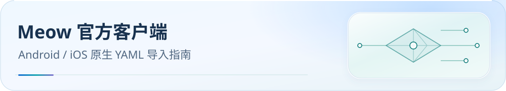

<picture>
  <source media="(max-width: 600px)" srcset="../../docs/assets/readme/page-meow-mobile.svg">
  
</picture>

# Meow 官方客户端导入指南

为官方 Meow Android、meow iOS 及 meow-rs 核心提供原生 YAML 分流配置。

官方项目：[meow-rs 核心](https://github.com/meow-rs/meow-rs) · [Android Meow](https://github.com/meow-rs/meow-android) · [iOS meow](https://github.com/meow-rs/meow-ios)。本仓库提供分流配置，安装和系统权限以对应客户端说明为准。

[内核家族入口](../README.md) · [下载目录](../../docs/guide/downloads.md#meow) · [支持队列](../../docs/support-queue.md#meow-official-apps) · [变更日志](CHANGELOG.md)


[可选业务方案与本地参数](../../docs/configuration.md)：完整配置继续作为默认；可选投影输出到独立目录，运行时参数支持范围见统一指南。

## 开始前与文件选择

### 在线选择与本地导入

打开[在线配置页面](https://ivansolis1989.github.io/Smart-Config-Kit/)，选择 **Meow 原生 YAML**，再选 Full / Lite / Custom 及可用的测速、QUIC 参数。若下载为 ZIP，先解压并保留清单，使用 `Meow内核系/Meow/` 中的 YAML；单个 YAML 可直接用于下文步骤。先在本地替换节点订阅占位地址，再通过官方 App 的本地 YAML 导入入口加载。页面不读取或上传订阅及个人配置；不要把订阅填到在线页面 URL 中。

更新时刷新页面，重新选择原业务方案和参数，下载新副本，备份原配置后重新填写自己的订阅并导入。官方模板 URL 指向完整默认方案且含不可用占位地址，不能作为个人配置的自动更新源。业务范围见[统一配置指南](../../docs/configuration.md)；官方 App 的 DNS、平台设置和真实连接仍按下文单独验收。

下载 [Meow(meow).yaml](Meow%28meow%29.yaml)。官方客户端使用本目录的原生 YAML；AEROVE Lite 的 JS 覆写和操作说明在并列的 [Aerove Lite 目录](../Aerove%20Lite/README.md)。

本仓库不提供节点或订阅。模板中的 `proxy-providers.Subscribe.url` 是不可用的占位地址，先替换为自己的 Clash 格式节点订阅。原文件不能直接启动，也不能将仓库模板 URL 当成个人可运行配置。

官方 Android 稳定 v1.0.8 固定核心 v0.20.2；iOS 稳定 v2.0.0 固定核心 a663364469b3b7dc2b46d2e0f4530e50a54108ee。旧核心关键字段已有源码依据，完整模板在这些 App 上仍待验，详见 [REFERENCE](REFERENCE-meow-rs.md)。

## 导入步骤

1. 下载 YAML，替换 `proxy-providers.Subscribe.url` 的 `https://example.invalid/replace-with-your-subscription-url`，保存个人配置。
2. 官方 Android/iOS 使用本地 YAML 或配置 URL 导入入口。URL 模式须托管已经替换订阅地址的私有配置，避免公开个人订阅。
3. 等待节点订阅、MRS / residual YAML 和首轮地区健康检查完成，选择有可用节点的地区/业务出口，再启动 VPN。
4. 读回最终配置与连接日志，核对组、规则、下载、DNS 和出口。iOS 替换源 DNS；Android 也管理 DNS、监听与 VPN，不能假定 App 原样保留核心 YAML 的所有平台设置。

直接使用官方核心时，将配置保存为 config.yaml，执行 `meow -f config.yaml -t`；订阅、规则与 Geo 数据准备成功后再启动核心及本机代理。

## 必要设置与验收

原生模板保留 33 业务组和 22 个地区/家宽组。地区通过 `use: [Subscribe]` 与 Rust regex 筛选 provider 成员，保留静态 REJECT 哨兵。空池、全故障或首轮健康检查前可能拒绝连接，不会自动切成直连。原生“其他”组沿用 CMFA 的广域备选口径。

模板只监听 127.0.0.1，不启用 TUN 或外部控制器。DNS 投影到原生字段，省略固定核心未声明的 Mihomo 扩展。规则顺序、下载代理、no-resolve、MRS 与逻辑规则保持同源。

官方 v0.26.1 发布二进制在核对归档 SHA-256 后实际运行 -t，149 个本地真实规则资产、168 条规则、55 个组和实际 Geo 数据均通过，无警告或错误。节点是合成样例，没有启动代理流量；此检查不证明生产 HTTP 下载出站或真实出口。

各 App 的完整导入、资源更新、宿主装配和真实连接仍见[支持队列](../../docs/support-queue.md#meow-official-apps)。不能以核心校验替代 App 验收。

## 常见问题

- **为何不能直接启动下载的 YAML？** 先替换不可用的节点订阅占位 URL，再等待资源下载和健康检查。
- **官方 App 要导入 JS 吗？** 本轮只核实了原生 YAML 导入接口；本目录无需 JS 宿主。
- **为何地区出口暂时拒绝？** 检查订阅、地区筛选和健康检查日志；空池、全故障或冷启动可能选择 REJECT。
- **App 的 DNS 为何不同？** App 管理平台设置，需读回实际最终配置，不能只检查源 YAML。

## 进阶与维护

生成需要 Node.js ≥ 18 和 Ruby ≥ 3.0；客户端运行不需要 Ruby。

```bash
node tools/generate-meow.js
node tools/generate-meow.js --check
node --test tools/tests/meow-generation.test.js tools/tests/meow-native-profile.test.js
```

设置 MEOW_BIN、MEOW_GEOSITE_FILE、MEOW_MMDB_FILE 后，最后一条命令执行真实核心 -t；未设置时明确跳过。独立 CI 固定下载官方核心并验 SHA 后执行。

规则权威源为 `rulesets/source/routing-graph.js`。原生组/字段从 CMFA 投影，rules/providers 使用经源指纹校验的 fused 结果。与 AEROVE Lite 共用生成器和[适配清单](../adapter-manifest.json)，各客户端的使用文档与验收状态分别维护。
