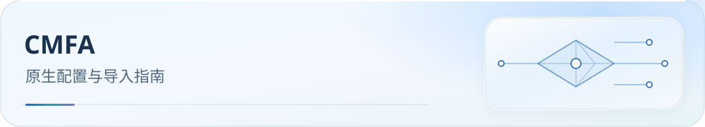

<picture>
  <source media="(max-width: 600px)" srcset="../../docs/assets/readme/page-cmfa-mobile.svg">
  
</picture>

# Clash Meta For Android（CMFA） 导入指南

在 Android 导入原生 Mihomo YAML；ClashMi 也可复用同一文件。先填节点订阅，再导入启动；本配置使用 **url-test，不含 Smart / LightGBM**。

<p><a href="../../docs/guide/downloads.md#mihomo"></a> <a href="../../docs/README.md"></a> <a href="#verification"></a></p>

[开始前](#before-you-start) · [选择文件](#downloads) · [导入步骤](#import) · [常见问题](#faq) · [进阶与参考](#reference)

<a id="-零基础-5-分钟快速开始"></a>

<a id="before-you-start"></a>

## 开始前：准备客户端与订阅

准备 Android 设备、CMFA APK、Mihomo 节点订阅与本目录 YAML。使用已验收的 **Mihomo v1.19.29 或更新核心**。

<a id="一下载-cmfa-客户端"></a>

1. 开源地址：https://github.com/MetaCubeX/ClashMetaForAndroid/releases
2. 根据手机 CPU 选择合适的 APK：
   - **arm64-v8a**：绝大多数 2017 年后的手机
   - **armeabi-v7a**：少数老机型
   - **universal**：不确定时的通用包
3. 安装后授权「VPN 权限」与「文件读写权限」。

配置包含 22 个区域组 + 33 个业务组；空区域组会拒绝连接，应选择有节点的地区或全球组。规则下载需要 GitHub Raw 可达或可用代理。

<a id="-规则下载链接"></a>

<a id="downloads"></a>

## 选择并下载文件

[](https://raw.githubusercontent.com/IvanSolis1989/Smart-Config-Kit/main/Mihomo%E5%86%85%E6%A0%B8%E7%B3%BB/Clash%20Meta%20For%20Android/CMFA%28mihomo%29.yaml)

点击按钮打开 Raw 原始文件；右键按钮可复制链接，需要本地文件时可另存为。

**CMFA YAML 直链：**

```text
https://raw.githubusercontent.com/IvanSolis1989/Smart-Config-Kit/main/Mihomo%E5%86%85%E6%A0%B8%E7%B3%BB/Clash%20Meta%20For%20Android/CMFA%28mihomo%29.yaml
```

下载 YAML 后，按下文填写节点订阅并导入；ClashMi 复用同一文件。

<a id="import"></a>

## 按顺序导入

<a id="二修改订阅链接"></a>

### 1. 填写节点订阅

打开 `CMFA(mihomo).yaml`，修改 proxy-providers.Subscribe.url；其余字段按文件现值保留。结构示例：

```yaml
proxy-providers:
  Subscribe:
    type: http
    url: 'https://my.example.com/your-subscription-url'   # ← 替换为你的机场订阅链接
    interval: 86400
    path: ./proxy_providers/subscribe.yaml
    health-check:
      enable: true
      url: 'https://www.gstatic.com/generate_204'
      interval: 300
    exclude-filter: '(?i)(导航网址|距离下次重置|剩余流量|套餐到期|网址导航|官网|订阅|到期|剩余|重置|10x|20x|100x)'
```

订阅须返回 Mihomo 兼容节点；使用 Sub-Store 时填其输出 URL，保留原有过滤与健康检查设置。

多机场优先按 [Sub-Store 教程](../../SubStore/README.md)输出一个手机可访问的 Mihomo URL；127.0.0.1 只指手机自身。需要手动配置多个 provider 时，见[进阶与参考](#reference)，全部 22 个区域组的 use 均须更新。

<a id="三导入配置到-cmfa"></a>

### 2. 导入修改后的 YAML

#### 方法 A：本地文件导入（推荐首次使用）

1. 将修改后的 `CMFA(mihomo).yaml` 复制到手机存储（例如 `Download/` 目录）。
2. 打开 CMFA → **配置（Profiles）** → 右下角 ➕ → **从文件导入**。
3. 选择刚才的 YAML → 命名为 `Clash Smart` → 确定。

#### 方法 B：URL 远程托管（推荐长期使用）

1. 将 YAML 托管到 GitHub Raw / Gist / 自建 HTTP 服务。
2. CMFA → **配置** → ➕ → **从 URL 导入** → 粘贴 URL → 确定。
3. 后续自动轮询更新（默认每 24 小时，可在配置设置里调整）。

<a id="四首次启动"></a>

### 3. 选中配置并启动 VPN

选中配置并启动，等待节点列表和融合规则集下载；DNS 所需 GeoSite/GeoIP 资源也须可用。日志应无解析或下载错误，随后检查实际连接记录。

本 YAML 不使用 LightGBM，不下载 Model.bin。下载受阻时先保留可用缓存，按[规则下载说明](../../docs/rule-asset-delivery.md)检查代理与 HTTP 状态。

<a id="verification"></a>

## 导入后核验

1. 在「代理」页面确认 22 区域组 + 33 业务组，区域组为 url-test；选择有节点的地区。
2. 检查节点与规则集已下载，日志没有解析错误；DNS 的 GeoSite / GeoIP 资源也须可用。
3. 访问国内与国外业务，检查连接记录的域名、命中规则、业务组和实际出站。
4. 按[完整验收清单](../../docs/guide/dns-and-verification.md#verification)检查 DNS 与规则加载；网页能打开不能证明全部配置生效。

<a id="七常见问题"></a>

<a id="faq"></a>

## 常见问题

### Q1：导入后提示 `list geosite not found` 或规则解析错误？

A：使用当前 CMFA 与 Mihomo 核心，核对实际错误、规则集下载和 GeoSite 资源。路由采用融合规则集，但 DNS policy 仍依赖 GeoSite。

### Q2：节点名称没有被正确分到区域组？

A：区域 filter 按节点名正则匹配。先确认 provider 已下载且 use 正确，再用脱敏节点名反馈漏判。

### Q3：LightGBM 自动择优未生效？

A：本 YAML 不使用 Smart/LightGBM。url-test 按延迟择优，不要添加 uselightgbm 或下载模型。

### Q4：fake-ip 模式下银行/支付 App 异常？

A：先检查具体失败域名、规则和出站。需要排除整个应用时使用客户端应用过滤；仅确认是 fake-ip 兼容问题后，才在本地副本添加对应域名。

### Q5：fake-ip 会不会让 STUN/WebRTC 测试失真？

A：STUN/TURN 域名使用真实 IP；标准端口 `3478 / 3479 / 5349 / 19302 / 19305 / 19307` 走 `DIRECT`。若测试服务强制使用 UDP/443 TURN，仍会受 QUIC 屏蔽策略影响。


<a id="reference"></a>

## 进阶与参考

- [DNS 与导入验收](../../docs/guide/dns-and-verification.md) · [规则下载](../../docs/rule-asset-delivery.md)。
- [私有节点 DNS 手动 overlay](../../docs/private-node-dns.md) · [测速 / QUIC](../../docs/traffic-options.md) · [微信连接排错](../../docs/research/2026-10-16-wechat-issue-187.md)。
- [Mihomo 代理组](https://wiki.metacubex.one/config/proxy-groups/) · [Mihomo DNS](https://wiki.metacubex.one/config/dns/) · [官方版本核对](../../docs/upstream/2026-10-19/mihomo/report.md)。

<a id="九兼容客户端clashmi跨平台"></a>

### ClashMi 导入同一 YAML

[ClashMi](https://github.com/KaringX/clashmi) 可复用本 YAML，使用其 Mihomo 核心，不需要独立产物。App 的覆写顺序、核心版本和 VPN 权限仍须单独检查，见[官方核对报告](../../docs/upstream/2026-10-19/mihomo/report.md)。

#### 导入方式

ClashMi App 首页菜单 → **我的配置** → 右上角 **＋** → 选择一种：
- **添加配置链接**（订阅 URL，推荐长期使用，定时自动更新）
- **从剪贴板导入**（粘贴 YAML 内容）
- **从文件导入**（本地 `.yml` / `.yaml`）
- **扫描二维码**

保存后启用。本 YAML 未写 tun，需在 App 中提供所需 TUN/VPN 设置；内置 DNS/TUN 覆写可能改变导入配置，须读回最终值。

#### 与 CMFA 行为一致的部分

复用 55 代理组（22 区域 + 33 业务）、168 主规则和 149 个融合 provider；区域组为 url-test。实际 DNS、嗅探和规则加载取决于 App 覆写及内置核心。


#### ClashMi 专属差异（官方 [FAQ](https://clashmi.app/guide/faq) 声明；本 YAML 均已规避）

- **GEOIP / GEOSITE 规则**：ClashMi 启动时强制转换为对应 geo rule-set（内核定制）。本 YAML 的 GEOSITE 在编译期融合；GEOIP 保留在少量 residual provider 中，由 GeoIP 数据库原生查询，避免展开成几十万 CIDR。
- **`GEOIP,<ASN>` ASN 规则**：ClashMi iOS 版本不支持 IP-ASN 数据库；本 YAML 未使用 ASN 规则。
- **iOS VPN Extension 50 MB 内存硬顶**：超出即被系统杀进程。MRS 与懒加载不保证不超限，最终内存占用仍需设备验证。
- **`tun:` YAML 字段块**：TUN 开关由 App UI 托管，不建议在 YAML 手写。本 YAML 未写 `tun:` 段，需交由 App 设置。
- **Mihomo Smart / LightGBM**：ClashMi 内置 mainline，非 `vernesong/mihomo` Smart fork，不识别 `type: smart`、`uselightgbm`、`lgbm-url`。本 YAML 使用 `url-test` 区域组，不使用这些 Smart 字段。
- **内核版本升级**：跟随 App 发版，不可独立更新（FAQ）。本 YAML 使用 mainline 稳定字段；仍需核对实际核心版本。

GEOIP residual、资源下载和最终内存占用仍需设备验证。

#### 使用结论

ClashMi 复用本 YAML，导入后核对 App 覆写、资源加载和实际连接。

<details>
<summary>多机场：Sub-Store、转换服务与手动 provider 配置</summary>

多机场可先聚合成一个 URL，或为每个来源配置独立 provider。

#### 方式 A：Sub-Store 融合（推荐）

按 [Sub-Store 教程](../../SubStore/README.md)聚合订阅，输出 Mihomo 格式，将**手机可访问的 URL**填到 Subscribe.url。127.0.0.1 只指手机自身，不能直接访问电脑上的服务。

#### 方式 B：在线订阅转换站（零门槛，无需安装任何工具）

在受信任的转换服务中合并多个 URL，输出选 Mihomo，再填入 Subscribe.url。服务端可看到订阅 token；敏感订阅优先使用本地 Sub-Store 或手动配置。

#### 方式 C：YAML 直接写多个 proxy-providers（无需额外工具）

每个 provider 使用独立名称和缓存路径，并让区域组 use 引用全部来源。

把单机场的 `proxy-providers` 块：

```yaml
proxy-providers:
  Subscribe:
    type: http
    url: 'https://airport1.example.com/sub?token=xxx'
    interval: 86400
    path: ./proxy_providers/sub1.yaml
    health-check:
      enable: true
      url: 'https://www.gstatic.com/generate_204'
      interval: 300
    exclude-filter: '(?i)(导航网址|距离下次重置|剩余流量|套餐到期|网址导航|官网|订阅|到期|剩余|重置)'
```

改为多机场版本：

```yaml
proxy-providers:
  Airport1:
    type: http
    url: 'https://airport1.example.com/sub?token=xxx'
    interval: 86400
    path: ./proxy_providers/airport1.yaml
    health-check:
      enable: true
      url: 'https://www.gstatic.com/generate_204'
      interval: 300
    exclude-filter: '(?i)(导航网址|距离下次重置|剩余流量|套餐到期|网址导航|官网|订阅|到期|剩余|重置)'

  Airport2:
    type: http
    url: 'https://airport2.example.com/sub?token=yyy'
    interval: 86400
    path: ./proxy_providers/airport2.yaml
    health-check:
      enable: true
      url: 'https://www.gstatic.com/generate_204'
      interval: 300
    exclude-filter: '(?i)(导航网址|距离下次重置|剩余流量|套餐到期|网址导航|官网|订阅|到期|剩余|重置)'

  Airport3:
    type: http
    url: 'https://airport3.example.com/sub?token=zzz'
    interval: 86400
    path: ./proxy_providers/airport3.yaml
    health-check:
      enable: true
      url: 'https://www.gstatic.com/generate_204'
      interval: 300
    exclude-filter: '(?i)(导航网址|距离下次重置|剩余流量|套餐到期|网址导航|官网|订阅|到期|剩余|重置)'
```

多个 provider 不会自动加入现有区域组。须把**全部 22 个区域组**的 use 更新为新名称；不要重复定义同名 provider。


在 YAML 中找到区域组的 use，把：

```yaml
  use:
  - Subscribe
```

改为（以 3 个机场为例）：

```yaml
  use:
  - Airport1
  - Airport2
  - Airport3
```

全部 22 个区域组都须更新；使用 Sub-Store 单一 URL 则保留 Subscribe，无需修改 use。

</details>

<a id="五代理组说明"></a>

<details>
<summary>区域与业务组选择参考</summary>

本配置共 **22 区域组（11 全部 + 11 家宽）+ 33 业务组**，进入 CMFA「**代理（Proxies）**」页面可见：

### 区域组（自动择优）

22 个 url-test 区域组按节点名筛选，包含各地区及家宽组。新增 provider 时要同步 use；空组会拒绝连接，应切换到有节点的地区或全球组。

### 业务组（手动选择）

33 个业务组可手动选择候选。下表供参考，具体候选以实际配置为准：

| 业务组 | 推荐区域 |
|--------|----------|
| 🤖 AI 服务（ChatGPT/Claude/Gemini） | 🇺🇸 美国节点（避开 HK/CN 地区） |
| 💰 加密货币 | 🇭🇰 香港节点 |
| 🏦 金融支付 | 🌍 全球节点 |
| 💬 即时通讯（Telegram/Discord） | 🇭🇰 香港节点 或 🇯🇵 日韩节点 |
| 📱 社交媒体（X/Twitter/Instagram） | 🇯🇵 日韩节点 |
| 🧑‍💼 会议协作（Zoom/Teams） | 🇯🇵 日韩节点（低延迟） |
| 📺 国内流媒体（B 站/爱奇艺/腾讯） | DIRECT（境内）或 🇭🇰 香港节点（境外） |
| 🎥 Netflix | 🇺🇸 美国节点 |
| 🎬 Disney+ | 🇺🇸 美国节点 |
| 📡 HBO/Max | 🇺🇸 美国节点 |
| 📺 Hulu | 🇺🇸 美国节点 |
| 🎬 Prime Video | 🇺🇸 美国节点 |
| 📹 YouTube | 🌍 全球节点 |
| 🎵 音乐流媒体（Spotify/Apple Music） | 🌍 全球节点 |
| 🇭🇰 香港流媒体（Now E / MyTV） | 🇭🇰 香港节点 |
| 🇹🇼 台湾流媒体（LiTV / 巴哈姆特） | 🇹🇼 台湾节点 |
| 🇯🇵 日韩流媒体 | 🇯🇵 日韩节点 |
| 🇪🇺 欧洲流媒体 | 🇪🇺 欧洲节点 |
| 🌐 其他国外流媒体 | 🌍 全球节点 |
| 🕹️ 国内游戏 | DIRECT |
| 🎮 国外游戏 | 🌍 全球节点 或 🇯🇵 日韩节点（低延迟） |
| 🔍 Google 服务 | 🌍 全球节点 |
| 🔧 工具与服务 | 🌍 全球节点 |
| Ⓜ️ 微软服务 | 🌍 全球节点 |
| 🍎 苹果服务 | DIRECT（境内） |
| 📥 下载更新 | 🌍 全球节点 |
| 🛰️ BT/PT Tracker | REJECT |
| 🏠 国内网站 | DIRECT |
| 🚫 受限网站（GFW） | 境内选代理，境外选 DIRECT |
| 🌐 国外网站 | 🌍 全球节点 |
| 🐟 漏网之鱼 | 🌍 全球节点（FINAL） |
| 🛑 广告拦截 | REJECT |

</details>

<a id="六常用高级设置"></a>

<details>
<summary>应用过滤、VPN 与后台设置</summary>

### 1. 启用 TUN 模式（系统级代理）

在客户端启动 VPN 并允许系统授权。本 YAML 没有 tun 段；Android 网络接管由客户端管理。

### 2. 启用 Meta SideBar（仪表盘）

使用客户端代理、连接或仪表盘查看 url-test 测速与实际出站；这里没有 LightGBM 模型状态。

### 3. 应用分应用代理（可选）

- CMFA → **设置** → **应用过滤** → 选择模式：
  - **黑名单**：列表内 App 不走代理（推荐国内银行/支付 App 加入）
  - **白名单**：仅列表内 App 走代理

### 4. 开启后台保活

- 系统「**电池优化**」中将 CMFA 设为「**不优化**」。
- MIUI / ColorOS / HarmonyOS 需额外在「自启动」与「后台弹出」权限中允许 CMFA。

</details>

<a id="八配置关键字段速查"></a>

<details>
<summary>配置关键字段速查</summary>

| 字段 | 位置 | 说明 |
|------|------|------|
| `mixed-port: 7890` | 顶部 | HTTP / SOCKS 混合端口 |
| `mode: rule` | 顶部 | 规则模式（勿改 global/direct） |
| `find-process-mode: strict` | 顶部 | 进程匹配仍取决于系统与客户端权限 |
| `dns.enhanced-mode: fake-ip` | `dns` | fake-ip 模式 |
| `sniffer.enable: true` | `sniffer` | 启用 SNI 嗅探 |
| `rule-providers.*.format: mrs` | `rule-providers` | 决定对应 provider 使用 MRS 格式 |

---

MRS 是否启用由 rule-providers 的 format 决定，geodata-mode 不是 MRS 开关；Android 进程匹配还取决于系统与客户端权限。

</details>

<a id="-协议支持mihomo-内核"></a>

<details>
<summary>协议能力参考（取决于实际内核）</summary>

协议能力取决于实际内置 Mihomo 版本；下表作为选型参考，不能据客户端名称假定所有版本能力相同。

| 协议 | 支持 | 说明 |
|---|:-:|---|
| **Shadowsocks (SS)** | ✅ | 全套 AEAD + SS 2022 |
| **ShadowsocksR (SSR)** | ✅ | 兼容老机场 |
| **VMess** | ✅ | ws/grpc/h2/httpupgrade |
| **VLESS** | ✅ | 含 **REALITY** + **XTLS-Vision** |
| **Trojan** | ✅ | + Trojan-Go 扩展 |
| **Hysteria v1 / v2** | ✅ | QUIC-based，弱网友好 |
| **TUIC v5** | ✅ | QUIC-based |
| **WireGuard** | ✅ | 作为出站 |
| **AnyTLS / ShadowTLS / Snell v4 / SSH / Mieru** | ✅ | 新协议/小众协议全覆盖 |
| **SOCKS5 / HTTP(S)** | ✅ | |

### 提示

本 YAML 的区域组为 url-test；CMFA 不执行 JS 覆写。FlClash 支持专用 JS，但同样不提供 vernesong Smart 组。

</details>

业务 DNS 权威源为 [business-dns-policy.json](../../rulesets/source/business-dns-policy.json)，维护命令：

```bash
node tools/sync-business-dns-policy.js
node tools/sync-business-dns-policy.js --check
node --test tools/tests/business-dns-policy.test.js tools/tests/business-dns-sync.test.js
```

<a id="十参考与致谢"></a>

- 上游内核：[MetaCubeX/mihomo](https://github.com/MetaCubeX/mihomo)
- LightGBM 模型：[vernesong/mihomo](https://github.com/vernesong/mihomo)
- 规则集：[blackmatrix7/ios_rule_script](https://github.com/blackmatrix7/ios_rule_script) · [MetaCubeX/meta-rules-dat](https://github.com/MetaCubeX/meta-rules-dat)
- GeoIP：[Loyalsoldier/geoip](https://github.com/Loyalsoldier/geoip)
- 兼容客户端：[KaringX/clashmi](https://github.com/KaringX/clashmi) · [ClashMi 官方 FAQ](https://clashmi.app/guide/faq)

<a id="-支持本项目"></a>

[变更历史](CHANGELOG.md) · [支持本项目](../../docs/donate.md) · [反馈问题](https://github.com/IvanSolis1989/Smart-Config-Kit/issues)
