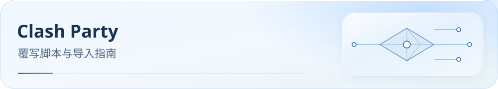

<picture>
  <source media="(max-width: 600px)" srcset="../../docs/assets/readme/page-clash-party-mobile.svg">
  
</picture>

# Clash Party / Clash Verge Rev 导入指南

将一份 Mihomo 节点订阅交给 JS 覆写，统一生成分组、分流与 DNS。**Smart / Normal 只选一份**；本仓库不提供代理节点。

<p><a href="../../docs/guide/downloads.md#mihomo"></a> <a href="../../docs/README.md"></a> <a href="#verification"></a></p>

[开始前](#before-you-start) · [选择文件](#downloads) · [导入步骤](#import) · [常见问题](#faq) · [进阶与参考](#reference)

<a id="-smart-版-vs-普通版怎么选"></a>

<a id="before-you-start"></a>


[可选业务方案与本地参数](../../docs/configuration.md)：完整配置继续作为默认；可选投影输出到独立目录，运行时参数支持范围见统一指南。

## 开始前：确认客户端与内核

准备返回 Mihomo 格式的节点订阅，以及支持 JS 覆写的客户端。规则下载需要 GitHub Raw 可达或可用代理。

| 选择 | 使用条件 |
|---|---|
| **Normal JS** | 普通 Mihomo；Clash Verge Rev 官方发行版使用这一份，区域组为 url-test |
| **Smart JS** | 已安装 vernesong/mihomo Smart 内核和 Model.bin，区域组为 smart |

MetaCubeX Alpha 不等于 Smart。两份脚本规则、DNS 与业务组相同，最多生成 22 区域组 + 33 业务组；脚本不设置会话粘性策略。

<a id="一安装客户端"></a>

### Clash Party（原 Mihomo Party）

- 开源地址：https://github.com/mihomo-party-org/clash-party/releases
- 支持 Windows / macOS (Intel + Apple Silicon) / Linux (deb/rpm/AppImage)
- 支持 stable / Alpha / Smart 内核与 JS 覆写；使用 Smart 脚本前在客户端确认选中 Smart 内核，并检查模型状态。

### Clash Verge Rev

- 开源地址：https://github.com/clash-verge-rev/clash-verge-rev/releases
- 官方发行构建下载 MetaCubeX/mihomo 的 stable / Alpha 内核，请使用本仓库**普通版**脚本。切换到 Alpha 不会获得 Smart 组；实际安装 vernesong/mihomo Smart 内核后，才可使用 Smart 版。依据见[官方构建源码](https://github.com/clash-verge-rev/clash-verge-rev/blob/4337bd85758d54d7b9044b2da3c9ac1176eae1f3/scripts/prebuild.mjs)。

<a id="-规则下载链接"></a>

<a id="downloads"></a>

## 选择并下载文件

### 在线选择与本地导入

打开[在线配置页面](https://ivansolis1989.github.io/Smart-Config-Kit/)，按实际内核选择 Clash Party Smart 或 Normal，选择 Full / Lite / Custom 和该端支持的参数并下载 JS。按下文创建 JavaScript 覆写、粘贴全文并关联订阅；通常关闭客户端二次 DNS 覆写。Clash Verge Rev 官方内核使用 Normal。页面在本机生成，不读取或上传订阅及个人配置。

更新时刷新页面，重新选择相同业务方案与参数，下载并替换本地覆写。官方远程 URL 指向完整默认脚本，不能自动保留定制；业务范围见[统一配置指南](../../docs/configuration.md)。

[](https://raw.githubusercontent.com/IvanSolis1989/Smart-Config-Kit/main/Mihomo%E5%86%85%E6%A0%B8%E7%B3%BB/Clash%20Party/ClashParty%28mihomo-smart%29.js) [](https://raw.githubusercontent.com/IvanSolis1989/Smart-Config-Kit/main/Mihomo%E5%86%85%E6%A0%B8%E7%B3%BB/Clash%20Party/ClashParty%28mihomo%29.js)

点击按钮打开 Raw 原始文件；右键按钮可复制链接，需要本地文件时可另存为。

**Smart JS 直链：**

```text
https://raw.githubusercontent.com/IvanSolis1989/Smart-Config-Kit/main/Mihomo%E5%86%85%E6%A0%B8%E7%B3%BB/Clash%20Party/ClashParty%28mihomo-smart%29.js
```

**Normal JS 直链：**

```text
https://raw.githubusercontent.com/IvanSolis1989/Smart-Config-Kit/main/Mihomo%E5%86%85%E6%A0%B8%E7%B3%BB/Clash%20Party/ClashParty%28mihomo%29.js
```

Smart 与 Normal 二选一，按所用内核选择；两者均为 JS 覆写脚本，按下文关联到节点订阅。


<a id="-零基础-5-分钟快速开始"></a>

<a id="import"></a>

## 按顺序导入

<a id="二准备订阅"></a>

### 1. 添加节点订阅

###### 场景 A：单机场订阅

直接在客户端「订阅（Subscriptions / Profiles）」中添加机场链接即可，脚本会自动识别并分类节点。

### 场景 B：多机场融合（推荐，脚本原生针对此优化）

需要把多个机场合成一个节点池时，可使用 [Sub-Store](../../SubStore/README.md)：

1. 自建或使用公共 **Sub-Store**（https://github.com/sub-store-org/Sub-Store）。
2. 在 Sub-Store 中添加 2–N 个机场作为「单条订阅」。
3. 新建一个「**组合订阅**」或「**远程订阅**」，聚合所有机场。
4. 生成一个 **Clash (Mihomo)** 格式的订阅 URL。
5. 将该 URL 粘贴到客户端的订阅中。

输出地址必须能被客户端访问；127.0.0.1 只适用于同一设备。脚本会清理信息节点并分类，倍率筛选默认关闭。

### 场景 C：在线订阅转换站（备选方案）

在受信任的转换服务中输入多个订阅 URL，输出格式选 Mihomo，再把结果导入客户端。

转换服务能看到订阅 token；敏感订阅优先使用本地 Sub-Store。

<a id="三导入覆写脚本核心步骤"></a>

### 2. 创建覆写并关联订阅

#### Clash Party（原 Mihomo Party）

1. 「覆写」→ 新建 → 类型选 JavaScript，粘贴所选 JS 全文并保存。
2. 返回「订阅」→ 编辑 → 启用覆写，勾选该脚本并保存。
3. 切换到该订阅并连接；只启用 Smart / Normal 其中一份。

#### Clash Verge Rev

1. 左侧 → **脚本（Scripts）** → ➕ **新建脚本** → **本地脚本**。
2. 粘贴 `.js` 全部内容，保存。
3. **订阅（Profiles）** → 右上角 ⋯ → **扩展管理（Extensions）** → 勾选刚才的脚本。
4. 重启内核（Ctrl/Cmd + R）。

### 3. 核对 DNS 所有权并连接

脚本已生成节点、组、规则、DNS 与嗅探，通常关闭客户端的二次 DNS 覆写。若使用 UI Mixin，保留私有节点的精确 policy 并检查最终配置；手动补充 YAML 见[进阶与参考](#reference)。

切换到已关联的订阅并连接。首次规则与模型下载受网络影响，先等待加载完成，再检查日志。


<a id="五验证配置生效"></a>

<a id="verification"></a>

## 导入后核验

1. **代理组**：最多 22 区域组 + 33 业务组；Smart 区域组为 smart，Normal 为 url-test；候选节点与区域相符。
2. **连接记录**：分别访问 AI、Netflix、国内流媒体，核对实际规则、业务组和出站。进阶中的推荐值仅供选择，以实际组名和可用节点为准。
3. **规则**：当前基线为 168 条主规则、149 个融合 rule-providers；不要用未融合源规则数判断是否完整。
4. **日志与 DNS**：无解析错误或规则集加载失败；最终 DNS 包含脚本 DoH 与 blacklist 模式。完整清单见专题页的[导入后验证](../../docs/guide/dns-and-verification.md#verification)。

<a id="七常见问题"></a>

<a id="faq"></a>

## 常见问题

### WebRTC 检测为什么显示本地公网 IP？

默认配置让常用 STUN/TURN 端口直连以兼容 NAT 探测，TUN 接管后仍会按规则直连。Windows 用户可在[在线配置页](https://ivansolis1989.github.io/Smart-Config-Kit/)将「Windows 浏览器 UDP」设为「拒绝（reject）」，下载并关联本地 JS，拒绝 Chrome / Edge / Firefox 的全部 UDP；默认关闭，HTTP/3 和 UDP 通话可能受影响。结合浏览器隐私策略并核对实际 STUN 连接；关闭客户端二次 DNS 覆写仍是正常用法。参见 [WebRTC 隐私与验收](../../docs/guide/webrtc-privacy.md)，包含适用边界、恢复和对照测试。

### Q1：启用脚本后节点为空 / 区域组为空？

- 确认订阅返回的是 **Mihomo / Clash.Meta** 格式（不是 Surge / Quantumult）。
- 确认机场节点名带有地区关键字（香港/HK/🇭🇰/hkg 至少其一；hk01 这类小写地区码加编号也支持）。
- 打开日志，查看是否有 `No node classified` 提示。

### Q2：首次连接特别慢？

- 首次需下载 **149 个融合 rule-providers**（Mihomo 优先 `.mrs`），体积显著低于展开源规则；
- 建议在 WiFi 环境下完成首次下载。

### Q3：如何升级到新版本？

- 将仓库里的 `.js` 文件更新，客户端会在下次刷新订阅时重新执行；
- 无需删除旧订阅或重新导入。

### Q4：能否同时启用多个覆写脚本？

- **不建议**。本脚本会完整重写 `proxy-groups` 与 `rules`，与其他脚本叠加可能导致冲突。

### Q5：LightGBM 模型未下载（仅 Smart 版）？

- 检查实际 Smart 内核与模型状态；若手动配置模型下载地址，当前字段为 `lgbm-url`（[官方配置源码](https://github.com/vernesong/mihomo/blob/83e67d0c4415b1114f9e01d8e9a00133caf89f6c/config/config.go)）；
- 确认客户端可访问 GitHub Release（可能需要代理）：
  ```
  https://github.com/vernesong/mihomo/releases/download/LightGBM-Model/Model.bin
  ```
- 或直接改用 **`ClashParty(mihomo).js`**，它用的是 url-test，不需要 LightGBM 模型。

### Q6：Smart 版与普通版可以切换吗？切换后订阅要不要重新导入？

- **可以任意切换**，两份脚本输出的 `proxy-groups / rules / rule-providers` 完全等价，客户端下次刷新订阅时自动重新生成。
- **不要同时启用两份脚本**（会互相覆盖，结果不可预期）。切换步骤：覆写列表里关掉旧的那份 → 勾选新的那份 → 刷新订阅。

### Q7：升级 Clash Party v2.0.3+ 后，每次启动都提示“自动关闭 DNS 覆写”怎么办？

这是客户端对原始订阅 DNS 的保护，不代表 JS 失败。保护先于 JS 执行；2.0.4 起可由客户端设置控制。官方顺序与版本边界见[核对报告](../../docs/upstream/2026-10-19/mihomo/report.md)。

1. 保持本仓库 JS 启用，关闭客户端内置 DNS 覆写 / controlDns。
2. 刷新订阅，检查最终配置有 dns.enable、仓库 DoH 和 fake-ip-filter-mode: blacklist；同时保留私有节点的精确 policy。
3. 若必须由客户端管理 DNS，先在原始订阅/聚合层处理受保护字段，再核对最终结果。

仍异常时提供客户端版本、脱敏 DNS 配置和覆写日志；不要公开订阅 token 或节点密码。

### Q8：Windows 11 Microsoft Store 报网络错误，或页面有内容但图标为空？

先核对实际内核 TUN、系统代理及 Store 到本机代理的回环入口，再用失败图片的实际 URL 比较 `Ⓜ️ 微软服务` 组所选出站的 HTTP 结果。按包检查和添加回环豁免、图片 CDN 对照方法见 [Windows 11 Microsoft Store 排障](../../docs/microsoft-store-windows.md)。

### Q9：`dldir1.qq.com` 是否已分流？微信下载仍失败怎么排查？

已收录精确域名规则，域名分流指向 `📥 下载更新`，不是广告拒绝。该组为手动选择组，候选以 `🌍 全球节点` 开头且包含 `DIRECT`；实际出口取决于你的组选择及客户端保存的选择。Windows 若识别到 `Weixin.exe`、`WeChat.exe` 或 `WeChatAppEx.exe`，更早的进程规则会先送到 `DIRECT`。因此“域名已收录”不等于所有连接都会经过下载组，也不等于默认直连。

1. 更新当前启用的 JS 覆写、刷新订阅与规则集并重载配置，确认连接记录中的实际域名、进程、命中规则和最终出口。
2. 若确实命中 `📥 下载更新` 且所选代理下载失败，可临时把该组切到 `DIRECT` 对比同一下载；这会同时影响该组的其他下载，复测后按需恢复原选择。若已命中进程 `DIRECT`，切换下载组不会改变该连接。
3. 仍失败时提供系统、客户端版本、失败时间及脱敏连接日志；HTTP 状态和域名有助于区分规则未更新、出口故障与服务端错误。

完整证据与静态验证边界见 [Issue #187 下载域名复核](../../docs/research/2026-10-16-wechat-issue-187.md#2026-10-23-补充dldir1qqcom)。


<a id="reference"></a>

## 进阶与参考

- [节点筛选](../../docs/subscription-node-filter.md)：小写地区码加编号、倍率筛选（默认关闭）、远程节点展开与拨号依赖。
- [私有节点 DNS](../../docs/private-node-dns.md)：默认 adaptive，按活动节点生成 DNS 提示。
- [测速 / QUIC](../../docs/traffic-options.md) · [ZeroTier UDP 代理（默认关闭）](../../docs/zerotier-planet-proxy.md) · [规则下载](../../docs/rule-asset-delivery.md)。
- [Mihomo 官方配置](https://wiki.metacubex.one/config/) · [官方版本与源码核对](../../docs/upstream/2026-10-19/mihomo/report.md)。

<a id="四粘贴-ui-补充配置"></a>

<details>
<summary>手动核对 GeoX、DNS 与 Sniffer（含原有截图及 YAML）</summary>

脚本已生成节点、组、规则、DNS 与嗅探。通常关闭客户端的二次 DNS 覆写即可；下方图片和 YAML 供手动核对使用。若使用 UI Mixin，须合并私有节点 policy，并检查最终配置，避免再次覆盖脚本。

GeoX URL：


```yaml
geox-url:
  geoip: https://fastly.jsdelivr.net/gh/Loyalsoldier/geoip@release/geoip.dat
  mmdb: https://fastly.jsdelivr.net/gh/Loyalsoldier/geoip@release/Country.mmdb
  asn: https://fastly.jsdelivr.net/gh/Loyalsoldier/geoip@release/GeoLite2-ASN.mmdb
  geosite: https://fastly.jsdelivr.net/gh/MetaCubeX/meta-rules-dat@release/geosite.dat
geo-auto-update: true
```

DNS：


```yaml
hosts:
  dns.alidns.com: [223.5.5.5, 223.6.6.6]
  doh.pub: [119.29.29.29]
  dns.google: [8.8.8.8, 8.8.4.4]
  cloudflare-dns.com: [1.1.1.1, 1.0.0.1]

dns:
  use-hosts: true
  use-system-hosts: false
  respect-rules: true
  prefer-h3: false
  default-nameserver:
    - https://223.5.5.5/dns-query
    - https://223.6.6.6/dns-query
    - https://8.8.8.8/dns-query
    - https://1.1.1.1/dns-query
    - 223.5.5.5
  nameserver-policy:
    geosite:cn:
      - https://dns.alidns.com/dns-query
      - https://doh.pub/dns-query
    geosite:geolocation-!cn:
      - https://cloudflare-dns.com/dns-query
      - https://dns.google/dns-query
    '+.jsdelivr.net':
      - https://cloudflare-dns.com/dns-query
      - https://dns.google/dns-query
    '+.github.com':
      - https://cloudflare-dns.com/dns-query
      - https://dns.google/dns-query
    '+.githubusercontent.com':
      - https://cloudflare-dns.com/dns-query
      - https://dns.google/dns-query
    '+.githubassets.com':
      - https://cloudflare-dns.com/dns-query
      - https://dns.google/dns-query
    '+.fastly.net':
      - https://cloudflare-dns.com/dns-query
      - https://dns.google/dns-query
  nameserver:
    - https://dns.alidns.com/dns-query
    - https://doh.pub/dns-query
  proxy-server-nameserver:
    - https://cloudflare-dns.com/dns-query
    - https://dns.google/dns-query
    - https://dns.alidns.com/dns-query
    - https://doh.pub/dns-query
  direct-nameserver:
    - https://dns.alidns.com/dns-query
    - https://doh.pub/dns-query
  direct-nameserver-follow-policy: true
  fallback:
    - https://cloudflare-dns.com/dns-query
    - https://dns.google/dns-query
  fallback-filter:
    geoip: true
    geoip-code: CN
    ipcidr:
      - 240.0.0.0/4
      - 0.0.0.0/32
      - 127.0.0.0/8
      - 10.0.0.0/8
      - 192.168.0.0/16
    domain: []
```

Sniffer：


```yaml
sniffer:
  enable: true
  parse-pure-ip: true
  force-dns-mapping: true
  override-destination: true
  sniff:
    HTTP:
      ports:
        - "80"
        - 8080-8880
      override-destination: true
    TLS:
      ports:
        - "443"
        - "8443"
    QUIC:
      ports:
        - "443"
        - "8443"
        - "4433"
  skip-domain:
    - +.push.apple.com
  skip-dst-address:
    - 91.105.192.0/23
    - 91.108.4.0/22
    - 91.108.8.0/21
    - 91.108.16.0/21
    - 91.108.56.0/22
    - 95.161.64.0/20
    - 149.154.160.0/20
    - 185.76.151.0/24
    - 2001:67c:4e8::/48
    - 2001:b28:f23c::/47
    - 2001:b28:f23f::/48
    - 2a0a:f280:203::/48
```

</details>

<a id="六业务组推荐配置"></a>

<details>
<summary>业务组选择参考</summary>

建议首次导入后，按以下方式为每个业务组「指定首选」：

| 业务组 | 推荐上游 |
|--------|----------|
| 🤖 AI 服务 | 🇺🇸 美国节点（必须避开 HK / CN） |
| 💰 加密货币 | 🇭🇰 香港节点（币安合规） |
| 🏦 金融支付 | DIRECT |
| 💬 即时通讯 | 🇭🇰 香港 / 🇯🇵 日韩 |
| 📱 社交媒体 | 🇯🇵 日韩节点 |
| 🧑‍💼 会议协作 | 🇯🇵 日韩节点（延迟低） |
| 📺 国内流媒体 | DIRECT（境内）/ 🇭🇰 香港（境外） |
| 🇺🇸 美国流媒体 | 🇺🇸 美国节点 |
| 🇭🇰 香港流媒体 | 🇭🇰 香港节点 |
| 🇹🇼 台湾流媒体 | 🇹🇼 台湾节点 |
| 🎮 游戏平台 | 🇯🇵 日韩节点（Steam/PSN） |
| 🔍 Google 服务 | 🌍 全球节点 |
| 🔧 工具与服务 | 🌍 全球节点 |
| 🚫 受限网站（GFW） | 中国选代理 / 海外选 DIRECT |

</details>

<a id="-协议支持mihomo--clashmeta--smart-内核"></a>

<details>
<summary>协议能力参考（取决于实际内核版本）</summary>

协议能力取决于客户端实际安装的 Mihomo 版本；下表用于选型，导入前仍需确认节点协议与核心兼容。

| 协议 | 支持 | 说明 |
|---|:-:|---|
| **Shadowsocks (SS)** | ✅ | 全套 AEAD 密码 + **SS 2022 (blake3)** |
| **ShadowsocksR (SSR)** | ✅ | 旧协议，仍兼容 |
| **VMess** | ✅ | 含 ws / grpc / h2 / httpupgrade 传输层 |
| **VLESS** | ✅ | 含 **REALITY** + **XTLS-Vision** + XTLS-rprx-splice |
| **Trojan** | ✅ | 支持 Trojan-Go 扩展字段 |
| **Hysteria v1** | ✅ | QUIC-based，弱网友好 |
| **Hysteria 2** | ✅ | 当前最流行的抗审查 UDP 协议 |
| **TUIC v5** | ✅ | QUIC-based，含 v4 兼容 |
| **WireGuard** | ✅ | 作为出站，内核级别 |
| **AnyTLS** | ✅ | 新型 TLS 混淆（mihomo 1.18+） |
| **ShadowTLS v1/v2/v3** | ✅ | TLS 伪装层 |
| **Snell v4** | ✅ | Surge 自家协议，Mihomo 兼容 |
| **SSH** | ✅ | 作为出站隧道 |
| **Mieru** | ✅ | 新协议（mihomo Alpha） |
| **SOCKS5 / HTTP(S)** | ✅ | 基础兜底 |

### 如何选协议？一句话建议

使用服务商提供且当前核心支持的协议；UDP 协议还需验证当前网络与所选节点的 UDP 回包。

</details>

<a id="八目录一览"></a>

本目录两份 JS 分别对应 Smart / Normal；手动补充 YAML 见上方参考。业务 DNS 的权威源为 [business-dns-policy.json](../../rulesets/source/business-dns-policy.json)，维护投影用 `node tools/sync-business-dns-policy.js`，并以 `--check` 与业务 DNS 测试核对。

<a id="九致谢"></a>

- [MetaCubeX/mihomo](https://github.com/MetaCubeX/mihomo) / [vernesong/mihomo](https://github.com/vernesong/mihomo) - Mihomo / Smart 内核
- [mihomo-party-org/mihomo-party](https://github.com/mihomo-party-org/mihomo-party) - 桌面客户端
- [clash-verge-rev](https://github.com/clash-verge-rev/clash-verge-rev) - 桌面客户端
- [sub-store-org/Sub-Store](https://github.com/sub-store-org/Sub-Store) - 多机场融合工具
- 所有上游规则集维护者（bm7 / MetaCubeX / Loyalsoldier / blackmatrix7 等）

<a id="-支持本项目"></a>

[变更历史](CHANGELOG.md) · [支持本项目](../../docs/donate.md) · [反馈问题](https://github.com/IvanSolis1989/Smart-Config-Kit/issues)
