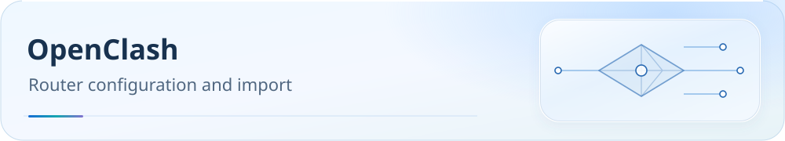

[**English**](README.md) | [中文](README.zh-CN.md)

<picture>
  <source media="(max-width: 600px)" srcset="../../docs/assets/readme/page-openclash-mobile.svg">
  
</picture>

# OpenClash import guide

Deploy a Shell override for an existing node subscription on OpenWrt to generate consistent groups, rules and DNS. **Choose either Smart or Normal.** Complete scripts use the fixed custom-script entry point.

<p><a href="../../docs/guide/downloads.md#mihomo"></a> <a href="../../docs/README.md"></a> <a href="#verification"></a></p>

[Preparation](#before-you-start) · [Select files](#downloads) · [Import](#import) · [Troubleshooting](#faq) · [Advanced reference](#reference)

<a id="1-三件套定位先搞清楚每个文件干嘛的"></a>
<a id="before-you-start"></a>

[Optional service profiles and local parameters](../../docs/configuration.md): the complete configuration remains the default. Optional projections use separate directories; see the shared guide for supported runtime parameters.

## Before you start: identify the core and back up

Install the plugin from [official OpenClash](https://github.com/vernesong/OpenClash). Prepare a Mihomo node subscription accessible from the router. Back up existing plugin settings and custom scripts; merge any existing custom logic before deployment.

| Selection | Required core and regional groups |
|---|---|
| Smart SH | vernesong/mihomo Smart; smart + LightGBM |
| Normal SH | MetaCubeX/mihomo stable or Alpha; url-test |
| UI CONF | Companion UCI snapshot oriented toward Smart; verify actual core, DNS, ports and networking mode after import |

Both scripts contain the same rules and 22 regional + 33 service groups. MetaCubeX Alpha is not Smart. Input subscriptions must contain expanded nodes; flatten remote providers through Sub-Store first. Rule downloads require GitHub Raw access or a working proxy.

<a id="-规则下载链接"></a>
<a id="downloads"></a>

## Select and download files

### Online selection and local import

Open the [configuration page](https://ivansolis1989.github.io/Smart-Config-Kit/), choose OpenClash Smart or Normal for your actual core, then Full / Lite / Custom and supported parameters. Download the Shell script. Back up the fixed custom entry point as described below, deploy the downloaded script and reload. Runtime environment variables still take precedence over script defaults. Generation is local and does not read or upload subscriptions or personal configuration.

To update, refresh the page, select the same profile and parameters, download, back up and replace the local script. Official remote URLs point to complete default scripts and cannot preserve customizations automatically. ShellClash users may reuse compatible Mihomo YAML or YAML embedded in the scripts through their own workflow, but must still verify on the device. See the [configuration guide](../../docs/configuration.md) for service scope.

[](https://raw.githubusercontent.com/IvanSolis1989/Smart-Config-Kit/main/Mihomo%E5%86%85%E6%A0%B8%E7%B3%BB/OpenClash/OpenClash%28mihomo-smart%29.sh) [](https://raw.githubusercontent.com/IvanSolis1989/Smart-Config-Kit/main/Mihomo%E5%86%85%E6%A0%B8%E7%B3%BB/OpenClash/OpenClash%28mihomo%29.sh) [](https://raw.githubusercontent.com/IvanSolis1989/Smart-Config-Kit/main/Mihomo%E5%86%85%E6%A0%B8%E7%B3%BB/OpenClash/OpenClash%28mihomo%29.conf)

Buttons open raw files. Right-click to copy a link or save a local file.

**Smart SH URL:**

```text
https://raw.githubusercontent.com/IvanSolis1989/Smart-Config-Kit/main/Mihomo%E5%86%85%E6%A0%B8%E7%B3%BB/OpenClash/OpenClash%28mihomo-smart%29.sh
```

**Normal SH URL:**

```text
https://raw.githubusercontent.com/IvanSolis1989/Smart-Config-Kit/main/Mihomo%E5%86%85%E6%A0%B8%E7%B3%BB/OpenClash/OpenClash%28mihomo%29.sh
```

**UI CONF URL:**

```text
https://raw.githubusercontent.com/IvanSolis1989/Smart-Config-Kit/main/Mihomo%E5%86%85%E6%A0%B8%E7%B3%BB/OpenClash/OpenClash%28mihomo%29.conf
```

Choose one of the Smart and Normal override scripts. UI CONF is a companion UCI snapshot. Upload each to its respective entry point below.

<a id="3-部署步骤"></a>
<a id="import"></a>

## Deploy and start in order

### 3.2 Open Overwrite Settings

LuCI → **Services → OpenClash → Overwrite Settings**. Labels can vary with interface language/version.

Import `.conf` on this page (§3.3), then deploy `.sh` through the fixed custom-script entry point (§3.4).

<details>
<summary>View original Chinese-interface screenshot</summary>


</details>

### 3.3 Review or import companion UCI settings

Find **Configuration file upload** on the Overwrite Settings page:

1. Choose **Upload / Browse**, then select `Mihomo内核系/OpenClash/OpenClash(mihomo).conf`.
2. Choose **Save and Apply**.

Back up current plugin settings before import. The snapshot targets Smart. For Normal, confirm the actual core and options match. Check DNS, ports and networking mode afterward.

> `.conf` is a UCI settings snapshot, not a node subscription. Do not load it as core configuration.

<details>
<summary>View original Chinese-interface screenshot</summary>


</details>

### 3.4 Deploy and enable the Shell override

Both complete Shell scripts use `/etc/openclash/custom/openclash_custom_overwrite.sh`. The [official startup process](https://github.com/vernesong/OpenClash/blob/e553e82e01c697aefbe1555261a503f425e00ccd/luci-app-openclash/root/etc/init.d/openclash#L3849-L3855) passes the active configuration path.

Download the existing fixed-path file as a local backup first. Merge your own logic before deployment. Replace the example router address with your address.

```bash
scp root@192.168.1.1:/etc/openclash/custom/openclash_custom_overwrite.sh ./openclash_custom_overwrite.sh.backup

# For the vernesong/mihomo Smart core, upload this file.
scp 'Mihomo内核系/OpenClash/OpenClash(mihomo-smart).sh' root@192.168.1.1:/etc/openclash/custom/openclash_custom_overwrite.sh

# For MetaCubeX/mihomo stable or Alpha, upload this instead (choose one).
# scp 'Mihomo内核系/OpenClash/OpenClash(mihomo).sh' root@192.168.1.1:/etc/openclash/custom/openclash_custom_overwrite.sh

ssh root@192.168.1.1 'chmod +x /etc/openclash/custom/openclash_custom_overwrite.sh && /etc/init.d/openclash restart'
```

Alternatively, use WinSCP / Cyberduck / FileZilla to back up and upload to the same fixed path. After restart, look for `[Clash-Smart]` or `[Clash-Normal]` completion records in `/tmp/openclash.log`, and inspect final groups, rules and DNS.

Ordinary modules under `/etc/openclash/overwrite/` use the [official INI section format](https://github.com/vernesong/OpenClash/blob/e553e82e01c697aefbe1555261a503f425e00ccd/.github/skills/openclash-user-guide/16-overwrite-module-format.md#162-覆写文件格式). This repository's complete script belongs at the fixed custom entry point. If older instructions led you to create a same-named module, disable it in the interface to avoid confusion. Deploy only one of the two scripts.

### 3.5 Merge multiple subscriptions (choose one method)

Nodes come from the **original subscription configuration** downloaded by LuCI, not remote proxy-providers entered into the override script. Current preflight accepts a `proxies` list or inline providers containing only `type` and `payload`. Expand other providers first.

#### Method A: Sub-Store aggregation (recommended)

Follow the [Sub-Store guide](../../SubStore/README.md), output Mihomo configuration containing a `proxies` list, then enter a router-accessible URL in LuCI's configuration subscriptions. `127.0.0.1` refers to the router itself.

#### Method B: online subscription conversion

Use a trusted conversion service to merge subscriptions into Mihomo configuration with `proxies`, then let LuCI download it. The server can read subscription tokens; prefer local processing for sensitive subscriptions.

#### Method C: manually merge input subscription configuration

Edit the **input subscription configuration** into one `proxies` list, or use providers containing only `type: inline` and `payload`. Do not add remote node providers to the Shell script's rule heredoc.

Preflight flattens accepted inline nodes and rebuilds regional groups. Remote providers, extra fields and ambiguous inputs are rejected while preserving the original subscription. See [node filtering](../../docs/subscription-node-filter.md) for exact input boundaries.

### 3.6 Import the subscription and start

LuCI → **Configuration subscriptions** → add URL → download → choose the configuration in **Global settings** → start OpenClash.

<a id="verification"></a>

## Post-start verification

- Runtime status should show a successfully started core; logs should not contain widespread rule-provider 403 / 404 errors.
- Expect 22 regional and 33 service groups. Smart regional groups use `smart`; Normal uses `url-test`.
- Use the [60-second post-import checklist](../../docs/guide/dns-and-verification.md#verification) to check downloads, GEOSITE matches and bounded anti-ad false-positive exceptions.

<a id="4-常见问题"></a>
<a id="faq"></a>

## Troubleshooting

### Q1: Can I use these rules without a Smart core?

Yes. Use `OpenClash(mihomo).sh`. Coverage is identical to Smart: 149 fused providers / 168 rules, from 525 source providers / 984 rules.

### Q2: Must I rebuild configuration when upgrading to Smart?

Keep the node subscription. Back up and replace the fixed custom script (§3.4), confirm the core type matches and restart. Do not register the complete Shell script as an ordinary override module.

### Q3: Is importing `.conf` mandatory?

The snapshot reduces manual setup, but requires a backup and post-import checks of core, DNS, ports and networking mode. If settings are already correct, compare them against the snapshot instead. Successful import is not runtime verification.

### Q4: Why do all rule providers download through `🚫 受限网站`?

A working proxy group fetches rules when direct GitHub Raw access is unavailable. Diagnose 404 responses, timeouts and unavailable proxies separately.

### Q5: Saving pasted Shell text returns `HTTP error! status: 500`?

Distinguish a web-form save failure from a core parser failure. HTTP 500 alone does not prove a script syntax error.

Use filesystem deployment (§3.4): back up, upload `.sh` as `/etc/openclash/custom/openclash_custom_overwrite.sh`, make it executable and restart. If it still fails, provide router model, OpenWrt / LuCI / OpenClash versions and output from `logread | grep -Ei 'luci|uhttpd|openclash|content|maximum|POST'`.

<a id="reference"></a>

## Advanced reference

- [Node filtering and subscription input boundaries](../../docs/subscription-node-filter.md): multiplier filtering is off by default; remote providers, extra fields and ambiguity are rejected.
- [Private-node DNS](../../docs/private-node-dns.md): defaults to adaptive. LuCI Mixin must preserve exact policies for active nodes.
- [Rule downloads](../../docs/rule-asset-delivery.md) · [Latency testing / QUIC](../../docs/traffic-options.md) · [WeChat troubleshooting](../../docs/research/2026-10-16-wechat-issue-187.md).
- Routers generally cannot identify processes on LAN devices. PROCESS-NAME does not replace domain rules.
- [Official versions, override entry point and device acceptance](../../docs/upstream/2026-10-19/mihomo/report.md) · [Local official reference](REFERENCE-openclash.md).

<a id="2-smart-与-normal-的区别"></a>

<details>
<summary>Smart / Normal fields and coverage</summary>

| Item | Smart (`OpenClash(mihomo-smart).sh`) | Normal (`OpenClash(mihomo).sh`) |
|---|---|---|
| Core | vernesong/mihomo Smart branch | MetaCubeX/mihomo stable (not Smart) |
| Regional groups | `type: smart` | `type: url-test` |
| LightGBM | Supported (`uselightgbm: true`) | Unsupported |
| Coverage | 149 fused providers / 168 rules (source 525 / 984) | 149 fused providers / 168 rules (source 525 / 984) |
| Service groups | 33 | 33 |
| Regional groups | 22 | 22 |
| DNS / Sniffer / Rule-Providers | Identical | Identical |

Choose Smart for ML-assisted selection, or Normal for a non-Smart core.

Smart uses [official fields](https://github.com/vernesong/OpenClash/releases/tag/mihomo) such as `uselightgbm` and `collectdata`, without setting `strategy`. Core target matching, connection quality and retries determine selection. MetaCubeX/mihomo Alpha is not the Smart core. See the [official version review](../../docs/upstream/2026-10-19/mihomo/report.md) for release, entry-point and acceptance boundaries.

</details>

<a id="5-配套文件"></a>

UI CONF is a UCI settings snapshot, not node configuration. Deploy complete Shell scripts to `/etc/openclash/custom/openclash_custom_overwrite.sh`, not as ordinary INI modules.

The business DNS authority is [business-dns-policy.json](../../rulesets/source/business-dns-policy.json). Maintenance commands:

```bash
node tools/sync-business-dns-policy.js
node tools/sync-business-dns-policy.js --check
node --test tools/tests/business-dns-policy.test.js tools/tests/business-dns-sync.test.js
```

<a id="-支持本项目"></a>

[Changelog](CHANGELOG.md) · [Support the project](../../docs/donate.md) · [Report an issue](https://github.com/IvanSolis1989/Smart-Config-Kit/issues)
