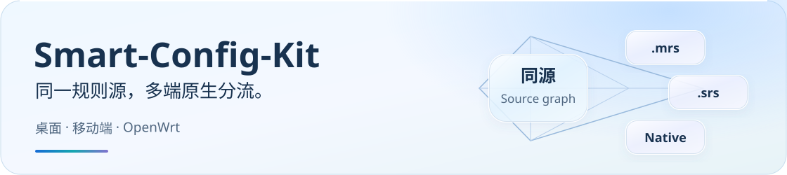
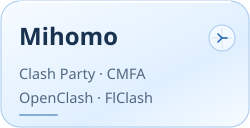
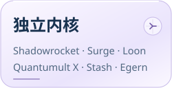
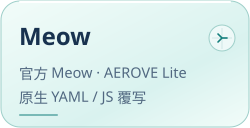
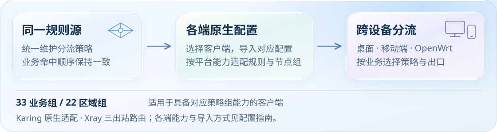

<h1 align="center">
  <picture>
    <source media="(max-width: 600px)" srcset="docs/assets/readme/hero-mobile.svg">
    
  </picture>
</h1>

  <a href="#start">开始使用</a> ·
  <a href="#downloads">客户端与下载</a> ·
  <a href="#routing">分流设计</a> ·
  <a href="docs/README.md">文档中心</a>

面向**桌面、移动端与 OpenWrt**的分流配置与覆写脚本。基于同一套规则，生成各客户端需要的原生格式；节点订阅由你自行准备。

各客户端的策略组、DNS 和导入能力不同，具体边界在对应教程中说明。

## 从这里开始

1. **准备节点订阅**：先在客户端导入自己的订阅，确认节点可用。
2. **选择对应配置**：进入下方客户端入口，按教程关联脚本、导入配置或导入分流规则。
3. **检查实际命中**：按[导入后验收清单](docs/guide/dns-and-verification.md#verification)检查规则下载、分流与 DNS。

## 找到你的客户端

按客户端所在系列进入，获取 **Raw 下载链接、版本选择和导入教程**。不知道内核名称时，可直接按卡片上的 APP 名称查找。

  
  
  
  
  
  

  <strong>客户端索引</strong>
  <a href="docs/guide/downloads.md#mihomo">Clash Party / Clash Verge Rev / Mihomo Party</a> ·
  <a href="docs/guide/downloads.md#mihomo">CMFA / ClashMi</a> ·
  <a href="docs/guide/downloads.md#mihomo">OpenClash</a> ·
  <a href="docs/guide/downloads.md#mihomo">FlClash</a> ·
  <a href="docs/guide/downloads.md#sing-box">SingBox / Hiddify / HomeProxy</a> ·
  <a href="docs/guide/downloads.md#sing-box">Karing</a> ·
  <a href="docs/guide/downloads.md#xray">v2rayN</a> ·
  <a href="docs/guide/downloads.md#dual-core">Passwall / Passwall2</a> ·
  <a href="docs/guide/downloads.md#independent">Shadowrocket</a> ·
  <a href="docs/guide/downloads.md#independent">Surge</a> ·
  <a href="docs/guide/downloads.md#independent">Loon</a> ·
  <a href="docs/guide/downloads.md#independent">Quantumult X</a> ·
  <a href="docs/guide/downloads.md#independent">Stash</a> ·
  <a href="docs/guide/downloads.md#independent">Egern</a> ·
  <a href="Meow内核系/Meow/README.md">官方 Meow</a> ·
  <a href="Meow内核系/Aerove%20Lite/README.md">AEROVE Lite</a>

[打开完整下载目录](docs/guide/downloads.md) · [按平台与协议选择客户端](docs/guide/client-support.md)

[Meow 内核系](Meow内核系/README.md)提供两个独立入口：**官方 Meow 原生 YAML**与 **AEROVE Lite JS 覆写**。Lite 配套无损 MRS 分片，遵守客户端的单资源预算；官方核心配置校验已通过，Lite 当前候选仍待 App 重验。导入步骤、已完成项目与连接验收进度见各自教程及[支持队列](docs/support-queue.md)。

## 一套策略，按客户端落地

- **规则同源**：业务规则和命中顺序集中维护，再生成各端原生配置。
- **用途与出口分层**：具备策略组能力的客户端可分别选择业务出口与地区节点；FCM 推送跟随 Google 服务所选出口，详见[策略与规则来源](docs/guide/routing-policy.md)。
- **差异写清楚**：保留平台能力边界，导入后以实际配置和连接日志验收。

<picture>
  <source media="(max-width: 600px)" srcset="docs/assets/readme/overview-mobile.svg">
  
</picture>

[了解 33 业务组、区域策略与规则来源](docs/guide/routing-policy.md)

## 按需深入

**选客户端与配置**　[下载目录](docs/guide/downloads.md) · [协议与导入边界](docs/guide/client-support.md)

**了解分流与 DNS**　[策略与规则来源](docs/guide/routing-policy.md) · [DNS 设计与验收](docs/guide/dns-and-verification.md)

**管理多机场订阅**　[Sub-Store 聚合教程](SubStore/README.md) · [浏览器同步助手](SubStore/edge-extension/README.md)

更多高级选项、能力矩阵、维护工具与官方证据，见[文档中心](docs/README.md)。

## 参与项目

遇到问题，先完成[验收与排查](docs/guide/dns-and-verification.md)。仍无法定位时，[提交 Issue](https://github.com/IvanSolis1989/Smart-Config-Kit/issues)，附客户端版本、脱敏配置和连接日志。

[维护契约](AGENTS.md#10-readme-与文档编写契约) · [变更日志](CHANGELOG.md) · [上游项目与致谢](docs/guide/acknowledgements.md) · [支持本项目](docs/donate.md)

本项目用于个人技术研究与学习，不提供节点、订阅或代理服务。采用 MIT License；第三方规则与数据遵循各自许可证。[使用边界](docs/guide/acknowledgements.md#usage)
