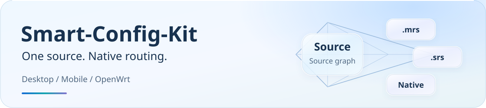
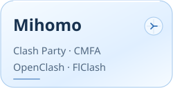
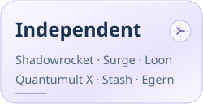
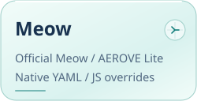
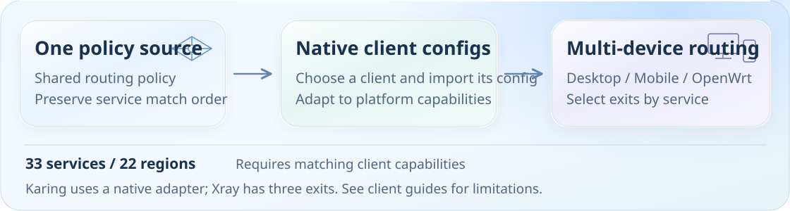

[**English**](README.md) | [中文](README.zh-CN.md)

<h1 align="center">
  <picture>
    <source media="(max-width: 600px)" srcset="docs/assets/readme/hero-mobile.svg">
    
  </picture>
</h1>

  <a href="#start">Get started</a> ·
  <a href="#downloads">Clients and downloads</a> ·
  <a href="#routing">Routing design</a> ·
  <a href="docs/README.md">Documentation</a>

Routing configurations and override scripts for **desktop, mobile, and OpenWrt**. A shared policy source produces each client's native format. Bring your own endpoint subscription.

Policy groups, DNS behavior, and import capabilities differ by client. Each guide documents its boundaries.

[Optional service profiles and local settings](docs/configuration.md): the default full configuration is unchanged. The [configuration page](https://ivansolis1989.github.io/Smart-Config-Kit/) lets you select services and supported options across 20 maintained entries, then download the result. See the guide for coverage.

## Get started

1. **Prepare your subscription:** import it into your client and verify that the endpoints work.
2. **Choose the matching configuration:** use the client entry below, then follow its instructions to associate a script, import a configuration, or import routing rules.
3. **Verify actual matches:** use the [post-import checklist](docs/guide/dns-and-verification.md#verification) to check rule downloads, routing, and DNS.

## Find your client

Choose a client family for **raw downloads, version selection, and import instructions**. You do not need to know the core name: look for your application on the cards.

  
  
  
  
  
  

  <strong>Client index</strong>
  <a href="docs/guide/downloads.md#mihomo">Clash Party / Clash Verge Rev / Mihomo Party</a> ·
  <a href="docs/guide/downloads.md#mihomo">CMFA / ClashMi</a> ·
  <a href="docs/guide/downloads.md#mihomo">OpenClash</a> ·
  <a href="docs/guide/downloads.md#mihomo">FlClash</a> ·
  <a href="docs/guide/downloads.md#sing-box">SingBox / Hiddify / HomeProxy</a> ·
  <a href="docs/guide/downloads.md#sing-box">Karing</a> ·
  <a href="docs/guide/downloads.md#xray">v2rayN</a> ·
  <a href="docs/guide/downloads.md#dual-core">Passwall / Passwall2</a> ·
  <a href="docs/guide/downloads.md#independent">Shadowrocket</a> ·
  <a href="docs/guide/downloads.md#independent">Surge</a> ·
  <a href="docs/guide/downloads.md#independent">Loon</a> ·
  <a href="docs/guide/downloads.md#independent">Quantumult X</a> ·
  <a href="docs/guide/downloads.md#independent">Stash</a> ·
  <a href="docs/guide/downloads.md#independent">Egern</a> ·
  <a href="Meow内核系/Meow/README.md">Official Meow</a> ·
  <a href="Meow内核系/Aerove%20Lite/README.md">AEROVE Lite</a>

[Full download directory](docs/guide/downloads.md) · [Choose by platform and protocol](docs/guide/client-support.md)

The [Meow family](Meow内核系/README.md) has two separate entries: **official Meow native YAML** and the **AEROVE Lite JavaScript override**. Lite uses lossless MRS partitions within the client's per-resource budgets. Official core configuration checks have passed; the current Lite candidate still needs application-level retesting. See each guide and the [support queue](docs/support-queue.md) for import steps, completed checks, and connection validation.

## One policy, client-specific implementations

- **Shared rules:** service rules and match order are maintained centrally, then rendered into native client configurations.
- **Separate services from exits:** clients with policy-group support can select service exits and regional endpoints separately. FCM push follows the exit selected for Google services; see [routing policy and sources](docs/guide/routing-policy.md).
- **Explicit differences:** platform limitations are documented. Validate the effective configuration and connection logs after import.

<picture>
  <source media="(max-width: 600px)" srcset="docs/assets/readme/overview-mobile.svg">
  
</picture>

[33 service groups, regional policies, and sources](docs/guide/routing-policy.md)

## Explore the guides

**Choose a client and configuration:** [downloads](docs/guide/downloads.md) · [protocol and import boundaries](docs/guide/client-support.md)

**Understand routing and DNS:** [routing policy and sources](docs/guide/routing-policy.md) · [DNS design and verification](docs/guide/dns-and-verification.md)

**Combine subscriptions:** [Sub-Store guide](SubStore/README.md) · [browser synchronization helper](SubStore/edge-extension/README.md)

See the [documentation index](docs/README.md) for advanced options, capability matrices, maintenance tools, and upstream evidence.

## Contribute

Start with [verification and troubleshooting](docs/guide/dns-and-verification.md). If the problem remains unresolved, [open an issue](https://github.com/IvanSolis1989/Smart-Config-Kit/issues) with the client version, a redacted configuration, and connection logs.

[Maintenance contract (Chinese source)](AGENTS.md#10-readme-与文档编写契约) · [Changelog](CHANGELOG.md) · [Upstream projects](docs/guide/acknowledgements.md) · [Support maintenance](docs/donate.md)

This repository provides configuration and routing tools, not endpoints, subscriptions, or a proxy service. No repository-wide license file is currently present; do not infer blanket MIT permission from earlier descriptions. Third-party materials remain subject to their own licenses. Read the [disclaimer and licensing boundaries](docs/disclaimer.md) before use.
