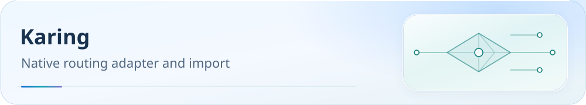

[**English**](README.md) | [中文](README.zh-CN.md)

<picture>
  <source media="(max-width: 600px)" srcset="../../docs/assets/readme/page-karing-mobile.svg">
  
</picture>

# Karing native routing import guide

<a id="karing-原生分流适配"></a>

Import same-source fused rules into Karing's custom routing groups. Configure nodes, node groups, DNS, TUN and the final default action in the application itself.

[](../../docs/guide/downloads.md) [](../../docs/README.md) [](#verification)

[Before you start](#before-start) · [Import](#import) · [Verification](#verification) · [Troubleshooting](#faq) · [Advanced](#advanced)

> Configuration: `v6.0.21-karing.3` · Build: 2026-11-09. Source: `rulesets/source/routing-graph.js` v6.0.21, derived through the fused manifest and SingBox 1.13 routing. See [CHANGELOG](CHANGELOG.md).

<a id="before-start"></a>
<a id="下载配置"></a>

[Optional service profiles and local parameters](../../docs/configuration.md): the complete configuration remains the default. Optional projections use separate directories; see the shared guide for supported runtime parameters.

## Before you start: nodes and routing file

1. Add your own node subscription to Karing and confirm the nodes work.
2. Download [diversion_rules_custom.json](diversion_rules_custom.json). This is **custom routing-group JSON**. It neither executes Clash Party / FlClash JS nor passes a complete sing-box configuration unchanged to Karing.
3. Start with a clean custom routing list. Before updating, back up existing settings and remove old `SCKI` entries to prevent stale names or incorrect ordering.

[](https://raw.githubusercontent.com/IvanSolis1989/Smart-Config-Kit/main/Sing-box%E5%86%85%E6%A0%B8%E7%B3%BB/Karing/diversion_rules_custom.json)

The button opens the raw file; copy the link or save it locally. Normal import needs only this JSON. It references remote fused SRS assets and standard sing-box source rule-sets for complex conditions.

### Online selection and local import

Open the [configuration page](https://ivansolis1989.github.io/Smart-Config-Kit/), choose Karing routing, Full / Lite / Custom and the QUIC parameter, then download and import routing JSON as below. If a ZIP is downloaded, fully extract it and select `diversion_rules_custom.json`; the accompanying manifest is reference material. The file contains only routing adaptation. Nodes, DNS and the final default action still require application settings.

To update, refresh the page, select the same services and parameters and download again. Back up settings, remove old `SCKI` entries, then import the new local routing file. Do not overwrite a customized file using the official full-configuration remote URL. Selection and generation run locally in the browser without reading or uploading subscriptions or personal configurations.

<a id="import"></a>
<a id="导入"></a>

## Import steps

1. Open **Settings → Routing → Routing rules → Edit → Custom routing groups**, then choose **Import** from the menu. Exact labels depend on application language/version.
2. Select the saved `diversion_rules_custom.json`, confirm import and enable the rules.
3. Preserve the numeric order in names. Every segment is an independent rule. Do not merge multiple segments belonging to the same service.
4. Check actions: `direct` and `block` follow source defaults; proxy services use `currentSelected`. For separate regional/service exits, first create custom node groups in Karing, then bind each routing rule manually. This file does not automatically create or restore nested source policy groups.
5. In Karing routing settings, set the **final default action** to **Current selection**. The import file has no empty-match FINAL rule.
6. Check DNS, TUN, sniffing and rule-download settings. Check whether ISP / built-in country-region rules match earlier, and adjust as needed.
7. **Registration check for affected versions:** Karing 1.2.25.2802 has a report of imported groups whose SRS entries are missing from probing. If affected, open each `SCKI` custom group and save without changing anything. This invokes the application's remote-asset registration path. Do not merge or reorder rules. No one-click batch alternative has been verified.
8. Return to Karing's home screen, turn the connection off and on to apply settings, then open **Routing rule probing** and confirm remote downloads before acceptance below.

See official [custom routing](https://karing.app/tutorial/custom-diversion), [group editing](https://karing.app/app-manual/diversion-rule-edit) and the [pinned source / compatibility reference](REFERENCE-Karing.md).

<a id="verification"></a>

## Import verification

- Rules are enabled and numeric order is intact. Direct, block and current-selection actions match the import preview.
- Remote rules download successfully; the current or manually bound node connects. The final default action remains Current selection.
- Check matches using actual connections and final generated configuration. Process matching depends on desktop system permissions. IP-rule `no-resolve` and resolve-first behavior require real-device readback.

[adapter-manifest.json](adapter-manifest.json) records every input rule, action mapping, default-exit resolution chain, URL, input/asset hash, manual setting and unperformed client acceptance. Current output contains 97 rules (28 direct, 5 block, 64 current selection) and 19 complex-condition assets; the manifest is authoritative.

Continue with the [runtime verification checklist](../../docs/guide/dns-and-verification.md#verification). Local tests and core compilation do not equal Karing real-device acceptance. Existing evidence does not include application download, import and connection testing.

<a id="faq"></a>

## Troubleshooting

**Why are service groups not created automatically?** Routing JSON supplies rules and default actions only. Node groups are managed separately by the application; create and bind them manually. `currentSelected` follows the current selection.

**Can I import SingBox Full or Clash JS directly?** This page covers only Karing native routing JSON. Lossless import of full configuration conversion or nested groups has not been established. See [REFERENCE-Karing](REFERENCE-Karing.md).

**Why are rules duplicated or ordered incorrectly after updating?** Back up settings, remove old `SCKI` entries, then import into a clean list. Also check built-in rule precedence and the final default action.

**Groups exist, but SRS is absent from probing?** Save each group as described in step 7. Custom-group URL references and application remote-asset registration are separate: a visible imported list does not prove downloads occurred. See [Issue #196](https://github.com/IvanSolis1989/Smart-Config-Kit/issues/196) and [source evidence](REFERENCE-Karing.md#issue-196自定义组可见但远程资产未登记). Do not add unsupported `rule_set_items` to the JSON or restore a complete application backup as a workaround.

**Assets are registered, but downloads report network errors?** Then check the application download network and selected node. See [rule asset delivery](../../docs/rule-asset-delivery.md). Do not conflate registration failure with download failure.

**How can maintainers check registration?** With an existing copy of the application's internal diversion configuration, run read-only `node tools/audit-karing-registration.js <custom-rules.json> <internal-diversion-config-copy.json>`. The tool lists unregistered groups. A normal custom export is insufficient, and passing registration does not prove real downloads. Do not supply subscriptions or keys, or overwrite application data.

<a id="advanced"></a>

## Advanced reference

<details>
<summary>Maintenance and controlled refresh</summary>

### Maintenance

Run from the repository root:

```sh
node tools/generate-karing.js
node tools/generate-karing.js --check
node --test tools/tests/karing-generation.test.js
```

Normal generation and `--check` read only bound inputs and do not download rules. `--check` writes no files and fails on drift, missing assets, invalid outbounds, cyclic default selection or match fields that cannot be converted losslessly.

Five QUIC exceptions depend on external geosite SRS. Exact decoded snapshots are stored in `rulesets/source/karing-support/*.json.gz`. Run the following only for an explicit refresh:

```sh
node tools/generate-karing.js --refresh-support
```

Refresh needs network access and an existing sing-box core (default `.cache/fused-rule-sets/sing-box/sing-box.exe`, or `sing-box` on other platforms; override with `SING_BOX_113_BIN`). It downloads only support SRS referenced by complex matches, decodes them, records URLs, retrieval times and binary/source/gzip hashes, then generates output. Upstream rules change; review refresh diffs. Generated source JSON uses version 3 (standard sing-box >=1.11); this is not a minimum Karing version or a real-device compatibility guarantee.
</details>

[Client support](../../docs/guide/client-support.md) · [Routing policy](../../docs/guide/routing-policy.md) · [Official reference](REFERENCE-Karing.md) · [Report a problem](https://github.com/IvanSolis1989/Smart-Config-Kit/issues)
