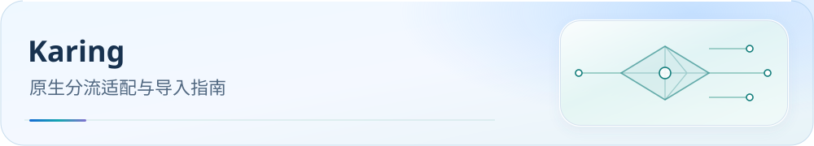

<picture>
  <source media="(max-width: 600px)" srcset="../../docs/assets/readme/page-karing-mobile.svg">
  
</picture>

# Karing 原生分流导入指南

<a id="karing-原生分流适配"></a>


将同源融合规则导入 Karing 的自定义分流组。节点、节点组、DNS、TUN 和最终默认动作仍在 App 中设置。

[](../../docs/guide/downloads.md) [](../../docs/README.md) [](#verification)

[开始前](#before-start) · [分步导入](#import) · [导入验收](#verification) · [常见问题](#faq) · [进阶参考](#advanced)

> 配置版本：`v6.0.21-karing.2` · Build：2026-10-28。规则源：`rulesets/source/routing-graph.js` v6.0.21，经 fused manifest 和 SingBox 1.13 路由派生。历史见 [CHANGELOG](CHANGELOG.md)。

<a id="before-start"></a>
<a id="下载配置"></a>

## 开始前：准备节点与分流文件

1. 在 Karing 添加自己的节点订阅，确认节点可用。
2. 下载本目录的 [diversion_rules_custom.json](diversion_rules_custom.json)。这是 **自定义分流组 JSON**，不执行 Clash Party / FlClash JS，也不将完整 sing-box 配置原样交给 Karing。
3. 首次导入使用干净的自定义分流列表；更新前备份现有设置并移除旧 `SCKI` 项，防止旧名称残留或顺序错位。

[](https://raw.githubusercontent.com/IvanSolis1989/Smart-Config-Kit/main/Sing-box%E5%86%85%E6%A0%B8%E7%B3%BB/Karing/diversion_rules_custom.json)

按钮打开 Raw 文件，可复制链接或另存为。普通导入只需这一份 JSON；它会引用远程融合 SRS 和复杂条件的标准 sing-box source 规则集。

<a id="import"></a>
<a id="导入"></a>

## 分步导入

1. 打开 **设置 → 分流 → 分流规则 → 编辑 → 自定义分流组**，在菜单中选择 **导入**。
2. 选择已保存的 `diversion_rules_custom.json`，确认导入并启用规则。
3. 按名称中的序号保持顺序。每个段是独立规则，同一业务出现在多个段时不要合并。
4. 检查动作：`direct` 和 `block` 按源配置默认动作生成，代理业务统一使用 `currentSelected`。需要独立地区或业务出口时，先在 Karing 创建自定义节点组，再逐项绑定对应分流规则；本文件不会自动创建或恢复原配置的嵌套策略组。
5. 在 Karing 分流设置中，将 **最终默认动作**选为 **当前选择**。导入文件没有空匹配 FINAL。
6. 在 App 中核对 DNS、TUN、嗅探和规则下载设置，并检查 ISP / 内置国家地区规则是否抢先匹配，按需要调整。
7. 返回 Karing 首页，关闭再打开连接使设置生效；随后打开 **分流规则探测**，确认远程规则下载成功，再进行下方验收。

入口依据见官方[自定义分流](https://karing.app/tutorial/custom-diversion)、[分流组编辑](https://karing.app/app-manual/diversion-rule-edit)及[固定源码与兼容边界](REFERENCE-Karing.md)。

<a id="verification"></a>

## 导入验收

- 规则已启用，序号顺序完整；直连、拦截和当前选择三种动作与导入预览一致。
- 远程规则下载成功，当前选择或手工绑定的节点能够连接；最终默认动作仍为“当前选择”。
- 通过实际连接与最终生成配置核对命中结果。进程匹配依赖桌面系统权限；IP 规则的 `no-resolve` 和先解析行为需要实机读回确认。

[adapter-manifest.json](adapter-manifest.json) 记录每条输入规则、动作映射、默认出口解析链、URL、输入/资产哈希、人工设置和未执行的客户端验收。当前生成结果为 97 条规则（28 直连、5 拦截、64 当前选择）及 19 个复杂条件资产，具体以清单为准。

继续检查[运行验证清单](../../docs/guide/dns-and-verification.md#verification)。本地测试与核心编译不等同于 Karing 实机验收；现有证据未包含 Karing App 的下载、导入和连接测试。

<a id="faq"></a>

## 常见问题

**为什么业务组没有自动出现？** 分流 JSON 只提供规则和默认动作。节点组由 App 单独管理，需要按步骤手工创建、绑定；`currentSelected` 跟随当前选择。

**能直接导入 SingBox Full 或 Clash JS 吗？** 本页仅覆盖 Karing 原生分流 JSON。完整配置转换和嵌套组并未获得无损导入证明，参见 [REFERENCE-Karing](REFERENCE-Karing.md)。

**更新后有重复规则，或命中顺序不对？** 先备份现有设置，移除旧 `SCKI` 项后重新导入干净列表；同时检查内置规则优先级和最终默认动作。

**规则下载失败？** 检查 App 的下载网络及当前节点，参考[规则下载说明](../../docs/rule-asset-delivery.md)。

<a id="advanced"></a>

## 进阶参考

<details>
<summary>维护与受控刷新</summary>

### 维护

从仓库根目录执行：

```sh
node tools/generate-karing.js
node tools/generate-karing.js --check
node --test tools/tests/karing-generation.test.js
```

普通生成与 `--check` 均只读已绑定输入，不下载规则。`--check` 不写文件，遇到漂移、缺失资产、非法出站、循环默认选择或不能无损转换的匹配字段会失败。

5 个 QUIC 例外依赖外部 geosite SRS，精确解码快照存于 `rulesets/source/karing-support/*.json.gz`。只有明确刷新时才运行：

```sh
node tools/generate-karing.js --refresh-support
```

刷新需要可用网络和已有 sing-box 核心（默认 `.cache/fused-rule-sets/sing-box/sing-box.exe`，其他平台默认 `sing-box`；可设 `SING_BOX_113_BIN`）。它只下载复杂匹配实际引用的 support SRS，解码后保存 URL、取回时间及二进制/source/gzip 哈希，随后生成产物。上游规则会变化，刷新后应审查差异。生成 source JSON 使用 version 3（标准 sing-box >=1.11）；这不是 Karing 最低版本或实机兼容性承诺。
</details>

[客户端支持](../../docs/guide/client-support.md) · [分流策略](../../docs/guide/routing-policy.md) · [官方参考](REFERENCE-Karing.md) · [反馈问题](https://github.com/IvanSolis1989/Smart-Config-Kit/issues)
