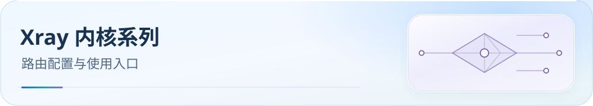

<picture>
  <source media="(max-width: 600px)" srcset="../docs/assets/readme/page-family-xray-mobile.svg">
  
</picture>

# Xray 内核系客户端入口

本系列提供 v2rayN 使用 Xray 核心时的路由规则 JSON。v2rayN 支持多种核心；若实际使用 Mihomo 或 sing-box，请改从相应系列选择配置。Xray JSON 仅用于路由设置，只有 proxy、direct、block 三类出口。

  

快速导航：[配置下载](../docs/guide/downloads.md#xray) · [文档中心](../docs/README.md) · [DNS 与导入后验收](../docs/guide/dns-and-verification.md)

## 客户端教程

- [v2rayN](./v2rayN/README.md) — 按实际核心选择 Mihomo、sing-box 或 Xray 路由文件

请在 v2rayN 中确认当前核心，再从该核心对应的入口导入文件；不要把 Xray 路由 JSON 当作完整代理配置。
