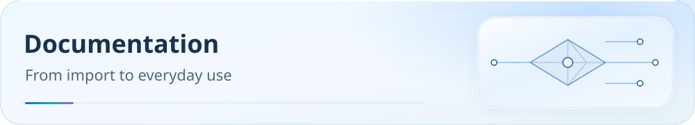

[**English**](README.md) | [中文](README.zh-CN.md)

<picture>
  <source media="(max-width: 600px)" srcset="assets/readme/page-docs-mobile.svg">
  
</picture>

# Documentation

Choose a path from configuration selection and complete import instructions to runtime verification. Topic guides and client tutorials are maintained with the repository.

 

[Project home](../README.md) · [Downloads](guide/downloads.md) · [Client selection](guide/client-support.md) · [Report a problem](https://github.com/IvanSolis1989/Smart-Config-Kit/issues)

## Start with these three steps

1. **[Find the configuration](guide/downloads.md):** browse clients, raw files, and import guides by core family.
2. **[Check client capabilities](guide/client-support.md):** confirm platform, protocols, minimum versions, and graphical-client import boundaries.
3. **[Verify after import](guide/dns-and-verification.md):** inspect resolution paths, rule downloads, actual matches, and final exits.

## Meow clients

- [Official Meow](../Meow内核系/Meow/README.md): native YAML for the official core and Android/iOS applications. Replace the endpoint subscription URL first. Core checks and application import are separate acceptance steps.
- [AEROVE Lite](../Meow内核系/Aerove%20Lite/README.md): JavaScript override. The [validation record](../Meow内核系/Aerove%20Lite/VALIDATION.md) distinguishes candidate checks, production integration, and real APK testing.
- [Meow family](../Meow内核系/README.md) · [Downloads](guide/downloads.md#meow) · [Support queue](support-queue.md#meow)

## Understand the routing design

- **[Policy and rule sources](guide/routing-policy.md):** architecture, 33 service groups, regional choices, and sources.
- [Cross-client capability matrix](client-capability-matrix.md): subscription input, dynamic grouping, node DNS, and optional capabilities for 15 existing semantic products. Meow candidate boundaries are documented separately above.
- [Rule quality and source ledger](rule-quality.md): source receipts, ordered semantics, exceptions, and release constraints.
- [GEOSITE coverage ledger](GEOSITE_COVERAGE_LEDGER.md): categories, supplemental rules, and coverage evidence.

## Subscriptions and advanced options

- **[Configuration entry point](configuration.md):** [online downloads](https://ivansolis1989.github.io/Smart-Config-Kit/), offline fallback, safe local JavaScript updates, cross-client service profiles, and feature coverage.
- **[Sub-Store aggregation](../SubStore/README.md):** clean, name, deduplicate, and combine subscriptions.
- [Browser subscription synchronization](../SubStore/edge-extension/README.md): account sign-in, site permissions, and subscription-update boundaries.
- [Endpoint filtering and rate multipliers](subscription-node-filter.md): cleanup, residential-endpoint classification, and filtering semantics.
- [Private endpoint DNS](private-node-dns.md): bounded projection of active endpoint hostnames and static-client limitations.
- [Speed tests and QUIC options](traffic-options.md): optional traffic behavior and cross-client support.
- [WebRTC privacy and verification](guide/webrtc-privacy.md): direct STUN trade-offs, browser privacy policy, and connection evidence.
- [ZeroTier UDP proxying](zerotier-planet-proxy.md): an optional, default-off configuration and its validation.
- [PROCESS-NAME compatibility](process-name-compatibility.md): platform-specific process-rule limitations.

## Maintenance and evidence

- **[Maintenance contract (Chinese source)](../AGENTS.md):** generation order, synchronized versions, documentation requirements, and visual acceptance.
- [Maintenance tools](../tools/README.md): upstream documentation cache, generators, and validators.
- [Client support queue](support-queue.md): candidates, interface boundaries, and remaining acceptance work.
- [Rule asset delivery](rule-asset-delivery.md): download URLs and complete-content verification.
- [Release batches](release-batch.md): generated artifacts, versions, and release checks.
- [Official references and historical reviews](archive/README.md): client references, dated upstream checks, and original topic-validation records.
- [AI issue replies](ai-issue-responder.md) · [Notifications](telegram.md) · [Changelog](../CHANGELOG.md)

Historical evidence in `upstream/2026-10-19/` retains paths from its recorded `base_commit`. Use the [download directory](guide/downloads.md) for current client locations.

## Community and support

[Upstream projects](guide/acknowledgements.md) · [Disclaimer and licensing boundaries](disclaimer.md) · [Support maintenance](donate.md)

[Documentation language coverage and retained source archives](documentation-language-coverage.md)
