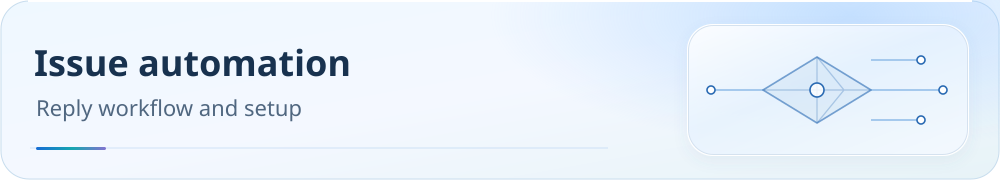

<picture>
  <source media="(max-width: 600px)" srcset="assets/readme/page-ai-issue-responder-mobile.svg">
  
</picture>

<a id="issue-自动回复维护说明"></a>
# Maintaining automated issue replies

**English** | [简体中文](ai-issue-responder.zh-CN.md)

Maintain the issue responder from triggers and credentials through failure handling. Start with the entry points, then review context and acceptance boundaries.

<p>
  <a href="guide/downloads.md"></a>
  <a href="README.md"></a>
  <a href="guide/dns-and-verification.md"></a>
</p>

[Downloads](guide/downloads.md) · [Documentation](README.md) · [Checks and troubleshooting](guide/dns-and-verification.md)

<a id="回复语言"></a>
## Reply language

Public replies follow the natural language of the question’s body; use the title only when the body contains no meaningful narrative. Template headings, checkboxes, quotations, code blocks, logs, paths, and links must not determine the language. Chinese questions receive Chinese text and headings; English questions receive English, and the same principle applies to other languages. Preserve exact product names, fields, commands, paths, protocol abbreviations, and necessary diagnostic quotations without unnecessary bilingual explanations. Repository documentation and internal prompt language do not override the question’s language.

The shared `tools/lib/ai-issue-language.js` v1.0.0 module supplies consistent constraints and static notices for the main MiMo responder, Codex-failure fallback, and local Codex worker. Static templates currently cover Chinese, English, Japanese, Korean, Indonesian, Spanish, French, German, Portuguese, Russian, and Arabic. Detection uses conservative script/word heuristics, not a guarantee of arbitrary-language detection or translation quality. Short, mixed-language, unsupported, or uncertain text is not forced into Chinese or English: public posting is blocked for maintainer review. The Actions run fails with fixed diagnostic `REPLY_LANGUAGE_UNCERTAIN`, without body text or credentials; the local worker retains the failed task and fixed error record. No new external notification channel is added; maintainers use existing Actions/worker failure records.

Model prompts require the question’s language. Before publication, independent cleaning checks the reply while retaining headings, ordinary quotations, and uppercase narrative; it does not reuse question-side template/log filtering. Chinese replies exempt only known necessary technical terms; other foreign-language identifiers must be clearly marked as inline code or code blocks. Uncertain content is blocked rather than falsely declared entirely Chinese. This is not word-by-word translation review and cannot guarantee correct classification of every technical quotation or foreign term. A language mismatch blocks the model text and patch, posts an incomplete-status notice in the recognized language, and retains existing failure/manual-review handling without adding model retries.

New local-worker failure receipts include a language-independent hidden status marker; old Chinese receipts remain recognized. Owner identity and task-marker checks are unchanged. Local behavior changes only after updating the installed worker snapshot, including copying the new shared module through the installer. Existing public comments are not automatically rewritten. Before resending replies for old persistent tasks, the original question’s language is checked again.

<a id="使用入口"></a>
## Entry points

Repository Actions Variable `LOCAL_CODEX_ENABLED` selects the main backend. When `true`, local Codex is used and the older MiMo responder skips processing; an independent analysis-only fallback handles explicit Codex failures. Other values retain the MiMo path below. The two primary processors are mutually exclusive; the failure fallback cannot modify code or publish releases.

<a id="本机-codex-自动处理"></a>
### Local Codex automation

`local-codex-issue.yml` stores task metadata as a GitHub artifact; the local machine polls every 60 seconds. Each task gets an isolated working directory and persistent Codex session. The worker pushes a candidate commit to a temporary `codex/issue-*` branch and invokes `validate-local-codex-candidate.yml` for four fixed checks on a temporary GitHub runner. Only after confirming every check actually passed does it serially push the same commit normally to `main` and reply to the issue. Existing branch protection is respected; there is no force push or automatic issue closure.

Dispatch is fixed to **GPT-6.1 Sol** (`gpt-6.1-sol`) with **ultra** reasoning. Configuration, thread creation, and every execution specify both explicitly. Local defaults are not inherited and no silent downgrade occurs. Unsupported accounts/clients produce a failed task with its state retained.

- Automatic entry: newly opened/reopened issues carrying `question`, `faq`, `help wanted`, `bug`, `enhancement`, or `documentation`. Historical issues predating installation are not replayed automatically.
- Maintainer entry: comment beginning `/codex`, or add the `codex` label. The event actor must have repository write/maintain/admin permission.
- Manual entry: Actions → **Queue Local Codex Issue Task** → Run workflow → enter the issue number. `handle` performs normal processing; `smoke` validates dispatch and model response only, without business-code changes, commits, or public replies.
- Delivered events are deduplicated by task key. An explicit new `/codex` comment creates a new task. One local worker processes a repository serially.
- Issues/comments are untrusted data. They cannot change dispatch authorization, read secrets, modify the maintenance contract, `.github/`, or dispatch infrastructure. Tasks requiring those changes report a blocker.

Windows requires Node.js 22+, Git, authenticated GitHub CLI, and Codex CLI. Existing local authentication is reused; `auth.json` is neither uploaded nor copied, and no OpenAI API key is needed in Actions. Install with:

```powershell
pwsh -NoProfile -File tools\install-local-codex-issue-worker.ps1
```

The default installation is `%LOCALAPPDATA%\Smart-Config-Kit\codex-issue-bridge`: `runtime` contains controlled script snapshots, `config.json` local paths, `state` receipts/task state, and `worktrees` isolated Git directories. Installation from an MSIX desktop app may redirect the directory to the package’s `LocalCache\Local`. The installer resolves the physical path through a real file handle so an out-of-package scheduled task can access it; use the path printed by installation. The current-user login task is `Smart-Config-Kit-Codex-Issue-Worker`. If task registration/startup fails, the installer uses current-user HKCU Run and records the actual method in `install-receipt.json`. Processing is unavailable while the machine is off, asleep, logged out, offline, or lacks valid authentication. Queue artifacts are retained for 90 days.

Status and side-effect-free validation:

```powershell
$bridge = Join-Path $env:LOCALAPPDATA 'Smart-Config-Kit\codex-issue-bridge'
node "$bridge\runtime\local-codex-issue-worker.js" --config "$bridge\config.json" --status
# Stop the resident worker before a one-shot run or validation to avoid lock conflicts.
node "$bridge\runtime\local-codex-issue-worker.js" --config "$bridge\config.json" --smoke
```

Stop the resident worker before a one-shot run or validation to avoid instance-lock conflicts. `--status` reports the actual PID, last claim time, terminal task state, session link, commit, and reply ID. A live process does not prove task completion. Open the recorded `codex://threads/<threadId>` in the desktop app. Pre-publication validation logs remain in the associated GitHub Actions run; release replies include actual commit links, passed-check names, and run links. The outer program does not directly execute candidate code locally.

To pause claims, create an empty `PAUSED` file in `state`; remove it to resume. Pausing does not interrupt an active task. Changing the repository variable to `false` restores MiMo. Pause and resolve local pending work before switching to avoid duplicate processing by both backends.

Crashed/timed-out model tasks become `interrupted`, retaining the session, work directory, and error; they are not automatically rerun. After inspection, stop the resident instance and use `--retry <taskKey> --once`. If a commit exists but push confirmation failed, use `--resume-publish <taskKey>`: revalidate and check the remote baseline before a normal push. If the remote already contains the commit, only verify/complete the reply. If main advanced without the commit, state is retained for manual integration. Lost push/comment confirmation triggers a check of actual remote state and reply markers rather than rerunning the model.

```powershell
pwsh -NoProfile -File tools\install-local-codex-issue-worker.ps1 -Uninstall
```

Uninstall stops only this worker and its children and removes autostart; configuration, work directories, and state remain. Stop the worker before updating script snapshots, then rerun installation. Installation preserves the original task-start cutoff.

References and reuse: [official App Server](https://learn.chatgpt.com/docs/app-server), [official commands](https://learn.chatgpt.com/docs/developer-commands), [WakeWire](https://github.com/glenncalleja/wakewire) (MIT), and [Wake](https://github.com/Abyssinia-Labs/wake) (MIT). This implementation uses the official protocol and existing GitHub artifacts/CLI. It implements only repository-specific Windows polling, persistent state, and publishing constraints, without importing those projects’ full webhook services or npm dependencies.

See the [acceptance receipts](research/2026-11-01-local-codex-issue-bridge-acceptance.md) for actual dispatch, fixed-model, and publication-gate evidence.

<a id="codex-失败后的-mimo-补答"></a>
### MiMo fallback after Codex failure

The independent entry point is [ai-codex-fallback.yml](../.github/workflows/ai-codex-fallback.yml), version 1.0.0. It bridges the gap where the local worker posted failure but `LOCAL_CODEX_ENABLED=true` caused the original MiMo backend to skip. It does not require reinstalling or overwriting the local worker.

- Accepts only `scki-local-codex:<taskKey>` failure comments from the personal-repository owner confirmed by GitHub API immutable user ID, with the fixed status `本次自动处理未完成，尚未发布到 main。` (automatic processing incomplete; not published to main). External issue authors, spoofed login names, quoted markers, PRs, and closed issues do not trigger it.
- Runs on comment creation/edit and every half hour scans comments updated within seven days, covering cases where GitHub-token events do not trigger another workflow. Manual Actions input can target an issue to recover older failures. Queue-workflow success is not treated as Codex processing success.
- Each Codex task has only one MiMo comment. A persistent pending marker is posted first and updated in place on completion; event, scheduled, and manual paths share a concurrency lock. After interruption or lost comment confirmation, existing markers are checked and the same comment updated rather than blindly repeating POST. One candidate’s read/processing failure does not stop others, but the run still fails; logs contain issue numbers and fixed statuses only. Original failure receipts outside the seven-day window, including incomplete pending replies, require manual issue-number recovery in Actions rather than unlimited historical scanning.
- Calls only `mimo-v2.6-flash` for analysis. Credentials/endpoints follow the next section. The model has no code-write, PR, or release permission. Issue/model text is not executed; local error records, sessions, and work directories are not sent. Vendor patches, filtered responses, and incomplete results are rejected, retaining one incomplete-status notice.
- Rechecks the Codex failure source before invocation and before publishing analysis. If the original comment now reports completion or the issue closed, stale fallback is cancelled. Missing `MIMO_API_KEY` fails the workflow without creating an empty reply; rerun after configuration. Completed or already-reported failed tasks are not automatically answered again; a new explicit Codex dispatch has a new key.
- First deployment requires merging workflow/scripts into the default branch, enabling Actions, retaining `LOCAL_CODEX_ENABLED=true`, and configuring a valid MiMo key. Offline tests do not prove a successful real MiMo call or public fallback reply. Inspect the actual workflow and issue reply after deployment.

<a id="mimo-后端"></a>
### MiMo backend

1. Issue labels trigger initial analysis. A maintainer, member, or collaborator can comment `/ai-help` for deeper analysis.
2. Configure Actions credentials/endpoints and check complete context and patch permissions.
3. Run offline tests first. Real API acceptance tests require explicit authorization.

The entry point is [ai-responder.yml](../.github/workflows/ai-responder.yml). Labels trigger initial `mimo-v2.6-flash` analysis; `/ai-help` from a maintainer, member, or collaborator uses `mimo-v2.6-pro`. Replies are advisory. Maintainers still decide merges and issue closure.

<a id="请求与上下文"></a>
## Requests and context

- `tools/build-ai-issue-context.js` selects repository files using client/failure keywords instead of loading every configuration, rule payload, historical log, and reference in related directories. Excerpts include paths, line numbers, and omission notices; URLs and errors retain their meaning.
- Code-editing mode requires complete `AGENTS.md` in the API `developer` message. Issues and follow-ups occupy a separate `user` message. The maintenance contract is not interpreted as a request to implement every feature it describes.
- If no complete editable target is available, analysis-only mode is selected before invocation. Missing/over-budget contracts disable patches. File evidence, not vendor filtering, determines this choice. Patches may target only files supplied completely; an incomplete patch target rejects the entire patch set.
- One or two explicitly mentioned small `docs/*.md` files may be supplied completely. Documentation-only tasks load only the maintenance contract and target documents. Over-budget documents remain labeled excerpts and cannot justify whole-file replacement.
- `tools/respond-ai-issue.js` invokes `tools/lib/ai-issue-responder.js`, passing issue/follow-up text as data. Prompts identify `rulesets/source/routing-graph.js` as rule authority, require evidence-based conclusions, and prohibit guessing network-request outcomes.
- Initial repository context is limited to 96 KiB. The invocation checks a 112 KiB limit after optional search excerpts. The output-token budget includes reasoning; truncated replies cannot modify files.

<a id="端点与凭据"></a>
## Endpoints and credentials

Actions Secret `MIMO_API_KEY` is required. `MIMO_BASE_URL` prefers the Actions Variable and supports a same-named Secret. If unset, the existing default remains `https://token-plan-cn.xiaomimimo.com/v1`.

Token Plan requires its console-provided dedicated Base URL and matching key. Pay-as-you-go keys should explicitly use `https://api.xiaomimimo.com/v1`. Manual live tests may use local environment variable `MIMO_TOKEN_PLAN_API_KEY`. Credentials are used only for request authentication and never written to artifacts or logs.

<a id="过滤和调用失败"></a>
## Filtering and invocation failures

Following [MiMo Chat Completions documentation](https://mimo.mi.com/docs/zh-CN/api/chat/openai-api), inspect `choices[0].finish_reason`: `stop` means complete, `content_filter` means filtered, and `length` means incomplete.

Also check `message.refusal` and recognize the full high-risk refusal observed in #186. The [official error codes](https://mimo.mi.com/docs/zh-CN/api/guidance/error-codes) distinguish HTTP `421` content blocking, `401` authentication failure, and `429` rate limiting.

Filtered responses produce an incomplete-status notice in the question’s recognized language, prohibit patches/PRs, and fail the job after the notice is published. Vendor refusal is not treated as technical analysis or as confirmation that the user’s issue is risky.

Filtering and authentication failures are not retried. Timeouts, connection errors, HTTP 429, and 5xx receive at most one identical-request retry. Models, endpoints, and input meaning are not changed to bypass filtering. Logs/job summaries contain only status, HTTP status, completion reason, restricted-format error codes, and request IDs, never credentials, full requests/responses, or model reasoning.

Results pass through runner temporary files so arbitrary replies cannot enter fixed-delimiter `GITHUB_OUTPUT`. File-based transport and passing external input through environment variables follow [GitHub workflow commands](https://docs.github.com/en/actions/reference/workflows-and-actions/workflow-commands) and [secure use](https://docs.github.com/en/actions/reference/security/secure-use), respectively.

<a id="186-的已知证据与验收边界"></a>
## Known evidence and acceptance boundaries for #186

[Run 38619558065](https://github.com/IvanSolis1989/Smart-Config-Kit/actions/runs/38619558065) succeeded at invocation and publication, but the bot’s body contained only a high-risk refusal. The same occurred in #182, #183, and #184.

Old code extracted only `message.content` without retaining HTTP status or completion reason. Old logs therefore cannot establish where the vendor filtered the request or which word/file caused it.

On 2026-10-16, a real `mimo-v2.6-flash` call completed analysis of #186’s original text and a complete small-document patch task. The latter was applied to a temporary copy using the workflow’s same Python code, then read back in full against expectations. See the [live-test receipt and boundaries](research/2026-10-16-mimo-issue-responder-acceptance.md). Tests posted no public issue comment and opened no PR. GitHub Actions cloud execution still required post-deployment verification.

```bash
node --test tools/tests/ai-issue-*.test.js tools/tests/ai-responder-workflow.test.js
```

The following commands make real MiMo calls and consume API usage. Evidence defaults to a system temporary directory. Run only for explicitly authorized manual acceptance; offline CI does not invoke them:

```bash
node tools/test-ai-issue-live.js
node tools/test-ai-issue-live.js --case docs-title --output /tmp/mimo-docs-acceptance
```

Real acceptance requires concrete analysis or a complete patch. HTTP 200, a nonempty reply, or an expression of willingness is insufficient. Documentation tasks apply only to temporary copies, not actual `docs/README.md`.

Independent workflow `validate-ai-responder.yml` runs these offline checks when responder code/tests change. These automation-tool changes do not change routing rules, client behavior, or output versions, and do not trigger full client regeneration.
