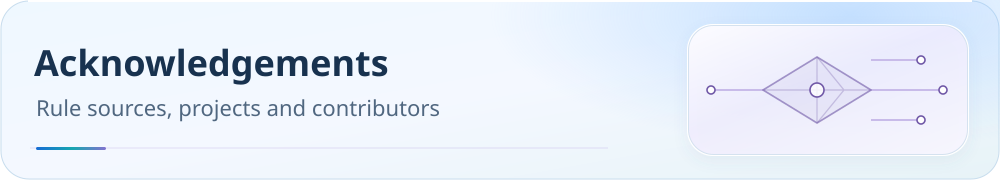

<picture><source media="(max-width: 600px)" srcset="assets/readme/page-acknowledgements-mobile.svg"></picture>

# Support the project

**English** | [中文](donate.zh-CN.md)

[Downloads](guide/downloads.md) · [Documentation](README.md) · [Validation](guide/dns-and-verification.md)

Participation is voluntary. Useful bug reports, evidence-backed fixes, client compatibility testing and documentation improvements all help maintain the project.

## Ways to contribute

- Report reproducible rule or import problems in an issue, with redacted diagnostics.
- Propose a tested pull request for rule coverage, endpoint classification or client compatibility.
- Share the project or star the repository if it is useful to you.
- If you choose to contribute financially, the existing [WeChat and Alipay payment QR codes are available on the Chinese-language support page](donate.zh-CN.md#扫码支持).

A contribution does not purchase a feature, service, delivery date or promise to resolve an issue. It does not change applicable licenses or grant rights in third-party materials. The project does not promise access to particular services or indefinite maintenance. Read the [scope and licensing notice](disclaimer.md).

Thank you for supporting careful, evidence-based maintenance.
