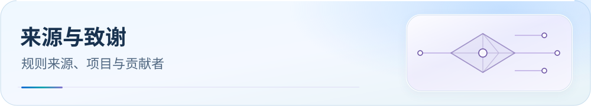

<picture>
  <source media="(max-width: 600px)" srcset="assets/readme/page-acknowledgements-mobile.svg">
  
</picture>

# 💖 支持本项目

支持项目维护，也可以通过反馈问题、贡献适配和分享项目参与。所有支持方式都自愿。

  
  
  

[下载配置](guide/downloads.md) · [文档目录](README.md) · [检查与排障](guide/dns-and-verification.md)

## 使用入口

1. 扫码支持：下方保留微信与支付宝收款码。
2. 参与维护：报告具体问题或提交有依据的改进。

本仓库纯个人 + AI 维护，**没广告 / 没商业合作 / 永久免费开源**。如果它帮你省了调试时间、让你的 ChatGPT 不再 403、或者拦住过一次钓鱼页，欢迎打赏一杯咖啡 ☕。

## 扫码支持

  
  &nbsp;&nbsp;&nbsp;&nbsp;
  

<em>左：微信 &nbsp;|&nbsp; 右：支付宝</em>

> 打赏完全自愿，不影响任何功能——本仓库 100% 开源，所有规则 / 配置 / 更新永久免费。

## 参与维护

不方便打赏也能**同等支持**：

- ⭐ **Star 本仓库** 让更多人看见
- 🐛 **开 Issue** 报告命中错误 / 规则失效
- 📝 **PR 贡献** 新兴服务域名补充 / 地区正则修正 / 客户端字段适配
- 📣 **告诉朋友**这个项目

感谢每一位使用者的支持 🙏
