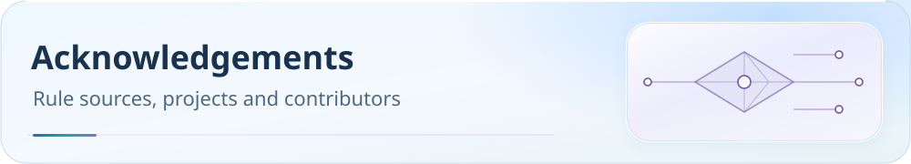

**English** | [中文](acknowledgements.zh-CN.md)

<picture>
  <source media="(max-width: 600px)" srcset="../assets/readme/page-acknowledgements-mobile.svg">
  
</picture>

# Acknowledgements, scope and licensing

The project builds on community software. This page collects upstream references for rules, clients and tools. Links are acknowledgements, not blanket redistribution grants.

 

[Project home](../../README.md) · [Documentation](../README.md) · [Post-import validation](dns-and-verification.md#verification)

[Upstream projects](#upstream) · [Scope and responsible use](#usage) · [Licensing](#license)

## Upstream projects

Thanks to the projects providing cores, clients, rules and tools.

### Cores and models

[mihomo](https://github.com/MetaCubeX/mihomo) / [Smart Alpha](https://github.com/vernesong/mihomo) / [LightGBM](https://github.com/vernesong/mihomo/releases/download/LightGBM-Model/Model.bin) / [sing-box](https://github.com/SagerNet/sing-box) / [Xray](https://github.com/XTLS/Xray-core) / [hiddify-sing-box](https://github.com/hiddify/hiddify-sing-box)

### Client projects

[mihomo-party](https://github.com/mihomo-party-org/mihomo-party) / [Verge Rev](https://github.com/clash-verge-rev/clash-verge-rev) / [CMFA](https://github.com/MetaCubeX/ClashMetaForAndroid) / [Stash](https://stash.wiki/) / [FlClash](https://github.com/chen08209/FlClash) / [OpenClash](https://github.com/vernesong/OpenClash) / [HomeProxy](https://github.com/immortalwrt/homeproxy) / [ShellCrash](https://github.com/juewuy/ShellCrash) / [Passwall2](https://github.com/Openwrt-Passwall/openwrt-passwall2) / [v2rayN](https://github.com/2dust/v2rayN) / [Hiddify](https://github.com/hiddify/hiddify-app)

### Base rule databases

[geosite](https://github.com/MetaCubeX/meta-rules-dat) / [geoip](https://github.com/Loyalsoldier/geoip) / [clash-rules](https://github.com/Loyalsoldier/clash-rules) / [v2ray-rules-dat](https://github.com/Loyalsoldier/v2ray-rules-dat)

### Rule sets

[bm7](https://github.com/blackmatrix7/ios_rule_script) / [Accademia](https://github.com/Accademia/Additional_Rule_For_Clash) / [DustinWin](https://github.com/DustinWin/ruleset_geodata) / [ACL4SSR](https://github.com/ACL4SSR/ACL4SSR) / [SukkaW](https://github.com/SukkaW/Surge) / [Hagezi](https://github.com/hagezi/dns-blocklists) / [MiHomo-Hagezi](https://github.com/MiHomoer/MiHomo-Hagezi) / [szkane](https://github.com/szkane/ClashRuleSet) / [VPSDance AI Rules](https://github.com/VPSDance/ai-proxy-rules) / [anti-AD](https://github.com/privacy-protection-tools/anti-AD)

### Tools and icons

[Sub-Store](https://github.com/sub-store-org/Sub-Store) / [PROCESS-NAME compatibility](../process-name-compatibility.md) / [QX scripts](https://github.com/KOP-XIAO/QuantumultX) / [Qure icons](https://github.com/Koolson/Qure) / [domain-list-community](https://github.com/v2fly/domain-list-community)

### Commercial clients

[Shadowrocket](https://apps.apple.com/app/shadowrocket/id932747118) / [Stash](https://apps.apple.com/app/stash-rule-based-proxy/id1596063349) / [Surge](https://nssurge.com/) / [Loon](https://apps.apple.com/app/loon/id1373567447) / [Quantumult X](https://apps.apple.com/app/quantumult-x/id1443988620) / [Egern](https://egernapp.com/)

Report missing upstream acknowledgements through an [issue](https://github.com/ivansolis1989/Smart-Config-Kit/issues).

---

## Scope and responsible use

This repository provides configuration and validation tools, not endpoints, subscriptions or a proxy service. Review applicable laws, network policies and service terms, and validate the effective configuration on your own devices. It does not promise anonymity, leak prevention or uninterrupted access. See the full [scope, limitations and licensing notice](../disclaimer.md).

## Licensing

There is no root `LICENSE` or `COPYING` file establishing a repository-wide license at this revision. Earlier blanket MIT claims were not adequately documented. Do not assume all code or generated assets share a license; check the relevant rights holders and component terms. Third-party materials retain their own copyright, attribution and license requirements. This page does not relicense them or restrict rights already granted by applicable open-source licenses.

For optional support information, see [Support the project](../donate.md).

---

[← Project home](../../README.md) · [Documentation](../README.md)
