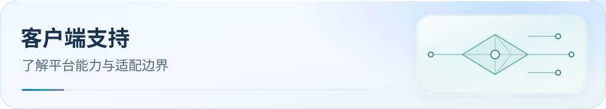

<picture>
  <source media="(max-width: 600px)" srcset="../assets/readme/page-client-support-mobile.svg">
  
</picture>

# 客户端选择与协议支持

先按设备选择客户端，再核对协议、内核版本与导入模式。

 

[项目首页](../../README.md) · [文档中心](../README.md) · [导入后验收](dns-and-verification.md#verification)

[按场景选择](#choose) · [协议矩阵](#protocols) · [条件与证据](#conditions)

开发中的客户端适配见[支持队列](../support-queue.md)。AEROVE Lite / meow-rs 已有分流覆写候选，仍待 App 配置准入和 Android 联调。

## 按使用场景选择

| 场景 | 选择与边界 |
| --- | --- |
| Smart 择路 | [Clash Party](../../Mihomo内核系/Clash%20Party/README.md) Smart：需 Smart 内核 + LightGBM，消费融合规则集。 |
| 普通 Mihomo | [Clash Party](../../Mihomo内核系/Clash%20Party/README.md) Normal / [FlClash](../../Mihomo内核系/FlClash/README.md)：规则语义相同，区域组使用 url-test；Clash Verge Rev 默认选 Normal。 |
| Android Mihomo | [CMFA](../../Mihomo内核系/Clash%20Meta%20For%20Android/README.md)：原生 YAML，同步产物，不是规则基准。 |
| Stash | [Stash](../../独立内核系/Stash/README.md)：从 CMFA 裁剪生成，保持 Clash Premium 兼容。 |
| Karing | [Karing](../../Sing-box内核系/Karing/README.md)：按源顺序适配 direct / block / currentSelected；节点组、DNS 与默认动作在 App 设置。 |
| sing-box / Hiddify / HomeProxy | [sing-box](../../Sing-box内核系/SingBox/README.md)：按实际 1.14 / 1.13 内核选择；GUI 完整配置边界须另验。 |
| v2rayN Xray | [v2rayN](../../Xray内核系/v2rayN/README.md)：78 个非空 fused SRS 资产展平为 98 项 Xray 路由规则。 |
| 其他 Apple 客户端 | [Egern](../../独立内核系/Egern/README.md) / [Shadowrocket](../../独立内核系/Shadowrocket/README.md) / [Surge](../../独立内核系/Surge/README.md) / [Loon](../../独立内核系/Loon/README.md) / [Quantumult X](../../独立内核系/Quantumult%20X/README.md)：分别使用各 App 原生语法。 |
| OpenWrt | 优先 [OpenClash](../../Mihomo内核系/OpenClash/README.md)；[Passwall](../../双内核系/Passwall/README.md) / [Passwall2](../../双内核系/Passwall2/README.md) 为降级参考，78 条 fused SRS 仅用于 sing-box 分流后端。 |

## 协议支持矩阵

以下沿用 **2026-10-19** 核验口径，描述核心或客户端能力；实际设备仍需完成连接验收。FlClash 与 Karing 等未单列客户端不借此扩展能力声明。

**✓ 支持**　 **△ 有条件支持**　 **— 不支持**

[查看 Mihomo](#mihomo-protocols) · [Stash / SR / Surge](#apple-protocols) · [Loon / QX](#loon-qx-protocols) · [sing-box / Xray](#singbox-xray-protocols)

### Mihomo 家族

CP = Clash Party；CMFA = Clash Meta For Android；OC = OpenClash；v2N = v2rayN mihomo。

CP、CMFA、OC 在下列协议上的支持状态一致，合并为一列；v2N 的条件上标单独保留。

| 协议 | CP/CMFA/OC | v2N |
| --- | :---: | :---: |
| **SS (+ 2022)** | ✓ | ✓ |
| **SSR** | ✓ | ✓¹ |
| **VMess** | ✓ | ✓ |
| **VLESS** | ✓ | ✓ |
| **REALITY + Vision** | ✓ | ✓ |
| **Trojan** | ✓ | ✓ |
| **Hysteria 1** | ✓ | ✓ |
| **Hysteria 2** | ✓ | ✓ |
| **TUIC v5** | ✓ | ✓ |
| **WireGuard** | ✓ | ✓ |
| **AnyTLS** | ✓ | ✓ |
| **ShadowTLS** | ✓ | ✓ |
| **Snell v4** | ✓ | ✓¹ |
| **Mieru** | ✓ | ✓¹ |
| **SSH 出站** | ✓ | ✓ |
| **HTTP / SOCKS5** | ✓ | ✓ |

**LightGBM 自动择优** 按入口分别判断：

- **CP：✓³**，需 vernesong Smart 分支 + JS 覆写；MetaCubeX Alpha 不等于 Smart。
- **OC：✓**，需 Smart Alpha 内核。
- **CMFA、v2N：—**。

### Stash / Shadowrocket / Surge

SR = Shadowrocket。

| 协议/能力 | Stash | SR | Surge |
| --- | :---: | :---: | :---: |
| **SS (+ 2022)** | ✓ | ✓ | ✓ |
| **SSR** | ✓ | ✓ | — |
| **VMess** | ✓ | ✓ | ✓ |
| **VLESS** | ✓ | ✓ | — |
| **REALITY + Vision** | ✓ | ✓ | — |
| **Trojan** | ✓ | ✓ | ✓ |
| **Hysteria 1** | ✓ | ✓ | — |
| **Hysteria 2** | ✓ | ✓ | ✓² |
| **TUIC v5** | ✓ | ✓ | ✓ |
| **WireGuard** | ✓ | ✓ | ✓ |
| **AnyTLS** | ✓ | ✓ | ✓⁵ |
| **ShadowTLS** | ✓ | ✓ | — |
| **Snell v4** | △⁴ | ✓ | ✓ |
| **Mieru** | — | △ | — |
| **SSH 出站** | ✓ | — | ✓ |
| **HTTP / SOCKS5** | ✓ | ✓ | ✓ |
| **LightGBM 自动择优** | — | — | — |

### Loon / Quantumult X

| 协议/能力 | Loon | QX |
| --- | :---: | :---: |
| **SS (+ 2022)** | ✓ | ✓ |
| **SSR** | ✓ | ✓ |
| **VMess** | ✓ | ✓ |
| **VLESS** | ✓ | △ |
| **REALITY + Vision** | ✓ | △ |
| **Trojan** | ✓ | ✓ |
| **Hysteria 1** | ✓ | — |
| **Hysteria 2** | ✓ | — |
| **TUIC v5** | ✓ | — |
| **WireGuard** | ✓ | — |
| **AnyTLS** | ✓⁶ | ✓⁷ |
| **ShadowTLS** | △ | — |
| **Snell v4** | ✓ | — |
| **Mieru** | — | — |
| **SSH 出站** | — | — |
| **HTTP / SOCKS5** | ✓ | ✓ |
| **LightGBM 自动择优** | — | — |

### sing-box 与 Xray

| 协议/能力 | sing-box | v2rayN Xray |
| --- | :---: | :---: |
| **SS (+ 2022)** | ✓ | ✓ |
| **SSR** | — | — |
| **VMess** | ✓ | ✓ |
| **VLESS** | ✓ | ✓ |
| **REALITY + Vision** | ✓ | ✓ |
| **Trojan** | ✓ | ✓ |
| **Hysteria 1** | ✓ | — |
| **Hysteria 2** | ✓ | — |
| **TUIC v5** | ✓ | — |
| **WireGuard** | ✓ | △ |
| **AnyTLS** | ✓ | — |
| **ShadowTLS** | ✓ | — |
| **Snell v4** | — | — |
| **Mieru** | — | — |
| **SSH 出站** | ✓ | — |
| **HTTP / SOCKS5** | ✓ | ✓ |
| **LightGBM 自动择优** | — | — |

### 条件与证据

条件标记与表内上标一一对应：

- **¹ v2rayN**：切到 mihomo 核心。
- **² Surge Hysteria 2**：iOS 5.8.0+ / Mac 5.4.0+。
- **³ Smart**：vernesong Smart 分支 + JS 覆写；MetaCubeX Alpha 不等于 Smart。
- **⁴ Stash Snell**：Wiki 当前示例为 v3，v4 以 App 实测为准。
- **⁵ Surge AnyTLS**：iOS 5.17.0+ / Mac 6.4.3+。
- **⁶ Loon AnyTLS**：3.3.9+。
- **⁷ Quantumult X AnyTLS**：1.6.0+。

[查看官方证据与未验证项](../upstream/2026-10-19/apple/report.md)。

Clash Party 包含 Clash Party / Clash Verge Rev / Mihomo Party；CMFA 是 Clash Meta For Android（含 [ClashMi](https://github.com/KaringX/clashmi) 使用入口）；QX 是 Quantumult X。表中 v2rayN mihomo 一列只描述 mihomo 核心，不能据此推定 sing-box 支持 SSR 或 Snell。

### 常见选择

常用协议（SS / VMess / Trojan）→ 按设备挑；VLESS + REALITY → Mihomo / sing-box / SR / Loon / v2rayN；Hysteria 2 / TUIC → 避开 Surge 旧版 / QX / Xray；想要 **LightGBM 自动择优** → 只能走 Clash Party / OpenClash + Smart Alpha 内核。

### 其他导入边界

ShellCrash（原 ShellClash，mihomo 模式）可用 CMFA YAML，但需检查启动后的覆写；HomeProxy 由 UCI 生成配置，尚未验证完整 JSON 导入；Stash / Egern 使用各自 YAML；Passwall / Passwall2 的 fused SRS fallback 仅适用于 sing-box 分流节点。Happ 的路由 Profile 与 v2rayN RuleObject 数组格式不同，不能直接导入本仓库 Xray JSON。详见[额外消费者核对](../upstream/2026-10-19/consumers/report.md)与各端说明。

完整操作入口见 [下载与导入](downloads.md)，各平台 DNS 与导入后的检查见 [DNS 与运行验证](dns-and-verification.md)。

---

[← 项目首页](../../README.md) · [文档索引](../README.md)
