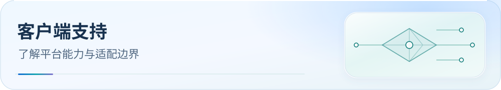

<picture>
  <source media="(max-width: 600px)" srcset="../assets/readme/zh-CN/page-client-support-mobile.svg">
  
</picture>

# 客户端选择与协议支持

[English](client-support.zh-CN.md) | **简体中文**

[适用范围与免责声明](../disclaimer.zh-CN.md)

先按设备选择客户端，再核对协议、内核版本与导入模式。

 

[项目首页](../../README.zh-CN.md) · [文档中心](../README.zh-CN.md) · [导入后验收](dns-and-verification.zh-CN.md#verification)

[按场景选择](#choose) · [协议矩阵](#protocols) · [条件与证据](#conditions)

[Meow 内核系](../../Meow内核系/README.zh-CN.md)提供并列客户端入口：[官方 Meow](../../Meow内核系/Meow/README.zh-CN.md)使用原生 YAML，[AEROVE Lite](../../Meow内核系/Aerove%20Lite/README.zh-CN.md)使用 JS 覆写。两者各有导入教程与参考文档；运行验收和接线见[支持队列](../support-queue.md)。

## 按使用场景选择

| 场景 | 选择与边界 |
| --- | --- |
| Smart 择路 | [Clash Party](../../Mihomo内核系/Clash%20Party/README.md) Smart：需 Smart 内核 + LightGBM，消费融合规则集。 |
| 普通 Mihomo | [Clash Party](../../Mihomo内核系/Clash%20Party/README.md) Normal / [FlClash](../../Mihomo内核系/FlClash/README.md)：规则语义相同，区域组使用 url-test；Clash Verge Rev 默认选 Normal。 |
| Android Mihomo | [CMFA](../../Mihomo内核系/Clash%20Meta%20For%20Android/README.md)：原生 YAML，同步产物，不是规则基准。 |
| 官方 Meow / meow-rs | [Meow](../../Meow内核系/Meow/README.zh-CN.md)：原生 YAML，先替换节点订阅占位 URL；核心配置校验已通过，官方 Android/iOS 导入与连接待验。 |
| AEROVE Lite（开发联调） | [AEROVE Lite](../../Meow内核系/Aerove%20Lite/README.zh-CN.md)：JS 覆写，节点先展开；生产 Meow 校验已接线，新分片已通过固定 Rust reader 与 App 原样头部/条目预算检查，固定 APK 全资源重验及真实路由待完成。 |
| Stash | [Stash](../../独立内核系/Stash/README.md)：从 CMFA 裁剪生成，保持 Clash Premium 兼容。 |
| Karing | [Karing](../../Sing-box内核系/Karing/README.zh-CN.md)：按源顺序适配 direct / block / currentSelected；节点组、DNS 与默认动作在 App 设置。 |
| sing-box / Hiddify / HomeProxy | [sing-box](../../Sing-box内核系/SingBox/README.md)：按实际 1.14 / 1.13 内核选择；GUI 完整配置边界须另验。 |
| v2rayN Xray | [v2rayN](../../Xray内核系/v2rayN/README.md)：78 个非空 fused SRS 资产展平为 98 项 Xray 路由规则。 |
| 其他 Apple 客户端 | [Egern](../../独立内核系/Egern/README.md) / [Shadowrocket](../../独立内核系/Shadowrocket/README.md) / [Surge](../../独立内核系/Surge/README.md) / [Loon](../../独立内核系/Loon/README.md) / [Quantumult X](../../独立内核系/Quantumult%20X/README.md)：分别使用各 App 原生语法。 |
| OpenWrt | 优先 [OpenClash](../../Mihomo内核系/OpenClash/README.md)；[Passwall](../../双内核系/Passwall/README.md) / [Passwall2](../../双内核系/Passwall2/README.md) 为降级参考，78 条 fused SRS 仅用于 sing-box 分流后端。 |

## 协议支持矩阵

以下描述核心或客户端能力，沿用 **2026-10-19** 核验基线，并单列 Xray Hysteria 2 的后续核对；实际设备仍需完成连接验收。FlClash、Karing 与 Meow 系等未单列客户端不借此扩展能力声明；Meow 核心字段及 App 联调分别见[官方依据](../../Meow内核系/Meow/REFERENCE-meow-rs.md)和[AEROVE 验收记录](../../Meow内核系/Aerove%20Lite/VALIDATION.md)。

**✓ 支持**　 **△ 有条件支持**　 **— 不支持**

[查看 Mihomo](#mihomo-protocols) · [Stash / SR / Surge](#apple-protocols) · [Loon / QX](#loon-qx-protocols) · [sing-box / Xray](#singbox-xray-protocols)

### Mihomo 家族

CP = Clash Party；CMFA = Clash Meta For Android；OC = OpenClash；v2N = v2rayN mihomo。

CP、CMFA、OC 在下列协议上的支持状态一致，合并为一列；v2N 的条件上标单独保留。

| 协议 | CP/CMFA/OC | v2N |
| --- | :---: | :---: |
| **SS (+ 2022)** | ✓ | ✓ |
| **SSR** | ✓ | ✓¹ |
| **VMess** | ✓ | ✓ |
| **VLESS** | ✓ | ✓ |
| **REALITY + Vision** | ✓ | ✓ |
| **Trojan** | ✓ | ✓ |
| **Hysteria 1** | ✓ | ✓ |
| **Hysteria 2** | ✓ | ✓ |
| **TUIC v5** | ✓ | ✓ |
| **WireGuard** | ✓ | ✓ |
| **AnyTLS** | ✓ | ✓ |
| **ShadowTLS** | ✓ | ✓ |
| **Snell v4** | ✓ | ✓¹ |
| **Mieru** | ✓ | ✓¹ |
| **SSH 出站** | ✓ | ✓ |
| **HTTP / SOCKS5** | ✓ | ✓ |

**LightGBM 自动择优** 按入口分别判断：

- **CP：✓³**，需 vernesong Smart 分支 + JS 覆写；MetaCubeX Alpha 不等于 Smart。
- **OC：✓**，需 Smart Alpha 内核。
- **CMFA、v2N：—**。

### Stash / Shadowrocket / Surge

SR = Shadowrocket。

| 协议/能力 | Stash | SR | Surge |
| --- | :---: | :---: | :---: |
| **SS (+ 2022)** | ✓ | ✓ | ✓ |
| **SSR** | ✓ | ✓ | — |
| **VMess** | ✓ | ✓ | ✓ |
| **VLESS** | ✓ | ✓ | — |
| **REALITY + Vision** | ✓ | ✓ | — |
| **Trojan** | ✓ | ✓ | ✓ |
| **Hysteria 1** | ✓ | ✓ | — |
| **Hysteria 2** | ✓ | ✓ | ✓² |
| **TUIC v5** | ✓ | ✓ | ✓ |
| **WireGuard** | ✓ | ✓ | ✓ |
| **AnyTLS** | ✓ | ✓ | ✓⁵ |
| **ShadowTLS** | ✓ | ✓ | — |
| **Snell v4** | △⁴ | ✓ | ✓ |
| **Mieru** | — | △ | — |
| **SSH 出站** | ✓ | — | ✓ |
| **HTTP / SOCKS5** | ✓ | ✓ | ✓ |
| **LightGBM 自动择优** | — | — | — |

### Loon / Quantumult X

| 协议/能力 | Loon | QX |
| --- | :---: | :---: |
| **SS (+ 2022)** | ✓ | ✓ |
| **SSR** | ✓ | ✓ |
| **VMess** | ✓ | ✓ |
| **VLESS** | ✓ | △ |
| **REALITY + Vision** | ✓ | △ |
| **Trojan** | ✓ | ✓ |
| **Hysteria 1** | ✓ | — |
| **Hysteria 2** | ✓ | — |
| **TUIC v5** | ✓ | — |
| **WireGuard** | ✓ | — |
| **AnyTLS** | ✓⁶ | ✓⁷ |
| **ShadowTLS** | △ | — |
| **Snell v4** | ✓ | — |
| **Mieru** | — | — |
| **SSH 出站** | — | — |
| **HTTP / SOCKS5** | ✓ | ✓ |
| **LightGBM 自动择优** | — | — |

### sing-box 与 Xray

| 协议/能力 | sing-box | v2rayN Xray |
| --- | :---: | :---: |
| **SS (+ 2022)** | ✓ | ✓ |
| **SSR** | — | — |
| **VMess** | ✓ | ✓ |
| **VLESS** | ✓ | ✓ |
| **REALITY + Vision** | ✓ | ✓ |
| **Trojan** | ✓ | ✓ |
| **Hysteria 1** | ✓ | — |
| **Hysteria 2** | ✓ | △⁸ |
| **TUIC v5** | ✓ | — |
| **WireGuard** | ✓ | △ |
| **AnyTLS** | ✓ | — |
| **ShadowTLS** | ✓ | — |
| **Snell v4** | — | — |
| **Mieru** | — | — |
| **SSH 出站** | ✓ | — |
| **HTTP / SOCKS5** | ✓ | ✓ |
| **LightGBM 自动择优** | — | — |

### 条件与证据

条件标记与表内上标一一对应：

- **¹ v2rayN**：切到 mihomo 核心。
- **² Surge Hysteria 2**：iOS 5.8.0+ / Mac 5.4.0+。
- **³ Smart**：vernesong Smart 分支 + JS 覆写；MetaCubeX Alpha 不等于 Smart。
- **⁴ Stash Snell**：Wiki 当前示例为 v3，v4 以 App 实测为准。
- **⁵ Surge AnyTLS**：iOS 5.17.0+ / Mac 6.4.3+。
- **⁶ Loon AnyTLS**：3.3.9+。
- **⁷ Quantumult X AnyTLS**：1.6.0+。
- **⁸ v2rayN Xray Hysteria 2** 适用于支持该原生出站的 Xray 核心。请在 App 核对节点实际使用的核心，并用当前节点的混淆、端口跳跃配置做连接验证。[官方出站文档](https://xtls.github.io/config/outbounds/hysteria.html) · [v2rayN 7.25.6 节点生成源码](https://github.com/2dust/v2rayN/blob/7.25.6/v2rayN/ServiceLib/Services/CoreConfig/V2ray/V2rayOutboundService.cs#L178-L192) · [路由导入边界](../../Xray内核系/v2rayN/REFERENCE-xray.zh-CN.md#current-review)

[查看官方证据与未验证项](../upstream/2026-10-19/apple/report.md)。

Clash Party 包含 Clash Party / Clash Verge Rev / Mihomo Party；CMFA 是 Clash Meta For Android（含 [ClashMi](https://github.com/KaringX/clashmi) 使用入口）；QX 是 Quantumult X。表中 v2rayN mihomo 一列只描述 mihomo 核心，不能据此推定 sing-box 支持 SSR 或 Snell。

### 常见选择

常用协议（SS / VMess / Trojan）→ 按设备挑；VLESS + REALITY → Mihomo / sing-box / SR / Loon / v2rayN；Hysteria 2 / TUIC → 可选 Mihomo 或 sing-box；v2rayN Xray 使用 Hysteria 2 时按上表核对核心；想要 **LightGBM 自动择优** → 只能走 Clash Party / OpenClash + Smart Alpha 内核。

### 其他导入边界

- **ShellCrash** 在 mihomo 模式可使用 CMFA YAML。若启用客户端覆写，启动后检查最终 DNS、规则顺序与 rule-provider。mix／route 模式可注入 `cn` MRS。[正式版与覆写源码](https://github.com/juewuy/ShellCrash/blob/1.9.4/scripts/starts/clash_modify.sh#L177-L211)
- **Clash Mi** 复用 CMFA YAML。订阅和自定义覆写先合并，App 再应用内置选项。iOS 使用 Apple 推送附加规则时，检查 App 的 APNs 捕获设置和最终匹配。[官方 FAQ](https://clashmi.app/guide/faq)
- **Clash Verge Rev** 使用 Normal 覆写。检查订阅扩展是否替换 DNS 策略表、App 是否接管 TUN 或 IPv6，以及续载后的最终规则。2.6.0 AutoBuild 可从连接详情增加规则，并在选择某些节点时联动父组。测试版须单独核对新增规则与实际出口。[覆写顺序](https://www.clashverge.dev/guide/extend.html) · [AutoBuild](https://github.com/clash-verge-rev/clash-verge-rev/releases/tag/autobuild)
- **Happ** 按订阅管理原生路由 Profile，应用变更后需要重连。JSON 订阅最多有一份随订阅提供的 Profile，路由数组只适用于 v2rayN。Desktop 4.8.3 对部分 JSON 订阅的 TUN 域名规则有专项修复，验证时以导入格式、重连和最终命中为准。[官方路由文档](https://www.happ.su/main/dev-docs/routing) · [Desktop 4.8.3](https://github.com/Happ-proxy/happ-desktop/releases/tag/4.8.3)
- **HomeProxy** 由 UCI 生成配置，尚未验证完整 JSON 导入。**Stash** 与 **Egern** 使用各自 YAML。**Passwall** 与 **Passwall2** 的融合 SRS 仅适用于 sing-box 分流节点。[额外消费者核对](../upstream/2026-10-19/consumers/report.md)

完整操作入口见 [下载与导入](downloads.zh-CN.md)，各平台 DNS 与导入后的检查见 [DNS 与运行验证](dns-and-verification.zh-CN.md)。

---

[← 项目首页](../../README.zh-CN.md) · [文档索引](../README.zh-CN.md)
