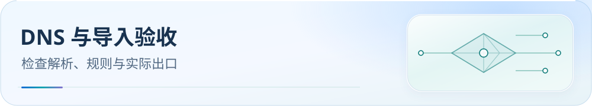
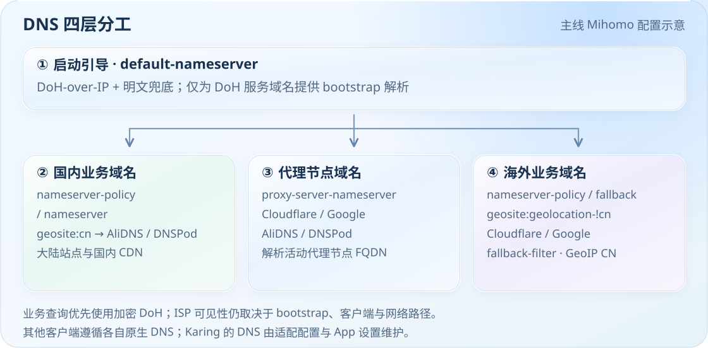

<picture>
  <source media="(max-width: 600px)" srcset="../assets/readme/page-dns-and-verification-mobile.svg">
  
</picture>

# DNS 设计与运行验证

看懂解析分工，按清单核对导入后的规则、DNS 与真实出口。

[](../README.md) [](downloads.md)

[项目首页](../../README.md) · [文档中心](../README.md) · [导入后验收](dns-and-verification.md#verification)

[平台边界](#platforms) · [业务策略来源](#business-dns) · [解析器地址](#resolvers) · [运行验证](#verification) · [问题入口](#troubleshooting)

## <a id="platforms"></a>DNS 分层与平台边界

仓库区分 bootstrap、业务域名和节点域名解析，业务查询优先使用 DoH。

### 私有节点 DNS：受限适配边界

Clash Party、FlClash 和 OpenClash 覆写只投影**活动代理节点 FQDN**所需的 DNS 提示。默认 `adaptive`，本地可选 `off / policy / adaptive`，均不改变策略组、规则或业务 DNS 基线。fake-ip 仅继承缺省/`blacklist` 的合法豁免，不转换 `whitelist` 或规则模式列表。

CMFA、Stash、Egern、Apple 配置、sing-box、v2rayN Xray、Passwall / Passwall2 是静态或路由产物，不自动读取机场 DNS。IPv6 bootstrap、通配符物化、静态端 Mixin、验证方法和“不保证零泄漏”的边界见 [私有节点 DNS 指南](../private-node-dns.md)；各端能力见[跨客户端能力矩阵](../client-capability-matrix.md)。

> **FlClash 应用层设置**
>
> 关联脚本后关闭「DNS 覆写」和「追加系统 DNS」；Android 使用应用排除名单时关闭 VPN「系统代理」。UI 二次覆盖与 VPN HTTP 代理可能破坏预期行为。完整设置和国内 APP 无法联网排查见 [FlClash 教程](../../Mihomo%E5%86%85%E6%A0%B8%E7%B3%BB/FlClash/README.md#应用层设置与-dns-所有权)。

**Clash Party v2.0.3+：** “已自动关闭 DNS 覆写”指客户端内置 `controlDns`；本仓库 JS 仍会写入 DNS。保持内置 DNS 覆写关闭，详见[教程](../../Mihomo%E5%86%85%E6%A0%B8%E7%B3%BB/Clash%20Party/README.md)。

**微信下载：** `dldir1.qq.com` 已有精确下载分流；下载组的实际出口和 Windows 进程 DIRECT 优先级见 [Clash Party 排障 Q9](../../Mihomo%E5%86%85%E6%A0%B8%E7%B3%BB/Clash%20Party/README.md#q9dldir1qqcom-是否已分流微信下载仍失败怎么排查)。

<details>
<summary>维护参考：业务 DNS 策略如何生成</summary>

### <a id="business-dns"></a>业务 DNS 策略来源与维护

业务域名 DNS policy 的唯一源数据是 `rulesets/source/business-dns-policy.json`，由 `routing-graph.getBusinessDnsPolicy()` 导出，编译器校验 provider、目标规则及 URL 后缀引用，再由同步器生成 Clash Party Smart/Normal、FlClash、CMFA 和 OpenClash Normal/Smart 六份投影。需要调整时先改源 JSON，并运行：

```bash
node tools/sync-business-dns-policy.js
node tools/sync-business-dns-policy.js --check
node --test tools/tests/business-dns-policy.test.js tools/tests/business-dns-sync.test.js
```

Stash 继续从 CMFA 生成器继承该 DNS policy。`routingReferences` 仅记录来源关联，不代表已证明远程规则集含有对应域名。Egern、SingBox 两个版本、Shadowrocket、Surge、Loon、Quantumult X 保留各自原生 DNS，不注入这份 Mihomo 业务表；v2rayN Xray 与 双内核系/Passwall/Passwall2 只交付路由/分流资产，不拥有 DNS 配置，不适用此 policy 投影。该变更不调整策略组结构或节点择路。

</details>

## <a id="resolvers"></a>DNS 四层分工

<picture>
  <source media="(max-width: 600px)" srcset="../assets/readme/dns-flow-mobile.svg">
  
</picture>

此图展示 Mihomo 系配置。`default-nameserver` 仅负责启动解析，优先 DoH-over-IP，并保留明文兜底；业务由 `nameserver-policy`、`nameserver` 和 `fallback` 接管。国内使用 AliDNS / DNSPod；节点域名可用 Cloudflare、Google、AliDNS、DNSPod；海外优先 Cloudflare / Google，并由 `fallback-filter.geoip-code: CN` 辅助过滤。实际 ISP 可见性仍取决于 bootstrap、客户端与网络路径。

<details>
<summary>查看完整 DNS 解析器地址</summary>

- **Bootstrap · DoH-over-IP**：`https://223.5.5.5/dns-query` · `https://223.6.6.6/dns-query` · `https://8.8.8.8/dns-query` · `https://1.1.1.1/dns-query`
- **AliDNS**：`https://dns.alidns.com/dns-query`
- **DNSPod**：`https://doh.pub/dns-query`
- **Cloudflare**：`https://cloudflare-dns.com/dns-query`
- **Google**：`https://dns.google/dns-query`

启动解析成功后，业务查询交给对应加密解析器；可用性和实际出站仍需查看客户端日志。

</details>

> 完整地址、YAML、验证命令及各端 DNS 状态表，见 [Clash Party 教程](../../Mihomo%E5%86%85%E6%A0%B8%E7%B3%BB/Clash%20Party/README.md)；订阅私有节点 DNS 的受限投影和静态端边界见 [docs/private-node-dns.md](../private-node-dns.md)。

---

## <a id="verification"></a>导入后运行验证

导入后检查节点、规则下载、命中和 DNS；此清单不能代替实际流量验收。

### 1. 节点与策略组

Mihomo / Stash / Apple 系客户端应看到 22 区域组 + 33 业务组；sing-box Full 应看到 54 个 selector / urltest 组；v2rayN Xray / Passwall 系没有业务策略组是正常限制。
### 2. 规则下载

Clash / OpenClash / CMFA / FlClash / Stash 里 `rule-providers` 不应有大面积 403 / 404；Surge / Loon / QX / Egern 看远程规则列表是否下载成功；sing-box 和 Passwall 系看 fused `.srs` 是否全部可用。
### 3. 广告与误伤

访问或规则测试 `paddle.com` 应命中 `🏦 金融支付`，`cloudflarestorage.com` 应命中 `🌐 国外网站`，都不是 `🛑 广告拦截`；小米账号/云服务域名应走 `DIRECT`。
### 4. 基础分类

`geosite:private` / 局域网应直连，`geosite:gfw` 应进入 `🚫 受限网站`，`geosite:category-ads-all` 应进入广告拦截。若客户端消费的是编译后规则集，检查等价分类命中，无需出现字面的 GEOSITE 规则。
### 5. DNS 路径

核对具体查询域名、解析器及出站；国内 DoH 是本仓库有意保留的路径，随机未分类域名也可能进入默认国内解析器。国家标签或 DoH 加密本身不证明“零泄漏”；排除 VPN 的 APP、浏览器安全 DNS 与 bootstrap 需分别检查。
### 6. 最终兜底

连接日志里落到 `🐟 漏网之鱼` 的域名要能解释；如果某个新服务长期落入 FINAL，再按 [GEOSITE 覆盖台账](../GEOSITE_COVERAGE_LEDGER.md) 判断是否补 provider。
### 7. 地区归类

按节点名或 tag 动态筛选的客户端中，yun hk01 / yun us01 / yun jp01 / yun sg01 / yun tw01 应进入对应地区组。sing-box Full、v2rayN Xray、Passwall / Passwall2 不从订阅节点名动态建组，属于架构限制而非匹配失败。

---


## <a id="troubleshooting"></a>遇到问题

先保留客户端版本、实际内核、导入模式、失败域名、规则命中与脱敏日志；勿公开订阅 URL、token、密码或节点内容。

- 规则下载异常：[规则资产交付说明](../rule-asset-delivery.md)。
- DNS 或国内 APP 异常：[私有节点 DNS](../private-node-dns.md)、[FlClash 教程](../../Mihomo%E5%86%85%E6%A0%B8%E7%B3%BB/FlClash/README.md)。
- 测速、QUIC 或远程连接：[流量选项](../traffic-options.md)、[ZeroTier UDP 代理](../zerotier-planet-proxy.md)（默认关闭）。
- 仍不能解决：[提交 Issue](https://github.com/ivansolis1989/Smart-Config-Kit/issues)，附上复现步骤与脱敏证据；[自动回复说明](../ai-issue-responder.md)。

---

[← 项目首页](../../README.md) · [文档索引](../README.md)
