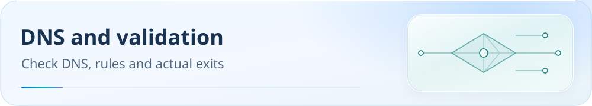
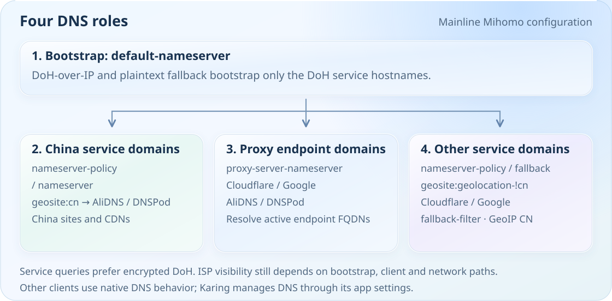

<picture>
  <source media="(max-width: 600px)" srcset="../assets/readme/page-dns-and-verification-mobile.svg">
  
</picture>

<a id="dns-设计与运行验证"></a>
# DNS design and runtime verification

**English** | [简体中文](dns-and-verification.zh-CN.md)

[Scope and limitations](../disclaimer.md)

Understand resolver responsibilities, then check imported rules, DNS paths, and actual connection exits.

[](../README.md) [](downloads.md)

[Project home](../../README.md) · [Documentation](../README.md) · [Post-import checks](dns-and-verification.md#verification)

[Platform boundaries](#platforms) · [Service-policy source](#business-dns) · [Resolver addresses](#resolvers) · [Runtime verification](#verification) · [Troubleshooting](#troubleshooting)

## <a id="platforms"></a>DNS layers and platform boundaries

The repository separates bootstrap resolution, service-domain resolution, and node-domain resolution. Service queries prefer DoH.

<a id="私有节点-dns受限适配边界"></a>
### Private-node DNS: limited adaptation scope

Clash Party, FlClash, and OpenClash overrides project only DNS hints needed by **active proxy-node FQDNs**. The default is `adaptive`; local choices `off / policy / adaptive` do not change policy groups, routing rules, or the service-DNS baseline. Fake-IP inherits valid exemptions only from absent/default or `blacklist` mode; it does not convert `whitelist` or rule-mode lists.

CMFA, Stash, Egern, Apple-client configurations, sing-box, v2rayN Xray, and Passwall / Passwall2 are static or routing-only outputs; they do not automatically read subscription-provider DNS settings. For IPv6 bootstrap, wildcard materialization, static-client Mixins, validation, and the absence of a zero-leak guarantee, see the [private-node DNS guide](../private-node-dns.md). See the [cross-client capability matrix](../client-capability-matrix.md) for individual capabilities.

> **FlClash app-layer settings**
>
> After linking the script, disable “DNS override” and “Append system DNS.” On Android, disable the VPN “System proxy” when using an app-exclusion list. A second UI override or VPN HTTP proxy can alter the intended behavior. For the complete settings and troubleshooting connectivity to China-specific apps, see the [FlClash guide](../../Mihomo%E5%86%85%E6%A0%B8%E7%B3%BB/FlClash/README.md#应用层设置与-dns-所有权).

**Clash Party v2.0.3+:** the “DNS override automatically disabled” message refers to the client’s built-in `controlDns`. This repository’s JS still writes DNS settings. Leave the built-in DNS override disabled; see the [guide](../../Mihomo%E5%86%85%E6%A0%B8%E7%B3%BB/Clash%20Party/README.md).

**WeChat downloads:** `dldir1.qq.com` already has an exact download-routing rule. For the download group’s actual exit and Windows process-DIRECT precedence, see [Clash Party troubleshooting Q9](../../Mihomo%E5%86%85%E6%A0%B8%E7%B3%BB/Clash%20Party/README.md#q9dldir1qqcom-是否已分流微信下载仍失败怎么排查).

<details>
<summary>Maintenance reference: how service-DNS policy is generated</summary>

### <a id="business-dns"></a>Service-DNS policy source and maintenance

The single source for service-domain DNS policy is `rulesets/source/business-dns-policy.json`, exported by `routing-graph.getBusinessDnsPolicy()`. The compiler checks provider, target-rule, and URL-suffix references. The synchronizer then generates six projections: Clash Party Smart/Normal, FlClash, CMFA, and OpenClash Normal/Smart. To adjust the policy, change the source JSON first, then run:

```bash
node tools/sync-business-dns-policy.js
node tools/sync-business-dns-policy.js --check
node --test tools/tests/business-dns-policy.test.js tools/tests/business-dns-sync.test.js
```

Stash continues to inherit this DNS policy through the CMFA-based generator. `routingReferences` records source associations; it does not prove that remote rule sets contain particular domains. Egern, both SingBox versions, Shadowrocket, Surge, Loon, and Quantumult X retain their native DNS configuration without this Mihomo service table. v2rayN Xray and the dual-core-family Passwall/Passwall2 outputs supply only routing assets and do not own DNS settings, so this projection does not apply. The projection does not change policy-group structure or node selection.

</details>

## <a id="resolvers"></a>Four DNS responsibilities

<picture>
  <source media="(max-width: 600px)" srcset="../assets/readme/dns-flow-mobile.svg">
  
</picture>

This diagram describes the Mihomo-family configuration. `default-nameserver` handles bootstrap only, preferring DoH-over-IP while retaining plaintext fallback. Service queries are handled by `nameserver-policy`, `nameserver`, and `fallback`. The existing China-specific category uses AliDNS / DNSPod. Node domains can use Cloudflare, Google, AliDNS, or DNSPod. Non-China categories prefer Cloudflare / Google, with additional filtering through `fallback-filter.geoip-code: CN`. These are current policy defaults, not location-based recommendations. Actual ISP visibility depends on bootstrap, client behavior, and the network path.

<details>
<summary>Complete DNS resolver addresses</summary>

- **Bootstrap · DoH-over-IP**: `https://223.5.5.5/dns-query` · `https://223.6.6.6/dns-query` · `https://8.8.8.8/dns-query` · `https://1.1.1.1/dns-query`
- **AliDNS**: `https://dns.alidns.com/dns-query`
- **DNSPod**: `https://doh.pub/dns-query`
- **Cloudflare**: `https://cloudflare-dns.com/dns-query`
- **Google**: `https://dns.google/dns-query`

After successful bootstrap resolution, service queries go to their corresponding encrypted resolvers. Verify availability and actual outbounds in client logs.

</details>

> For complete addresses, YAML, verification commands, and per-client DNS status, see the [Clash Party guide](../../Mihomo%E5%86%85%E6%A0%B8%E7%B3%BB/Clash%20Party/README.md). For limited projection of private subscription-node DNS and static-client boundaries, see [docs/private-node-dns.md](../private-node-dns.md).

---

## <a id="verification"></a>Post-import runtime verification

After import, check nodes, rule downloads, matching, and DNS. This checklist does not replace real-traffic validation.

<a id="1-节点与策略组"></a>
### 1. Nodes and policy groups

Mihomo, Stash, and Apple-family clients should show 22 regional groups and 33 service groups. sing-box Full should show 54 selector / urltest groups. The absence of service policy groups in v2rayN Xray and Passwall-family outputs is an expected limitation.
<a id="2-规则下载"></a>
### 2. Rule downloads

Clash / OpenClash / CMFA / FlClash / Stash `rule-providers` should not show widespread 403 / 404 errors. In Surge / Loon / QX / Egern, confirm remote-rule downloads. In sing-box and Passwall-family clients, check that every required fused `.srs` asset is available.
<a id="3-广告与误伤"></a>
### 3. Ad blocking and false positives

A connection or rule test for `paddle.com` should match `🏦 金融支付` (financial payments); `cloudflarestorage.com` should match `🌐 国外网站` (international websites). Neither should match `🛑 广告拦截` (ad blocking). Xiaomi account/cloud-service domains should use `DIRECT`.
<a id="4-基础分类"></a>
### 4. Base categories

`geosite:private` / LAN traffic should connect directly; `geosite:gfw` should enter `🚫 受限网站` (the restricted-site category); `geosite:category-ads-all` should enter ad blocking. For clients consuming compiled rule sets, check equivalent category matches; literal GEOSITE rules need not appear.
<a id="5-dns-路径"></a>
### 5. DNS paths

Check the specific query domain, resolver, and outbound. China-based DoH is an intentional path in the existing configuration, and unclassified domains can also reach its default China-based resolver. A country label or DoH encryption alone does not prove “zero leakage.” Check VPN-excluded apps, browser secure DNS, and bootstrap separately.
<a id="6-最终兜底"></a>
### 6. Final fallback

Understand why domains in connection logs reach `🐟 漏网之鱼` (final fallback). If a new service repeatedly falls through to FINAL, use the [GEOSITE coverage ledger](../GEOSITE_COVERAGE_LEDGER.md) to decide whether an additional provider is justified.
<a id="7-地区归类"></a>
### 7. Regional classification

In clients that filter dynamically by node name or tag, yun hk01 / yun us01 / yun jp01 / yun sg01 / yun tw01 should enter their corresponding regional groups. sing-box Full, v2rayN Xray, and Passwall / Passwall2 do not create groups dynamically from subscription-node names. That is an architectural limitation, not a matching failure.

---


## <a id="troubleshooting"></a>Troubleshooting

Record the client version, actual core, import mode, failing domain, rule match, and redacted logs. Do not publish subscription URLs, tokens, passwords, or node details.

- Rule download errors: [Rule-asset delivery](../rule-asset-delivery.md).
- DNS or China-specific app issues: [Private-node DNS](../private-node-dns.md) and the [FlClash guide](../../Mihomo%E5%86%85%E6%A0%B8%E7%B3%BB/FlClash/README.md).
- Health checks, QUIC, or remote connections: [Traffic options](../traffic-options.md) and [ZeroTier UDP proxy](../zerotier-planet-proxy.md), which is off by default.
- Still unresolved: [Open an issue](https://github.com/ivansolis1989/Smart-Config-Kit/issues) with reproduction steps and redacted evidence. See [automated reply behavior](../ai-issue-responder.md).

---

[← Project home](../../README.md) · [Documentation index](../README.md)
