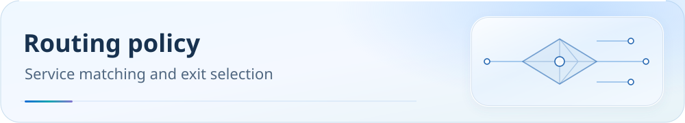
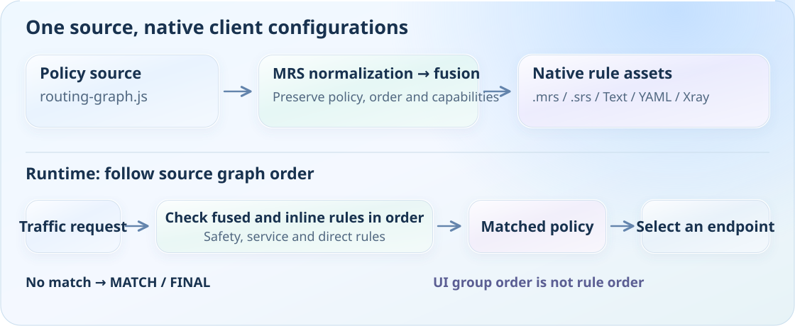
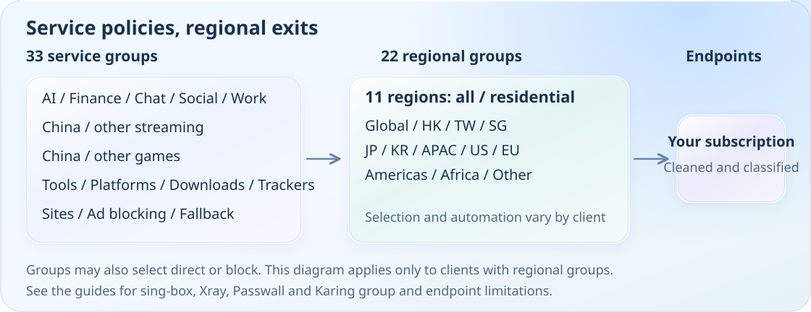

<picture>
  <source media="(max-width: 600px)" srcset="../assets/readme/page-routing-policy-mobile.svg">
  
</picture>

# Routing architecture and service policies

**English** | [简体中文](routing-policy.zh-CN.md)

[Scope and limitations](../disclaimer.md)

Understand how service policies, regional exits, and rule matches relate to one shared rule source.

 

[Project home](../../README.md) · [Documentation](../README.md) · [Post-import checks](dns-and-verification.md#verification)

[Architecture](#architecture) · [Service groups and sources](#business-groups) · [Coverage and constraints](#coverage)

## From rule source to clients

<picture>
  <source media="(max-width: 600px)" srcset="../assets/readme/routing-flow-mobile.svg">
  
</picture>

Subscription nodes are cleaned and classified by region and residential-network labels. The regional layer selects routes; the service layer expresses their purpose. `routing-graph.js` compiles rules in their original order into each client’s native format. DNS, sniffing, and final fallback depend on platform capabilities. Refer to each client’s guide for Smart / url-test, static outbound, and Karing import boundaries.

---

## 33 service groups and regional selection

Service groups select a purpose, while regional groups select an exit. The layers are maintained separately, and rules match in order. Karing maps service proxy actions to the currently selected node; it does not automatically import this nested group structure.

<picture>
  <source media="(max-width: 600px)" srcset="../assets/readme/policy-map-mobile.svg">
  
</picture>

### Service groups and rule-source reference

> The tables list principal source-graph inputs and origins, not the final provider inventory. The compiler generates `rulesets/generated/fused/**/scki-fused-*` according to policy, order, and platform capability.

Compilation preserves shared-source semantics, deduplicates within segments, and retains native GEOIP behavior. Parsing errors, invalid residual rules, or exceeded budgets stop the build. See the [rule-quality ledger](../rule-quality.md) for audit evidence.

#### Work, communication, and payments

| Service group | Principal input examples and sources |
| --- | --- |
| AI services (`🤖 AI 服务`) | `openai` `claude` `gemini` `copilot` `szkane-ai` `acc-copilot` `vpsdance-ai-coding` Sources: MetaCubeX / blackmatrix7 / szkane / Accademia / VPSDance |
| Cryptocurrency (`💰 加密货币`) | `cryptocurrency` `binance` `szkane-web3` Sources: blackmatrix7 / szkane |
| Financial payments (`🏦 金融支付`) | `paypal` `stripe` `paddle.com` `visa` `tigerfintech` `acc-bank-*` `acc-vf-*` Sources: blackmatrix7 / Accademia / SCKI supplemental / local false-positive allowlist |
| Messaging (`💬 即时通讯`) | `telegram` `telegram-ip` `discord` `whatsapp` `line` `kakaotalk` `kakaotalk.com` `acc-signal` Sources: MetaCubeX / blackmatrix7 / Accademia / SCKI supplemental |
| Social media (`📱 社交媒体`) | `twitter` `twitter-ip` `tiktok` `facebook` `instagram` `snapchat` `reddit` Sources: MetaCubeX / blackmatrix7 |
| Meetings and collaboration (`🧑‍💼 会议协作`) | `zoom` `slack` `teams` `atlassian` `notion` `remotedesktop` `acc-rustdesk` `rustdesk.com` Sources: ACL4SSR / blackmatrix7 / Accademia / SCKI supplemental |

#### Streaming and regional content

| Service group | Principal input examples and sources |
| --- | --- |
| Chinese streaming (`📺 国内流媒体`) | `bilibili` `iqiyi` `youku` `tencentvideo` `douyin` `zjcdn.com` `neteasemusic` Sources: blackmatrix7 / SCKI supplemental / local early-match guards |
| TikTok (`🎵 TikTok`) | `tiktok` Sources: MetaCubeX |
| Netflix (`🎥 Netflix`) | `netflix` `netflix-ip` `szkane-netflixip` Sources: MetaCubeX / szkane |
| Disney+ (`🎬 Disney+`) | `disney` Sources: blackmatrix7 |
| HBO/Max (`📡 HBO/Max`) | `hbo` Sources: blackmatrix7 |
| Hulu (`📺 Hulu`) | `hulu` Sources: blackmatrix7 |
| Prime Video (`🎬 Prime Video`) | `primevideo` `amazon` Sources: blackmatrix7 |
| YouTube (`📹 YouTube`) | `youtube` Sources: MetaCubeX |
| Music streaming (`🎵 音乐流媒体`) | `spotify` `tidal` `deezer` `soundcloud` `pandora` `lastfm` `qobuz` `overcast` Sources: blackmatrix7 |
| Hong Kong streaming (`🇭🇰 香港流媒体`) | `mytvsuper` `tvb` `nowe` `rthk` `szkane-bilihmt` Sources: blackmatrix7 / szkane |
| Taiwan streaming (`🇹🇼 台湾流媒体`) | `bahamut` `kktv` `litv` `hamivideo` `linetv` `friday` Sources: blackmatrix7 |
| Japanese and Korean streaming (`🇯🇵 日韩流媒体`) | `abema` `dazn` `dmm` `tver` `niconico` `rakuten` Sources: blackmatrix7 |
| European streaming (`🇪🇺 欧洲流媒体`) | `bbc` `itv` `all4` `my5` `skygo` `britboxuk` `szkane-uk` Sources: MetaCubeX / blackmatrix7 / szkane |
| Other international streaming (`🌐 其他国外流媒体`) | `viu` `biliintl` `iqiyiintl` `wetv` `viki` `paramount` `peacock` `twitch` `vimeo` `dailymotion` `acc-kwai` Sources: blackmatrix7 / Accademia |

#### Games, platforms, and tools

| Service group | Principal input examples and sources |
| --- | --- |
| Chinese games (`🕹️ 国内游戏`) | `mihoyo/yuanshen` `netease` `wegame` `steamcn` `majsoul` `battlenet.com.cn` Sources: local early-match rules + blackmatrix7 / SCKI supplemental |
| International games (`🎮 国外游戏`) | `steam` `epic` `playstation` `xbox` `riot` `ea` `hoyoverse` Sources: blackmatrix7 (broad rules follow China-specific game rules) |
| Google services (`🔍 Google 服务`) | `google` `google-ip` `googlefcm` `scholar` (Apple outputs also include `GoogleSearch` `GoogleDrive` `GoogleEarth`) Sources: MetaCubeX / blackmatrix7 |
| Tools and services (`🔧 工具与服务`) | `bing` `yandex` `github` `docker` `gitlab` `python` `developer` `szkane-developer` Sources: blackmatrix7 / szkane |
| Microsoft services (`Ⓜ️ 微软服务`) | `onedrive` `microsoft` `microsoftedge` `acc-microsoftapps` Sources: blackmatrix7 / Accademia |
| Apple services (`🍎 苹果服务`) | `apple` `icloud` `appstore` `appletv` `applemusic` `acc-apple` `acc-applenews` Sources: blackmatrix7 / Accademia |
| Downloads and updates (`📥 下载更新`) | `systemota` `download` `ubuntu` `mozilla` `android` `acc-macappupgrade` Sources: blackmatrix7 / Accademia |
| BT/PT trackers (`🛰️ BT/PT Tracker`) | `privatetracker` `acc-emuleserver` Sources: blackmatrix7 / Accademia |

#### Websites, fallback, and security

| Service group | Principal input examples and sources |
| --- | --- |
| China-specific websites (`🏠 国内网站`) | `amap` / `GaoDe` `cn` `cn-ip` `acc-chinamax` `acc-geo-d-asia-china` Sources: MetaCubeX / blackmatrix7 / Accademia |
| Restricted-site category (`🚫 受限网站`) | `loyalsoldier-gfw` `loyalsoldier-greatfire` `GEOSITE,gfw` `szkane-proxygfw` Sources: Loyalsoldier / MetaCubeX / szkane |
| International websites (`🌐 国外网站`) | `proxy` `cnn` `nytimes` `bloomberg` `ebay` `wikipedia` `acc-waybackmachine` `mail` `protonmail` `cloudflare` `fastly` `akamai` Sources: blackmatrix7 / Accademia / szkane / MetaCubeX |
| Final fallback (`🐟 漏网之鱼`) | `MATCH` / `FINAL`, plus native platform fallback Sources: core fallback (not a fixed provider) |
| Ad blocking (`🛑 广告拦截`) | `anti-ad` `sukka-phishing` `hagezi-tif` `advertising` `privacy` `GEOSITE,category-ads-all` `acc-unsupportvpn` Sources: DustinWin / SukkaW / Hagezi / blackmatrix7 / MetaCubeX / Accademia |

Final rule formats by platform

Compiled outputs are distributed by platform:

- Mihomo / CMFA / OpenClash / FlClash / Stash: `scki-fused-*-domain.mrs`, `scki-fused-*-ipcidr.mrs`, `scki-fused-*-residual.yaml`
- Shadowrocket / Surge / Loon / Quantumult X / Egern: `rulesets/generated/fused/<platform>/scki-fused-*`
- sing-box: `rulesets/generated/fused/sing-box/scki-fused-*.srs`; see the relevant guide for GUI import limits.
- v2rayN Xray: fused sing-box JSON flattened into Xray `RuleObject` entries.
- Passwall / Passwall2: 78 `rule-set:remote` fused `.srs` entries, only for the sing-box routing backend.

---

## Coverage and compilation constraints

> Final configurations consume fused outputs. Only necessary port, logical-combination, fallback, DNS/geo, and similar rules remain inline. See the [coverage ledger](../GEOSITE_COVERAGE_LEDGER.md).

### Emerging services

New AI, Web3, and developer services may not yet be covered by existing lists. Inputs such as `szkane-ai`, `vpsdance-ai-coding`, `acc-grok`, and SCKI supplemental enter the source graph before compilation into fused assets.

Examples: cursor.com · zed.dev · windsurf.com · openrouter.ai.

### Splitting broad categories

`geosite:apple` and `geosite:google` are broad categories. They cannot express finer decisions such as direct App Store traffic or proxied Google workflows. blackmatrix7, Accademia, and SCKI supplemental provide individual service inputs, which are fused according to the final service groups.

Example: separate decisions for individual services within the Apple, Google, and Microsoft families.

### Defense in depth

`category-ads-all` alone does not cover every phishing, malware, SDK telemetry, or DNS-hijacking risk. anti-AD, Sukka, Hagezi, bm7, and Accademia inputs are combined into the `🛑 广告拦截` (ad blocking) fused output. Combining lists is not a guarantee of complete protection.

Example: anti-AD + sukka-phishing + hagezi-tif.

### Regional supplemental coverage

The current configuration includes supplemental coverage for China-specific SDKs, Hong Kong/Macau/Taiwan service variants, and selected IoT, payment, and regional CDN domains. Inputs from szkane, Accademia, and SCKI supplemental enter the fused outputs. These are descriptions of existing categories, not recommendations based on a user’s location.

Examples: Bilibili Hong Kong/Macau/Taiwan variants, Aqara IoT, and regional financial/payment domains.

### Cross-client consistency

GEOSITE, GEOIP, and ASN support differs across clients. Maintaining separate ad hoc rules can introduce drift. One source graph is compiled into `.mrs`, `.srs`, Apple-client text rules, Egern YAML, Xray RuleObject, and Passwall shunt formats.

Example: v2rayN Xray and Passwall no longer maintain a handwritten 33-group fallback table.

> **Addition criterion:** reject or remove an input that overlaps native geosite by more than 95% without an ordering, platform, or false-positive benefit. Geo databases remain infrastructure; ordinary classifications are represented in fused outputs.

---

[← Project home](../../README.md) · [Documentation index](../README.md)
