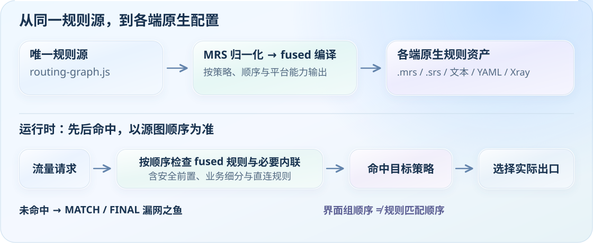
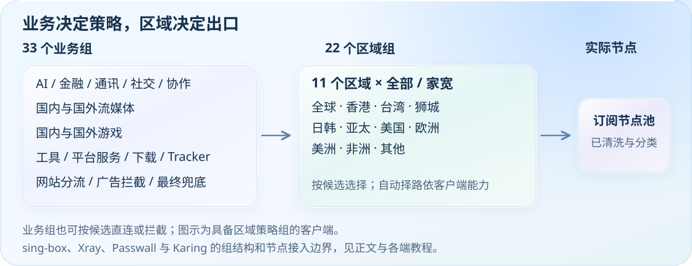

# 分流架构与业务策略

了解单一规则源如何编译成各端原生规则，以及区域、业务和最终兜底的关系。

[← 项目首页](../../README.md) · [文档索引](../README.md)

[架构概览](#architecture) · [业务组与来源](#business-groups) · [覆盖与约束](#coverage)

<picture>
  <source media="(max-width: 600px)" srcset="../assets/readme/routing-flow-mobile.svg">
  
</picture>

订阅节点先清洗、识别地区与家宽，再由区域层负责择路、业务层表达用途。`routing-graph.js` 按原顺序编译规则，各端消费对应原生格式；DNS、嗅探和最终兜底按平台能力设置。Smart / url-test、静态出站和 Karing 的导入边界以各端教程为准。

---

## 33 个业务组与区域选择

业务组负责选择用途，区域组负责选择出口；两层各自维护，规则按顺序命中。Karing 将业务代理适配为当前选择节点，不自动导入此嵌套组结构。

<picture>
  <source media="(max-width: 600px)" srcset="../assets/readme/policy-map-mobile.svg">
  
</picture>

### 🗂️ 代理组与主要 Rule-Providers 对照（source graph 输入）

> 表中仅列主要源图输入及来源，不是最终 provider 清单；编译器按策略、顺序和平台能力生成 `rulesets/generated/fused/**/scki-fused-*`。

编译保留同源语义、段内去重和原生 GEOIP；解析失败、非法残余或预算超限即停止。审计依据见[规则质量台账](../rule-quality.md)。

#### 工作、通讯与支付

| 业务组 | 主要输入示例与来源 |
| --- | --- |
| 🤖 AI 服务 | `openai` `claude` `gemini` `copilot` `szkane-ai` `acc-copilot` `vpsdance-ai-coding` 来源：MetaCubeX / blackmatrix7 / szkane / Accademia / VPSDance |
| 💰 加密货币 | `cryptocurrency` `binance` `szkane-web3` 来源：blackmatrix7 / szkane |
| 🏦 金融支付 | `paypal` `stripe` `paddle.com` `visa` `tigerfintech` `acc-bank-*` `acc-vf-*` 来源：blackmatrix7 / Accademia / SCKI supplemental / 本地误伤白名单 |
| 💬 即时通讯 | `telegram` `telegram-ip` `discord` `whatsapp` `line` `kakaotalk` `kakaotalk.com` `acc-signal` 来源：MetaCubeX / blackmatrix7 / Accademia / SCKI supplemental |
| 📱 社交媒体 | `twitter` `twitter-ip` `tiktok` `facebook` `instagram` `snapchat` `reddit` 来源：MetaCubeX / blackmatrix7 |
| 🧑‍💼 会议协作 | `zoom` `slack` `teams` `atlassian` `notion` `remotedesktop` `acc-rustdesk` `rustdesk.com` 来源：ACL4SSR / blackmatrix7 / Accademia / SCKI supplemental |

#### 流媒体与地区内容

| 业务组 | 主要输入示例与来源 |
| --- | --- |
| 📺 国内流媒体 | `bilibili` `iqiyi` `youku` `tencentvideo` `douyin` `zjcdn.com` `neteasemusic` 来源：blackmatrix7 / SCKI supplemental / 本地前置守卫 |
| 🎵 TikTok | `tiktok` 来源：MetaCubeX |
| 🎥 Netflix | `netflix` `netflix-ip` `szkane-netflixip` 来源：MetaCubeX / szkane |
| 🎬 Disney+ | `disney` 来源：blackmatrix7 |
| 📡 HBO/Max | `hbo` 来源：blackmatrix7 |
| 📺 Hulu | `hulu` 来源：blackmatrix7 |
| 🎬 Prime Video | `primevideo` `amazon` 来源：blackmatrix7 |
| 📹 YouTube | `youtube` 来源：MetaCubeX |
| 🎵 音乐流媒体 | `spotify` `tidal` `deezer` `soundcloud` `pandora` `lastfm` `qobuz` `overcast` 来源：blackmatrix7 |
| 🇭🇰 香港流媒体 | `mytvsuper` `tvb` `nowe` `rthk` `szkane-bilihmt` 来源：blackmatrix7 / szkane |
| 🇹🇼 台湾流媒体 | `bahamut` `kktv` `litv` `hamivideo` `linetv` `friday` 来源：blackmatrix7 |
| 🇯🇵 日韩流媒体 | `abema` `dazn` `dmm` `tver` `niconico` `rakuten` 来源：blackmatrix7 |
| 🇪🇺 欧洲流媒体 | `bbc` `itv` `all4` `my5` `skygo` `britboxuk` `szkane-uk` 来源：MetaCubeX / blackmatrix7 / szkane |
| 🌐 其他国外流媒体 | `viu` `biliintl` `iqiyiintl` `wetv` `viki` `paramount` `peacock` `twitch` `vimeo` `dailymotion` `acc-kwai` 来源：blackmatrix7 / Accademia |

#### 游戏、平台与工具

| 业务组 | 主要输入示例与来源 |
| --- | --- |
| 🕹️ 国内游戏 | `mihoyo/yuanshen` `netease` `wegame` `steamcn` `majsoul` `battlenet.com.cn` 来源：本地前置 + blackmatrix7 / SCKI supplemental |
| 🎮 国外游戏 | `steam` `epic` `playstation` `xbox` `riot` `ea` `hoyoverse` 来源：blackmatrix7（宽规则在国内游戏之后） |
| 🔍 Google 服务 | `google` `google-ip` `scholar`（Apple 端另含 `GoogleSearch` `GoogleDrive` `GoogleEarth`） 来源：MetaCubeX / blackmatrix7 |
| 🔧 工具与服务 | `bing` `yandex` `github` `docker` `gitlab` `python` `developer` `szkane-developer` 来源：blackmatrix7 / szkane |
| Ⓜ️ 微软服务 | `onedrive` `microsoft` `microsoftedge` `acc-microsoftapps` 来源：blackmatrix7 / Accademia |
| 🍎 苹果服务 | `apple` `icloud` `appstore` `appletv` `applemusic` `acc-apple` `acc-applenews` 来源：blackmatrix7 / Accademia |
| 📥 下载更新 | `googlefcm` `systemota` `download` `ubuntu` `mozilla` `android` `acc-macappupgrade` 来源：blackmatrix7 / Accademia |
| 🛰️ BT/PT Tracker | `privatetracker` `acc-emuleserver` 来源：blackmatrix7 / Accademia |

#### 网站、兜底与安全

| 业务组 | 主要输入示例与来源 |
| --- | --- |
| 🏠 国内网站 | `amap` / `GaoDe` `cn` `cn-ip` `acc-chinamax` `acc-geo-d-asia-china` 来源：MetaCubeX / blackmatrix7 / Accademia |
| 🚫 受限网站 | `loyalsoldier-gfw` `loyalsoldier-greatfire` `GEOSITE,gfw` `szkane-proxygfw` 来源：Loyalsoldier / MetaCubeX / szkane |
| 🌐 国外网站 | `proxy` `cnn` `nytimes` `bloomberg` `ebay` `wikipedia` `acc-waybackmachine` `mail` `protonmail` `cloudflare` `fastly` `akamai` 来源：blackmatrix7 / Accademia / szkane / MetaCubeX |
| 🐟 漏网之鱼 | `MATCH` / `FINAL`，以及平台原生兜底能力 来源：内核兜底（非固定 provider） |
| 🛑 广告拦截 | `anti-ad` `sukka-phishing` `hagezi-tif` `advertising` `privacy` `GEOSITE,category-ads-all` `acc-unsupportvpn` 来源：DustinWin / SukkaW / Hagezi / blackmatrix7 / MetaCubeX / Accademia |

最终编译输出按平台分发：

- Mihomo / CMFA / OpenClash / FlClash / Stash：`scki-fused-*-domain.mrs`、`scki-fused-*-ipcidr.mrs`、`scki-fused-*-residual.yaml`
- Shadowrocket / Surge / Loon / Quantumult X / Egern：`rulesets/generated/fused/<platform>/scki-fused-*`
- sing-box：`rulesets/generated/fused/sing-box/scki-fused-*.srs`；GUI 导入边界见对应教程
- v2rayN Xray：由 fused sing-box JSON 展平成 Xray `RuleObject`
- Passwall / Passwall2：78 条 `rule-set:remote` fused `.srs`，仅用于 sing-box 分流后端

---

## 规则覆盖与编译约束

> 最终配置消费 fused 产物；仅端口、逻辑组合、兜底及 DNS/geo 等必要规则保留内联。覆盖审查见[台账](../GEOSITE_COVERAGE_LEDGER.md)。

### 新兴服务

新 AI / Web3 / 开发工具上线后通常滞后收录。`szkane-ai` / `vpsdance-ai-coding` / `acc-grok` / SCKI supplemental 进入 source graph，再编译成 fused。

例子：cursor.com · zed.dev · windsurf.com · openrouter.ai。

### 子类拆分

`geosite:apple` / `geosite:google` 是粗分类，无法表达 AppStore 直连、Google 工作流代理等细分决策。blackmatrix7 / Accademia / SCKI supplemental 拆成子服务输入，再按最终业务组融合。

例子：Apple / Google / Microsoft 家族各子服务独立决策。

### 安全纵深

`category-ads-all` 不能覆盖钓鱼、恶意软件、SDK 埋点、DNS 劫持等完整风险面。anti-AD / Sukka / Hagezi / bm7 / Accademia 多源合并到 `🛑 广告拦截` fused 产物。

例子：anti-AD + sukka-phishing + hagezi-tif。

### 地区长尾

国际社区不稳定维护中国特有 SDK、港澳台细分、IoT / 支付 / 本土 CDN 长尾。szkane / Accademia / SCKI supplemental 补齐后进入 fused 输出。

例子：B 站港澳台版 · 绿米 IoT · 本土金融支付域名。

### 跨端一致性

不同客户端对 GEOSITE/GEOIP/ASN 支持差异大，直接散写会造成端间漂移。同一 source graph 编译为 `.mrs` / `.srs` / Apple 文本规则 / Egern YAML / Xray RuleObject / Passwall shunt。

例子：v2rayN Xray 与 Passwall 不再维护手写 33 组降级表。

> **加法原则**：和原生 geosite >95% 重叠且没有顺序、平台或误伤收益 → 拒绝加入或删除；Geo 数据库保留为基础设施，普通分类沉淀到 fused 输出。

---

[← 项目首页](../../README.md) · [文档索引](../README.md)
