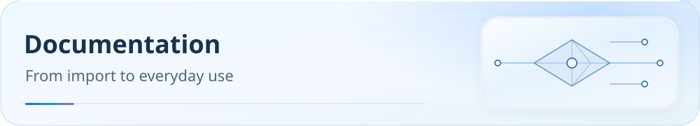

<picture>
  <source media="(max-width: 600px)" srcset="../assets/readme/page-docs-mobile.svg">
  
</picture>

<a id="webrtc-隐私与连接验收"></a>
# WebRTC privacy and connection validation

**English** | [简体中文](webrtc-privacy.zh-CN.md)

[Scope and limitations](../disclaimer.md)

Rule-based routing retains direct traffic. A proxied web page does not imply that WebRTC initiated by the same page uses the proxy exit. On Windows, you can optionally reject UDP from specified browsers, then validate the result using browser privacy policies and actual connection records.

[Documentation](../README.md) · [DNS and post-import checks](dns-and-verification.md) · [Clash Party](../../Mihomo内核系/Clash%20Party/README.md) · [FlClash](../../Mihomo内核系/FlClash/README.md)

<a id="为什么-tun-开着仍可能显示本地公网-ip"></a>
## Why the local public IP may appear with TUN enabled

Before service routing, the current source graph sends destination ports `3478`, `3479`, `5349`, `19302`, `19305`, and `19307` to `DIRECT` for STUN/TURN and NAT-discovery compatibility. These are destination-port rules, not a protocol-aware WebRTC firewall. Domains including `stun.l.google.com` are also in the fake-IP exclusion list.

After TUN intercepts a connection, routing rules still select its exit. Entering TUN and passing through a proxy node are different events. A real DNS answer for STUN does not force direct routing; the `DIRECT` rules above determine the exit here. DNS encryption, fake-IP, and sniffing options alone do not guarantee that WebRTC will hide your public IP.

**Disabling the client’s “DNS override” is the normal setup after linking this repository’s script.** This disables the app’s second override; the script-generated Mihomo DNS remains active. That switch alone does not establish a DNS failure. Inspect the effective configuration.

<a id="windows启用浏览器-udp-保护"></a>
## Windows: enable browser UDP protection

This option applies to **Clash Party Smart / Normal and FlClash JS on Windows**, matching only `chrome.exe`, `msedge.exe`, and `firefox.exe`. It is off by default. When enabled, it rejects all UDP from these three processes, including UDP/19302, other STUN ports, and HTTP/3, regardless of STUN-domain lists or node UDP support.

1. Open the [online configuration page](https://ivansolis1989.github.io/Smart-Config-Kit/), choose your client, and set **Windows browser UDP** to **Reject (reject)** in the optional settings. Download the JS. You can also use the [offline configuration page](../configuration.html).
2. Save the download as a separately named local override and link it to your node subscription, preserving this choice. Do not overwrite local options through automatic updates from the official Raw URL. Choose either Clash Party Smart or Normal; follow the relevant client’s import guide.
3. Enable TUN, use rule mode, and reapply the configuration. Confirm that `find-process-mode: strict` remains active in the final configuration and identifies the browser process. The rule cannot protect a browser excluded by the client, unidentified by process detection, or bypassing TUN.
4. Retest and confirm that browser UDP connections hit the `AND` rejection rule with outbound `REJECT`. Web-page TCP requests continue to follow service rules. Then check whether your usual web calls and screen sharing still work.

The option comes from the trusted local constant `SCKI_BROWSER_UDP_POLICY`; subscription content and environment variables cannot enable it. It rejects browser UDP before regular routing and QUIC service exceptions. Other apps retain the original rules, including default direct STUN/TURN compatibility paths. To restore the previous behavior, choose Off (off), then download, link, and apply the configuration again.

Advanced users can preview changes to an existing local JS file that supports the option, then save. Saving backs up the original file and reads the result back:

```powershell
node tools/configure.js --target 'D:\Configs\local.js' --browser-udp reject --dry-run
node tools/configure.js --target 'D:\Configs\local.js' --browser-udp reject
```

If an older script lacks this capability, the tool refuses to enable it. Update to a supporting version first. Updating a local script preserves the selected protection rather than silently turning it off.

**This does not disable all WebRTC.** UDP calls may fail or fall back to TCP/TURN. TCP/TURN, browser host candidates, and connections that never enter the core still require browser policy and actual validation. Browser process names and detection differ on Android, macOS, and Linux, so this Windows option does not apply there. AEROVE Lite, OpenClash, and other native configurations do not provide this option in this revision; successful import does not mean the protection is enabled.

<a id="选择适合自己的方式"></a>
## Choose an approach

| Requirement | Approach | Tradeoff |
| --- | --- | --- |
| Prioritize calls and NAT traversal | Keep default routing | STUN may reveal the local public IP |
| Prevent UDP from the specified Windows browsers | Enable browser UDP protection above | Affects browser HTTP/3 and UDP calls |
| Restrict browser UDP | Use browser WebRTC policy | Some calls may fail or use relays |
| Do not use WebRTC | Disable PeerConnection in a supporting browser | Affects web calls and screen sharing |

Chrome provides the enterprise policy `WebRtcIPHandling`; the value `disable_non_proxied_udp` restricts UDP that does not pass through the browser’s proxy. Configure it for the relevant browser according to the [official Chrome policy](https://chromeenterprise.google/policies/#WebRtcIPHandling), then reload `chrome://policy` and confirm acceptance. Fully exit and reopen the browser before testing. An administrator should configure devices with existing managed policies; do not overwrite managed values. Chrome extensions can also manage this privacy tradeoff through the official [privacy API](https://developer.chrome.com/docs/extensions/reference/api/privacy#property-network-webRTCIPHandlingPolicy).

For manual Windows Chrome configuration, use registry key `HKEY_CURRENT_USER\Software\Policies\Google\Chrome` and set the string value `WebRtcIPHandling` to `disable_non_proxied_udp`. Export the key and record the original value first. Change only this value; restore the original when reverting, or delete only the added value if it did not previously exist. A policy-page error or rejection means the setting is not verified as active. This browser setting requires an explicit user choice; repository scripts and the offline form do not write it for you.

This is not a Mihomo DNS setting. A browser may not treat TUN alone as a configured proxy. Verify final candidates and connections rather than assuming the policy name guarantees proxied traffic. If retaining WebRTC calls, also validate the proxy path, node UDP support, or TCP/TURN relay availability.

Firefox supports restricting or disabling PeerConnection. Its [official privacy API](https://developer.mozilla.org/en-US/docs/Mozilla/Add-ons/WebExtensions/API/privacy/network) distinguishes `peerConnectionEnabled` from IP-handling policy. Disabling it prevents pages from establishing WebRTC peer connections. Consult each browser’s official documentation for available interfaces, policies, and values. To revert, restore the original browser settings and retest calls.

To disable PeerConnection completely in Firefox desktop, record the original `media.peerconnection.enabled` value in `about:config`, set it to `false`, and fully exit and reopen the browser. Restore the original value to revert. [Mozilla’s WebRTC privacy documentation](https://wiki.mozilla.org/Media/WebRTC/Privacy) describes this control.

**Hiding LAN host candidates does not hide the public address discovered by STUN.** Blocking a few common ports is not complete protection: servers may use other ports, and TURN can use TCP/443. Routing known STUN traffic to a proxy is also insufficient by itself. The [official Mihomo rule documentation](https://wiki.metacubex.one/config/rules/) notes that UDP may continue matching later rules if the selected node does not support UDP.

<a id="按这个顺序验收"></a>
## Validate in this order

1. On the same browser and network, open [BrowserLeaks WebRTC](https://browserleaks.com/webrtc). Distinguish the page’s `Remote IP` from WebRTC’s `Public IP Address` and `Local IP Address`. Record whether candidates exist and whether public addresses match.
2. Open the client’s connection log, retest, and find `stun.l.google.com`, UDP/19302, or the actual STUN/TURN destination. Record the transport protocol, destination port, matched rule, and outbound chain. A TCP web request’s exit is not a substitute for this record.
3. You may briefly use global mode as a comparison: explicitly select a working node that supports the required protocol, fully close the previous test page, and retest. Record candidate and connection differences, then restore rule mode. Global mode is not an ongoing privacy guarantee.
4. Apply browser privacy settings, fully exit and restart the browser, and retest. After the page IP is as expected and candidates do not expose the local public IP, check whether your usual calls still work.

`No Leak` may mean that candidate addresses match the web-page exit, or simply that no candidates were collected. It does not by itself prove that UDP is proxied. Check IPv6, VPN-excluded apps, system routes, and browser extensions on the actual device too.

<a id="向维护者提供什么"></a>
## What to provide to maintainers

Include the operating system, browser version, client and core versions, script version, TUN/rule-mode status, candidate types from the two tests above, and one STUN connection record. Share only relevant DNS, rule, and outbound fragments from the effective configuration. Remove subscription URLs, tokens, passwords, and device paths; redact the local and proxy-exit public IPs. Retain public STUN destination domains/IPs, ports, matched rules, and outbound chains needed for diagnosis.

The [additional screenshots in issue #193](https://github.com/IvanSolis1989/Smart-Config-Kit/issues/193#issuecomment-6499914068) confirmed three Chrome UDP/19302 connections to `stun.l.google.com` entering TUN, matching `DstPort(19302) → DIRECT`, and transmitting actual data, while HTTPS requests from the same page used a proxy. This supports the routing explanation above. It does not validate all traffic outside those screenshots or the device state after enabling this protection. The screenshots contain public addresses and node information; redact further as appropriate when providing feedback.
