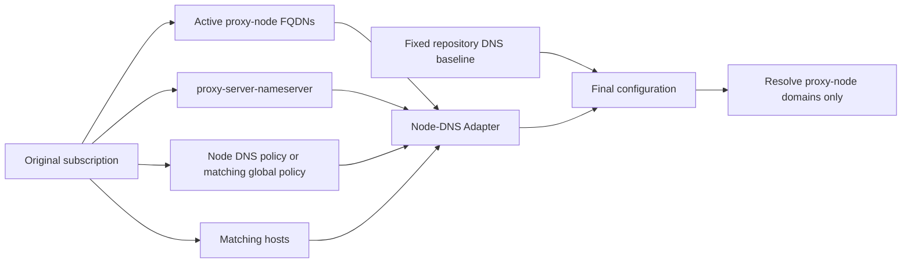

<picture>
  <source media="(max-width: 600px)" srcset="assets/readme/page-private-node-dns-mobile.svg">
  
</picture>

<a id="私有节点-dns受限投影与跨端边界"></a>
# Private-node DNS: limited projection and client boundaries

**English** | [简体中文](private-node-dns.zh-CN.md)

Determine whether private-node DNS can be projected automatically or must be merged into client-local configuration. This guide addresses proxy-node domain resolution only.

<p>
  <a href="guide/downloads.md"></a>
  <a href="README.md"></a>
  <a href="guide/dns-and-verification.md"></a>
</p>

[Downloads](guide/downloads.md) · [Documentation](README.md) · [Checks and troubleshooting](guide/dns-and-verification.md)

<a id="使用入口"></a>
## Entry points

1. Check “Clients with automatic adaptation” to establish the capability of your import path.
2. For automatic paths, select a trusted local profile. For static paths, use the manual overlay example.
3. After refresh, follow “Validation and troubleshooting” to inspect the effective node policy and bootstrap settings.

> This guide concerns only how proxy-node domains resolve. Each client output’s fixed DNS baseline still owns service-domain `nameserver`, `fallback`, fake-IP, and routing rules.

<a id="结论"></a>
## Summary

Do not copy subscription-provided private DNS wholesale: it may replace global service DNS, carry routing suffixes, or inject unrelated hosts into the final configuration. The repository restricts it to a small runtime module: **project only the resolvers, policies, and bootstrap hosts required to resolve FQDNs of proxy nodes actually active in the current subscription.**



<details>
<summary>Maintainers: module interface and snapshot closure checks</summary>

The adapter is a runtime **module**. `tools/runtime/node-dns-hints.js` and `.rb` are its only authoritative sources; desktop JS and OpenClash Ruby are synchronized **adapters**.

Its narrow interface is `captureNodeDns(source, activeServers, profile) → snapshot` and `applyNodeDns(repository, snapshot, profile) → report`: capture only reads the subscription; apply writes only after the repository DNS baseline exists.

`apply` also rechecks the snapshot’s internal closure: policy keys must be listed among active node domains, and hosts must belong to that policy or its resolver-hostname closure. Out-of-scope, malformed, or profile-inconsistent snapshots produce zero writes.

Production adapters pass only the snapshot from the corresponding `capture` call. Subscription parsing therefore has one responsibility and a clear trust boundary, rather than repeating heuristic code in five places.

</details>

<a id="可选功能-profile"></a>
## Optional profiles

`tools/runtime/subscription-adapter-profiles.json` is the sole profile source. The published default is `adaptive`. This is a **trusted local setting**, never read from subscription fields. Every profile leaves `routing-graph.js`, the 55 policy groups, rules, rule providers, global `nameserver` / `fallback` / fake-IP, and the fixed `proxy-server-nameserver` unchanged.

<a id="off"></a>
### `off`

- **Subscription DNS projection**: does not read or write any subscription Node-DNS hint.
- **Use case**: the repository’s fixed DNS baseline can resolve all provider-node domains.

<a id="policy"></a>
### `policy`

- **Subscription DNS projection**: materializes only `proxy-server-nameserver-policy` or `nameserver-policy` entries matching active nodes as exact policies.
- **Use case**: trust only explicitly declared node policies.

<a id="adaptive默认"></a>
### `adaptive` (default)

- **Subscription DNS projection**: extends `policy` by allowing validated subscription `proxy-server-nameserver` values as fallback for **active nodes without a matching policy**.
- **Use case**: a private resolver is still needed when the subscription supplies no exact policy.

To change the published default, maintainers must change `default` in that JSON, then run `node tools/sync-node-dns-hints-adapters.js`. The synchronizer updates all three JS and both OpenClash adapters.

At deployment, choose `off / policy / adaptive / hosts-only` in a trusted local copy. Do not put the profile into provider YAML or use it to remove policy groups or rewrite global DNS.

<a id="hosts-only显式本地选择"></a>
### `hosts-only` (explicit local choice)

Projects only valid IP hosts for exact FQDNs of currently active nodes, retaining multiple IPs and IPv6. It does not project resolvers/policies or change node server, SNI, or Host. Wildcards, aliases, unrelated records, and invalid values are excluded; existing repository hosts take priority. Tampered or over-budget snapshots produce zero writes. The default remains `adaptive`; the original three modes retain their boundaries. See the [unified configuration entry](configuration.md).

<a id="输入输出与拒绝规则"></a>
## Inputs, outputs, and rejection rules

<a id="proxiesserver"></a>
### `proxies[].server`

- **Adapter behavior**: keeps only valid FQDNs of active, non-informational nodes. IP-based nodes need no DNS and are ignored.

<a id="dnsproxy-server-nameserver"></a>
### `dns.proxy-server-nameserver`

- **Adapter behavior**: read only in `adaptive`; after validation, used only as exact policy values for active nodes without a more specific policy. The fixed global `proxy-server-nameserver` list is unchanged. Ordinary `nameserver` and `fallback` are not read.

<a id="dnsproxy-server-nameserver-policy"></a>
### `dns.proxy-server-nameserver-policy`

- **Adapter behavior**: exact matches take priority. Wildcards materialize only as exact active-node FQDNs; the whole map is not imported.

<a id="dnsnameserver-policy"></a>
### `dns.nameserver-policy`

- **Adapter behavior**: used as a compatibility fallback only when the node has no `proxy-server-nameserver-policy`; again, only exact FQDNs are materialized.

<a id="hosts"></a>
### `hosts`

- **Adapter behavior**: takes only matching records for the node itself and accepted resolver hostnames. Fixed-baseline hosts take priority and cannot be replaced by the subscription.

Discarded values include `system` / `dhcp` / `rcode:`, resolver routing suffixes containing `#`, `skip-cert-verify`, `ecs`, and `h3` parameters, malformed domains, invalid IPs, excessively long inputs, and over-budget entries.

A single hostname redirect in hosts remains a scalar; only IP values use arrays, following [Mihomo hosts](https://wiki.metacubex.one/en/config/dns/hosts/) semantics. Limits are 512 proxies, 128 nodes, and 64 resolver / policy / hosts outputs. Wildcard scanning is limited to 256 entries per source policy/hosts map; case-insensitive exact active-node keys have a separate bounded scan of 4096 entries.

Resolver-hostname hosts are collected before node hosts. A policy whose required resolvers exceed capacity is rejected in full, not left partially configured without bootstrap. Logs contain counts only, not node domains, DNS addresses, or bootstrap IPs.

`proxy-server-nameserver` and `proxy-server-nameserver-policy` already apply only to proxy-node domains. The latter also requires the former to be nonempty. `default-nameserver` resolves DNS endpoints themselves, and its endpoint host must be an IP.

See [Mihomo DNS configuration](https://wiki.metacubex.one/en/config/dns/) and [domain wildcard syntax](https://wiki.metacubex.one/en/handbook/syntax/) for semantics.

<a id="通配符如何处理"></a>
## Wildcard handling

Source subscriptions may use Mihomo’s `+.`, `.`, or `*.` syntax. After matching according to official semantics, the adapter generates only exact keys such as `hk.node.example`:

- `+.node.example`: `node.example` and all subdomains.
- `.node.example`: subdomains only, excluding the apex.
- `*.node.example`: exactly one additional label.

Conflicting resolvers at the same priority fail closed for that entry rather than choosing arbitrarily. Resolver URL paths/queries preserve case and are not incorrectly merged. Wildcards therefore do not broaden the final private-DNS scope.

<a id="哪些端可以自动适配"></a>
## Clients with automatic adaptation

| Output / entry point | Status |
| --- | --- |
| Clash Party Smart | Automatic |
| Clash Party Normal | Automatic |
| FlClash override | Automatic, with app-layer prerequisites |
| OpenClash Normal / Smart | Automatic |
| CMFA / Stash / Egern | Local overlay |
| Shadowrocket / Surge / Loon / Quantumult X | Local configuration |
| Sing-box / Hiddify / HomeProxy | Local configuration |
| v2rayN Xray | Not applicable |
| Passwall / Passwall2 | Not applicable |

- **Clash Party Smart**: the JS override receives subscription configuration input.
- **Clash Party Normal**: the same applies.
- **FlClash override**: after linking JS, disable “DNS override” to prevent the UI from overwriting node-DNS projection. Inspect the final configuration; see the [FlClash guide](../Mihomo%E5%86%85%E6%A0%B8%E7%B3%BB/FlClash/README.md).
- **OpenClash Normal / Smart**: override Ruby can read the original subscription before writing local configuration.
- **CMFA / Stash / Egern**: static YAML, without a runtime subscription transformation hook. Stash/Egern are generated outputs and must not be hand-edited.
- **Shadowrocket / Surge / Loon / Quantumult X**: repository outputs are static private-format configurations and cannot read source provider YAML.
- **Sing-box / Hiddify / HomeProxy**: repository output is static sing-box JSON, not a subscription-DNS converter.
- **v2rayN Xray**: the JSON here supplies Xray routing fallback only.
- **Passwall / Passwall2**: outputs are shunt-rule/UCI references and do not own a Mihomo DNS runtime.

This table summarizes Node-DNS boundaries. Assess all 14 products alongside subscription input, dynamic grouping, and optional profiles in the [cross-client capability matrix](client-capability-matrix.md). The matrix distinguishes a client’s ability to import subscriptions from a repository-owned runtime subscription hook, so static configurations are not mislabeled as automatic adapters.

<a id="clash-party-v203-的内置-dns-保护"></a>
### Built-in DNS protection in Clash Party v2.0.3+

Clash Party v2.0.3 added subscription DNS-override protection. Before overrides run, the main process inspects the original subscription’s `proxy-server-nameserver`, `proxy-server-nameserver-policy`, and `nameserver-policy`.

If built-in DNS control was previously enabled, the client may automatically disable `controlDns` and show a notice. This is separate from the repository JS’s limited Node-DNS projection.

The repository’s Smart / Normal JS subsequently rebuilds repository-owned global DNS and projects only trusted active-node hints into exact policies. Keep Clash Party’s built-in DNS override disabled when using this repository and validate final script output. Do not remove script DNS merely to suppress the notice.

Only when deliberately switching to client-managed DNS should those fields be removed at the original subscription/aggregation layer and the repository DNS baseline disabled. References: [v2.0.3 release notes](https://github.com/mihomo-party-org/clash-party/releases/tag/v2.0.3) and [DNS guard source](https://github.com/mihomo-party-org/clash-party/blob/v2.0.3/src/main/core/dnsOverrideGuard.ts).

Reusing repository configurations through ShellClash, ClashMi, or similar entry points does not automatically provide this capability. A separate adapter is possible only if they expose an equivalent subscription-override hook.

<a id="静态端的手动-overlay-示例"></a>
## Manual overlay example for static clients

If nodes require a private resolver, merge the following concepts into **that client’s own local configuration / Mixin**, replacing placeholders. Do not replace the entire repository DNS baseline:

```yaml
hosts:
  resolver.example:
    - 203.0.113.53       # Example only; supply a trusted bootstrap IP for the private resolver.
    - "2001:db8::53"

dns:
  proxy-server-nameserver:
    - https://resolver.example/dns-query
  proxy-server-nameserver-policy:
    proxy-node.example:
      - https://resolver.example/dns-query
```

The example IPs are placeholders; supply trusted bootstrap IPs for the private resolver. If `resolver.example` cannot already resolve through trusted bootstrap, supply a hosts mapping or client-local IP-form `default-nameserver`. Do not make an endpoint depend on itself for resolution.

This example applies only to clients supporting the same Mihomo DNS fields. Apple private formats, sing-box, Passwall, and others require their own native fields; do not paste it directly.

<a id="验证与排障"></a>
## Validation and troubleshooting

1. After subscription refresh, inspect the final configuration. Only actual node FQDNs may appear in `proxy-server-nameserver-policy`; no `geosite:`, `rule-set:`, or unrelated domain should appear.
2. Inspect `proxy-server-nameserver`: it must retain the fixed repository baseline. Private resolvers appear only in exact `proxy-server-nameserver-policy` entries for their active nodes.
3. If a private resolver hostname cannot bootstrap, check its bootstrap IP / hosts first instead of copying the subscription’s entire `nameserver` list.
4. `profile-mismatch` and `missing-pss-baseline` logs mean zero writes. The first indicates inconsistent trusted profiles between capture/apply; the second means the caller did not first write the fixed repository PSS baseline.
5. Maintainers can run:

   ```bash
   node tools/sync-node-dns-hints-adapters.js --check
   node tools/validate-js-overwrites.js
   node tools/test-openclash-node-dns-hints.js
   node tools/generate-client-capability-matrix.js --check
   ```

This isolation reduces the risk of subscription DNS rewriting service DNS. It is not an absolute guarantee against all DNS leaks. Verify system DNS, client bypasses, TUN/VPN switches, resolver network paths, and endpoint TLS trust separately.
