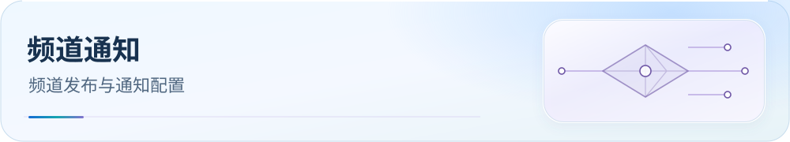

<picture>
  <source media="(max-width: 600px)" srcset="assets/readme/page-telegram-mobile.svg">
  
</picture>

# Olympus 官方频道自动通知

维护 Olympus 频道的根日志通知，了解预览、发送与恢复的区别。常规检查从 `preview` 开始，实际发送模式的效果见下方。

<p>
  <a href="guide/downloads.md"></a>
  <a href="README.md"></a>
  <a href="guide/dns-and-verification.md"></a>
</p>

[下载配置](guide/downloads.md) · [文档目录](README.md) · [检查与排障](guide/dns-and-verification.md)

## 使用入口

1. 先配置 Actions Secret 并授予机器人频道发布权限。
2. 用手动 workflow 的 `preview` 核对内容和来源提交。
3. 实际通知后检查 commit status 回执；不确定发送先核对频道，再选择恢复方式。

频道：[Olympus](https://t.me/IvanSolis89)；讨论群：[Olympus_Habitue](https://t.me/Olympus_Habitue)；
机器人：`@Olympus_TL_bot`。

## 通知内容与触发

`.github/workflows/telegram-release.yml` 仅在 main 的根 `CHANGELOG.md` 改动时自动通知。
普通提交、子目录日志和 GitHub Release 不触发频道更新；通知脚本自身的提交只执行测试和差异检查。
脚本比较完整 push 的 before/after，只有根日志实际修改才发送，正文取该提交根日志的第一节。
通知只包含一次标题、最多四条实际更新内容和一个[仓库链接](https://github.com/IvanSolis1989/Smart-Config-Kit)，
关闭链接预览，不发送配置文件或压缩包。
根日志引用的同日子目录日志会展开为实际描述，合并重复内容，不机械转发“详见某日志”。

## 首次配置

1. 在 Settings → Secrets and variables → Actions 保存 `TELEGRAM_BOT_TOKEN`。
2. 将机器人设为频道管理员并授予“发布消息”。
3. Telegram 自动把频道新帖转发至关联讨论群，机器人无须群管理权限。

Token 不进入源码、日志和文档，无须部署常驻服务器。Smart-Config-Kit 不再使用 `TELEGRAM_API_ID`、`TELEGRAM_API_HASH`，无需安装上传依赖。

## 手动验证与恢复

Actions → **Telegram release notification** → Run workflow，选择 main：

- `preview`：只预览根日志最新节；tag 可填写提交 SHA，留空取 main，不发消息。
- `test`：发送一条静音“机器人部署测试”，验证 Secret 和频道权限。
- `send`：发送指定提交的更新内容和仓库链接；tag 留空取 main。
- `recover`：先检查频道确认上次没有成功发送，再使用此模式；它允许重试不确定发送，可能造成重复消息。
- `edit`：更新已有成功通知的文字内容。

## 回执与恢复

文字通知回执保存在来源提交的 GitHub commit status：`telegram/olympus/link-changelog-<SHA>`。
同一提交已有 success 回执时跳过；首次发送前写 pending，消息发送成功后写 success 和频道消息链接。
网络失败或回执保存失败保留 pending，自动重跑不会盲目再发。
确认原消息已存在时，可将该 context 改为 success 并附原消息链接，无须重发。
通知按仓库串行，失败在 Actions 明确显示，不更改规则、配置、版本号或用户数据。

## 维护与参考

脚本和行为测试位于 `.github/scripts/telegram-release*.mjs`，使用 Node 自带测试运行器：

```sh
node --test .github/scripts/telegram-release.test.mjs .github/scripts/telegram-artifacts.test.mjs
python3 .github/scripts/telegram-files.test.py
```

Aerove 共用发布机器人，按自己的公开 Release 通知并发送原始产物文件，独立维护工作流。
频道 numeric ID 固定，改公开用户名时需同步消息链接。

依据：[Telegram sendMessage](https://core.telegram.org/bots/api#sendmessage)、
[关联讨论群](https://core.telegram.org/api/discussion)、
[GitHub 路径过滤](https://docs.github.com/en/actions/reference/workflows-and-actions/workflow-syntax#onpushpull_requestpull_request_targetpathspaths-ignore)、
[发送回执的 commit statuses API](https://docs.github.com/en/rest/commits/statuses)。
