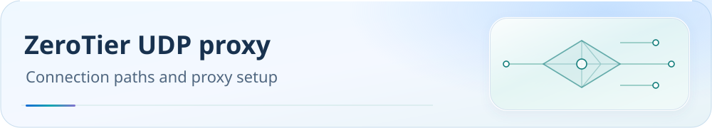

<picture>
  <source media="(max-width: 600px)" srcset="assets/readme/page-zerotier-mobile.svg">
  
</picture>

<a id="zerotier-根节点-udp-的本地代理选项"></a>
# Local proxy option for ZeroTier root-node UDP

**English** | [简体中文](zerotier-planet-proxy.zh-CN.md)

Use this local option only on a device where direct root-node UDP has been confirmed to receive no replies and a US node supports UDP. Save the choice and verify actual connections as described below.

<p>
  <a href="guide/downloads.md"></a>
  <a href="README.md"></a>
  <a href="guide/dns-and-verification.md"></a>
</p>

[Downloads](guide/downloads.md) · [Documentation](README.md) · [Checks and troubleshooting](guide/dns-and-verification.md)

<a id="使用入口"></a>
## Entry points

1. Link the override as a local-type file and inspect updates with `--dry-run` first.
2. Explicitly choose `--zerotier on` or `off` for an existing local JS file.
3. Inspect the first four effective rules, fixed node selection, and replies to ZeroTier-owned UDP, then check ordinary connections.

On a device where direct UDP to ZeroTier root nodes has been confirmed to receive no replies, and an existing US node group supports UDP, enable this option in a local JS copy. The repository’s published value is always `false`. Subscription fields and system environment variables cannot choose it.

```js
const SCKI_ZEROTIER_PLANET_PROXY = true
```

It applies to Clash Party Smart, Normal, and the equivalent FlClash JS. Enable it only on devices confirmed to need this path. Leave `false` on normally functioning networks and ordinary mobile subscriptions. Update an already linked local script with the commands below, preserving that device’s explicit on/off choice. Temporary rules in client memory do not establish persistent configuration.

```powershell
# Update an existing override: retain ZeroTier; preserve-local also retains health-check/QUIC.
node tools/configure-traffic-options.js --target 'C:\path\existing-local.js' --source 'Mihomo内核系/Clash Party/ClashParty(mihomo-smart).js' --preserve-local --dry-run
node tools/configure-traffic-options.js --target 'C:\path\existing-local.js' --source 'Mihomo内核系/Clash Party/ClashParty(mihomo-smart).js' --preserve-local

# Enable or disable on this device only; omit source to adjust the existing file only.
node tools/configure-traffic-options.js --target 'C:\path\existing-local.js' --zerotier on
node tools/configure-traffic-options.js --target 'C:\path\existing-local.js' --zerotier off
```

The first pair updates an existing override, retaining its ZeroTier boolean and, with `--preserve-local`, health-check/QUIC choices. The last pair explicitly enables/disables this device only; without `--source`, only the existing local file is adjusted.

`--target` must be an existing regular `.js` file; `--source` may instead point to Normal or FlClash source. The tool strictly reads a unique trusted top-level `const` without executing target code. Invalid or duplicate switches reject writing; a missing switch means the published default `false`.

Explicit arguments take priority. A real update backs up the original, replaces it atomically, and reads it back. Dry runs and identical repeated updates do not write. ZeroTier arguments require a local target file and cannot change repository-wide defaults.

The device should link a **local-type** override, whose content is updated through this entry point. Subscription refresh reruns that script and retains its saved constant. Replacing it directly with the remote published script restores the default `false`. Automatically updated remote overrides cannot merge device constants themselves; convert to a local copy first. This tool neither reloads the core nor changes group selections.

When enabled, only the following four flows enter the existing `🇺🇸 美国节点` (US nodes) group, ahead of normal routing rules.

All targets match **UDP / 9993** only:

| Destination IP | Outbound |
| --- | --- |
| 103.195.103.66/32 | `🇺🇸 美国节点` |
| 79.127.159.187/32 | `🇺🇸 美国节点` |
| 84.17.53.155/32 | `🇺🇸 美国节点` |
| 185.152.67.145/32 | `🇺🇸 美国节点` |

Each uses `AND,((NETWORK,UDP),(DST-PORT,9993),(IP-CIDR,<address>/32,no-resolve)),🇺🇸 美国节点`. TCP/9993, other UDP ports, and other IPs do not match.

Other rule ordering, group membership/selections, DNS, and health-check/QUIC options remain unchanged. Repeated generation retains exactly four rules; disabling restores default rules.

If no US node survives preflight/filtering, the script preserves the original input before writing and logs `requires existing 🇺🇸 美国节点`. It does not create an empty US group or choose another region. On an enabled device, inspect the first four generated rules, actual UDP replies, and ZeroTier ONLINE status; a version number or on-disk switch is insufficient.

The official [Mihomo routing rules](https://wiki.metacubex.one/config/rules/) define `AND`, `NETWORK`, `DST-PORT`, `IP-CIDR`, `no-resolve`, and top-to-bottom matching.

The documentation also states that a node without UDP support continues matching later rules. This option therefore requires an existing target group that can actually carry UDP. The repository’s existing minimum script version need not be raised.

<a id="来源与平台范围"></a>
## Source and platform scope

<details>
<summary>Maintainers: authority, synchronization, and platform boundaries</summary>

`getZeroTierPlanetProxyPolicy()` in `rulesets/source/routing-graph.js` is the sole definition of the four addresses, port, protocol, and target. `tools/sync-traffic-options.js` projects it into the shared runtime and three JS files.

It is not added to the default source/fused graph or cross-platform `traffic-options.json`. Synchronization uses source presets for health-check/QUIC while preserving an explicit ZeroTier `true` or `false`. All three repository-published scripts remain `false`.

The local-copy entry point preserves the device choice from the target file.

| Output | Treatment in this revision |
| --- | --- |
| Clash Party Smart / Normal | Local switch, pre-write checks, leading rules, and regressions synchronized; off by default |
| FlClash JS | Same runtime synchronized; existing url-test regional groups retained; off by default |
| CMFA / Stash / OpenClash Normal / Smart | Static/shell option entry points not extended; default graph and actual output bytes unchanged |
| Shadowrocket / Surge / Loon / Quantumult X / Egern | No new local option in their independent formats; default rules and asset bytes unchanged. Egern manifest only updates actual source hashes |
| SingBox / v2rayN / Passwall / Passwall2 | Static outbound/routing option entry points not extended; default rules and asset bytes unchanged |

This is a trusted local JS option for affected devices, not a cross-platform default-routing change. The protocol/port/exact-IP `AND` combination is a logical rule permitted inline by the maintenance contract. Putting it in default supplemental/fused sets would affect all devices, so it stays separate. The original 55 group definitions and each platform’s default ad-first ordering remain unchanged; only the four exact exceptions on locally enabled devices take precedence.

</details>

<a id="udp-选路与刷新验收"></a>
## UDP selection and refresh validation

A successful TCP test of the US group, a node’s `udp: true` declaration, or cumulative historical downloads do not prove that current ZeroTier UDP receives replies. On an enabled device, first measure download increments for the four root UDP flows during the observation window, then fix the US group to the node validated on that device.

Fixing the US group also affects other traffic currently referencing it, but does not require changing other selectors. Do not encode a node that worked once on one device as a repository-wide constant.

All three JS files enable [`profile.store-selected`](https://wiki.metacubex.one/config/general/#_28). The Smart fork’s [API selection](https://github.com/vernesong/mihomo/blob/daf3ad03021cca6031f4a7303ca6d861a14d5a16/hub/route/proxies.go#L74) writes to cache; [configuration refresh](https://github.com/vernesong/mihomo/blob/daf3ad03021cca6031f4a7303ca6d861a14d5a16/hub/executor/executor.go#L449) restores selections for selectable groups including Smart. `fixed` is API runtime state, not a new Smart configuration field.

Restoration requires the same cache, group name, and a node name that still exists. If the node disappears, [Smart returns to automatic selection](https://github.com/vernesong/mihomo/blob/daf3ad03021cca6031f4a7303ca6d861a14d5a16/adapter/outboundgroup/smart.go#L616). Report validation as failed and retest. Do not substitute TCP scores for UDP evidence or iterate through unknown candidates.

On Windows, use the read-only validation script before/after deployment or after subscription refresh:

```powershell
pwsh -NoProfile -File tools/verify-zerotier-planet.ps1 -OverridePath 'C:\path\existing-local.js' -Seconds 20 -RequireFixed -ReportPath '.cache\zerotier-after.json'
```

A single Mihomo admin pipe is detected automatically; specify `-PipeName` for multiple instances. The tool checks the first four rules, increments in ZeroTier-owned UDP downloads through the same node, sustained ONLINE status, fixed selection, TUN, selectors, and protected-file state. Flow ownership must be proven by the source endpoint’s unique service PID. The report must be a separate new JSON file.

`-PeerAddress`, `-SourceAddress`, and `-InterfaceIndex` optionally test ports 22/3389 with ordinary and interface-bound connections. The tool does not write APIs, clear connections, change routes/firewall/ZeroTier settings, or restart services.

When the identity private key is unreadable, it compares only file size and modification time and reports `HashAvailable=false`. No new reply within 20 seconds means only that the window did not establish success; extend to 60 seconds if needed. It does not prove permanent node failure. TCP, SSH, and root UDP are independent validation signals.

<a id="仓库验证"></a>
## Repository validation

<details>
<summary>Maintainers: regression commands and scope</summary>

```text
node tools/sync-traffic-options.js --check
node --test tools/tests/local-traffic-options.test.js tools/tests/zerotier-planet-proxy.test.js tools/tests/traffic-options.test.js tools/tests/traffic-cross-clients.test.js
node tools/validate-js-overwrites.js
node tools/validate-artifact-contracts.js --strict-ruby
node tools/validate-process-name-direct.js
```

Regressions execute all three actual `main()` implementations and check existing traffic-option combinations, default results, the four rules’ scope and priority, repeated generation, untrusted subscription input, and preservation when no target group exists. Device deployment still requires reading back effective configuration and actual connection results.

</details>
