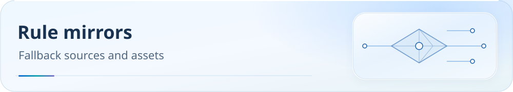

[**English**](README.md) | [中文](README.zh-CN.md)

<picture>
  <source media="(max-width: 600px)" srcset="../docs/assets/readme/page-mirrors-mobile.svg">
  
</picture>

# mirrors

> This directory contains a small selection of mirrored rule examples and supplemental lists referenced by production configurations or troubleshooting guides as needed.

 

Documentation：[docs/README.md](../docs/README.md) · Downloads：[downloads.md](../docs/guide/downloads.md)

## Mirrored files

- [CiciAi.list](./CiciAi.list)
- [Grok.yaml](./Grok.yaml)
- [UK.list](./UK.list)
