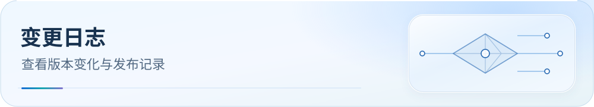

<picture>
  <source media="(max-width: 600px)" srcset="../../docs/assets/readme/page-changelog-mobile.svg">
  
</picture>

# Egern — 变更日志

 [返回 README](../../README.md) · [仓库文档中心](../../docs/README.md)

## v6.0.21-egern.12 (2026-10-28)

- Google FCM 从下载更新调整至 Google 服务；15 个域名与 26 个 IPv4 谓词、规则顺序及 55 个策略组不变。其他推送、DNS 与 fake-IP 不变。

## v6.0.20-egern.11 (2026-10-24)

- 将客户端目录归入内核系列分类，原有配置文件与说明保留在客户端子目录；规则语义和配置字段不变。旧 Raw 配置链接因路径迁移而变化，现有用户需重新导入对应配置；共享 `rulesets/` 资产地址保持不变。

## 2026-10-19 — 官方文档与版本核对

- 缓存当前官方发布记录、配置文档和适用源码，更新 REFERENCE 时效与能力边界；详见[核对报告](../../docs/upstream/2026-10-19/apple/report.md)。本次文档核对不改变本产物的规则、策略组或生成载荷。

## v6.0.20-egern.10 (2026-10-16)

- Issue #187：在既有 `scki-adfp-direct` 中为 `szlong.weixin.qq.com`、`hklong.weixin.qq.com`、`hkshort.weixin.qq.com` 增加精确 DIRECT 例外，防止微信连接端点先命中广告集合。
- 不扩大到父域或子域，`ad.weixin.qq.com`、`log.weixin.qq.com` 保持广告拒绝；不改变其他策略或规则顺序。
- 继续通过现有生成器消费融合资产，保留本平台原生规则语法；不手工修改生成文件。
- 依据与有限静态验收范围见[微信连接复查](../../docs/research/2026-10-16-wechat-issue-187.md)；报告者设备是否恢复仍待实际复测。

## v6.0.19-egern.9 (2026-10-15)

- FIX#186：自有远程规则资产统一使用 GitHub raw HTTPS，避开 jsDelivr 仓库大小门槛；保留版本查询参数与原生格式。
- 复用已验证的融合载荷，规则内容、顺序和策略不变；补充 raw/CDN 引用识别回归。原因、下载前提与官方字段依据见[规则下载说明](../../docs/rule-asset-delivery.md)。

## v6.0.18-egern.8 (2026-10-14)

- 修复跨服务首匹配误归类；规范 Apple/Microsoft 过宽关键词和共享 AWS/Azure/CDN 后缀，加入 game-cn、microsoft-live、microsoft-ai、intl-site、stream-jpkr、tools、social、bytedance-app 八类 guard。证书吊销/状态查询的 CA 精确主机直连与微软邮件精确国际策略新增 6 条 ADFP 记录，总数 35。`api.byteoversea.com` 作为精确 TikTok 规则，不扩共享后缀。保留现有 Claude Desktop `a-api`/`a-cdn` 精确例外、QUIC/测速选项和默认关闭的 ZeroTier 代理开关。Crisp relay 仅为静态 ASN 覆盖风险推断，并非实测事故。
- 源规则图 v6.0.18：525 providers / 984 source rules；生成 149 Mihomo providers / 168 main rules / 19 inline rules / 107 MRS / 78 non-empty SRS across 81 segments。

## v6.0.17-egern.7 (2026-10-13)

- 在现有 `scki-adfp-ai` 精确加入 `a-api.anthropic.com` 与 `a-cdn.anthropic.com`，供 Claude Desktop 应用代码和用户内容加载所需主机走 AI 服务策略。依据 [官方 Desktop 网络要求](https://code.claude.com/docs/en/desktop#network-access-requirements)；不推断 `a-api` 的具体路径。
- 本端规则集与原生语法沿用现有实现；来源语义 gate、29 条 ADFP 例外校验、Claude 服务阶段清单及文件级发布批次检查接入同一发布链。详见 [Claude 服务依赖台账](../../docs/claude-service-dependencies.md) 与 [发布批次检查](../../docs/release-batch.md)。未进行真机故障复现或测量。

## v6.0.16-egern.7 (2026-10-12)

- 本端随 v6.0.16 主线登记来源/版本收据、有序 domain-projection 差分及现有 ADFP 例外双向校验；客户端转换格式、规则顺序和目标策略沿用既有实现，未新增运行时规则。详见[规则质量台账](../../docs/rule-quality.md)。
- 复用当前 fused 载荷，只记录当前可观察字节及转换收据；旧资产的原始远端输入 SHA 无法从输出反推，因此不宣称完整历史来源追溯，也未进行真机流量测量。

## 来源清单核对 (2026-10-12)

- 源图新增默认关闭的 JS 本地 ZeroTier 规则导出后，generation manifest 仅更新 `source.routing_graph_sha256`；默认图完整相同，Egern profile、原生资产及冻结快照保持原字节。客户端版本仍为 v6.0.15-egern.7；本次未增加 Egern 选项或规则。

## v6.0.15-egern.7 (2026-10-07)

- 此次 CMFA 默认 `lazy` 更新只刷新生成清单的源元数据哈希；Egern `smart` 组的测速行为和本端尾号保持不变。
- 受管配置同步海外 UDP/443 选择；当前 smart 组保留原生自适应探测，不套用 auto_test 的 interval。选项切换从带 SHA 校验的便携压缩快照复用已发布的原生资产，follow-rules 仅重算受影响的域名部分并保留非域名数据。完整生成会刷新中立快照后输出当前选项。
- 切换命令、平台能力及验证方法见 [测速与 QUIC 策略选项](../../docs/traffic-options.md)。

## v6.0.14-egern.6 (2026-09-30)

- SYNC：从 CMFA v6.0.14-cmfa.7 离线重建并刷新源哈希、Profile 哈希和生成清单。
- SCOPE：Egern 官方代理类型不含 Mihomo 的具名 direct/reject，未套用其类型排除字段；125 个原生资产、137 条规则与 120 个引用不变。逐端适用性见 [后续研究](../../docs/research/2026-09-30-routing-runtime-followup.md)。

## v6.0.14-egern.5 (2026-09-29)

- SYNC：重建 Egern 原生规则集，第 001 DIRECT provider 加入微信 HTTPDNS 两个精确域名，先于 BlockHttpDNS 拦截生效。
- VERIFY：保持 125 个原生资产、137 条规则与 120 个 rule_set 引用。

## v6.0.13-egern.4 (2026-09-03)

- FIX-LINUXDO-CN-ROUTE：以 `39b9a1e` 固定载荷重放原生 rule_set，仅在第 013 国内网站 provider 增加 `linuxdo.org`。
- SYNC：保持 125 个原生资产、137 条规则与 120 个 rule_set 引用；`linux.do` 的第 059 受限网站语义不变。

## v6.0.12-egern.3 (2026-09-01)

- FIX#181-PC：以 `HEAD` 固定载荷重放原生 rule_set，仅在首段 DIRECT provider 增加 `login.nvidia.cn`；保持 125 个原生资产、137 条规则与 120 个 rule_set 引用。

## v6.0.11-egern.2 (2026-08-22)

- Profile 与原生 rule_set 由 CMFA v6.0.11-cmfa.3 重生成；Gemini 与 Accademia Gemini 首命中为 `🔍 Google 服务`，不改 szkane AI 规则。

## v6.0.10-egern.2 (2026-08-08)

- FIX#179-NETEASE-GAME-DIRECT：由 CMFA v6.0.10-cmfa.3 重新生成首段原生 YAML rule_set；两个网易游戏服务主机优先于 anti-AD 与国内游戏宽规则。

## v6.0.9-egern.1 (2026-07-19)

- 正式 Profile 由 CMFA v6.0.9-cmfa.1 重生成；通用 `api.github.com` 原生规则集前置到工具组，两个 Windows 进程逻辑规则明确跳过而不伪造兼容性。

## v6.0.8-egern.1 (2026-07-15)

- 原生 YAML rule_set 同步国内权威优先级，并支持带发布缓存键的 Mihomo 融合源解析与 Egern 资产引用。

## v6.0.7-egern.1 (2026-07-14)

- FIX#176：正式 Profile 由 CMFA v6.0.7-cmfa.1 重生成；Egern 原生 `rule_set` 顺序使国内域名 guard 先于通用国际 CDN / `geoip_set` fallback。

## v6.0.6-egern.1 (2026-07-14)

- PLATFORM：正式 Profile 已由 CMFA v6.0.6-cmfa.1 重新生成；Egern 原生规则集明确跳过 Windows `PROCESS-NAME` 条目，`WorkPro.exe` / `WorkProWebProcess.exe` 不被伪装为不兼容规则。

## v6.0.5-egern.1 (2026-07-14)

- PLATFORM：正式 Profile 由 CMFA v6.0.5-cmfa.1 重新生成；Egern 官方规则不提供 Clash 风格 PROCESS-NAME，WorkPro.exe 保持明确省略而非伪装同步。

## v6.0.4-egern.1 (2026-07-13)

- DIRECT-ITWDB：正式 Profile 与 Egern 原生 YAML 规则集已从 CMFA v6.0.4 重建，默认 direct domain set 包含 `itwdb.com`，覆盖 WorkPro 子域名。

## v6.0.3-egern.1 (2026-07-12)

- SYNC：由 CMFA v6.0.3-cmfa.1 重建正式 Profile 与 Egern 原生资产；源端为 124 个融合 provider / 141 条规则，目标端按平台能力去重与空资产裁剪。
- AI-PRECEDENCE：从 CMFA 的融合顺序继承 ChatGPT/OpenAI 与必要 telemetry 的前置 AI 路由，避免落入广告或国外网站后段。
- CONTRACT：生成清单继续对 CMFA、source graph、Profile、每个原生 YAML 的内容哈希和引用顺序做确定性校验。

## v6.0.2-egern.2 (2026-07-11)

- FIX：移除 Egern 产物合同中 `111 / 94 / 99` 的固定计数快照。上游规则内容变化会影响目标端的全局去重和空资产裁剪，固定数字会把合法刷新误判为失败。
- VERIFY：生成器新增 `rulesets/generated/egern/manifest.json`，以确定性内容哈希绑定当前 CMFA、`routing-graph.js`、完整 Profile、每个原生 YAML 资产及其引用顺序；validator 同时拒绝陈旧 Profile、漏引用、重复引用和资产内容漂移。
- BUILD：修复生成说明清理模式，连续运行生成器不再累加重复注释；Profile 头升级到 `v6.0.2-egern.2`。

## v6.0.2-egern.1 (2026-07-10)

- FIX：Egern 派生器不再静默跳过服务型 `GEOIP`；ISO 国家码输出为原生 `geoip_set`，服务型标签展开为 CIDR，`IP-ASN` 输出为 `asn_set`。
- NO-RESOLVE：由 CMFA `RULE-SET,...,no-resolve` 或残余规则携带的解析语义写入 Egern rule-set 顶层 `no_resolve: true`。
- PERF：主配置从 CMFA 的 113 个融合 provider / 130 条规则生成；跨资产首匹配去重后省略 19 个目标为空引用，实际为 111 条主规则、94 个 `rule_set` 引用和 99 个非空 Egern 原生 YAML，聚合约 12.94 MiB / 575,957 条。
- PLATFORM：仅 `PROCESS-NAME` / `PROCESS-PATH` 因 Egern 官方规则集未提供对应字段而明确跳过，其他未知类型不再伪装成同步成功。

## v6.0.1-egern.1 (2026-07-10)

- FIX#174 同类修复：Egern 原生 `provider-scki-fused-005-ad-domain.yaml` 原为超过 CDN 单文件预算的远程 YAML，现由生成器按 18 MiB 上限拆为 3 个有序 YAML rule_set。
- SEMANTICS：三个 rule_set 均指向 `🛑 广告拦截`，保持在原时间线位置连续求值；主配置计数变为 132 条规则 / 115 个 rule_set 引用，增加的两条仅为同策略分片引用。
- VERIFY：Egern 生成器与融合 manifest / 客户端远程资产大小合同共同校验，避免出现配置可导入但远程文件无法下载的隐性故障。

## v6.0.0-egern.1 (2026-07-09)

- FUSED-RULESETS：由融合后的 CMFA 规则顺序重新生成，Egern 不直接引用 Mihomo `.mrs`。
- EGERN-NATIVE：输出 118 个 Egern 原生 YAML 规则集，主配置渲染 130 条规则、113 个 rule_set 引用。
- PLATFORM：GEOIP / PROCESS-NAME 等官方能力限制继续记录为平台例外，不当作同步遗漏。

## v5.4.39-egern.1 (2026-07-09)

- SYNC：由 CMFA v6.0.0-cmfa.1 重新生成，跟随 113 个融合 rule-provider / 130 rules 的主线顺序。
- EGERN-NATIVE：Egern 不直接引用 Mihomo `.mrs`；生成器通过 `.mrs` manifest 回溯上游来源，输出 487 个 Egern 原生 YAML 规则集。
- PARITY：`独立内核系/Egern/Egern.yaml` 当前渲染 927 条主规则与 484 个顶层 `rule_set`；两个桌面 `PROCESS-NAME` 补充规则继续作为官方能力限制跳过。
- VERIFY：合同校验改为检查 generated Egern `scki-*` 规则集，而不是旧的 supplemental preview 路径。

## v5.4.38-egern.2 (2026-07-09)

- EGERN-FORMAL：`独立内核系/Egern/Egern.yaml` 从 Preview 升级为正式同步产物，跟随 CMFA 规则顺序生成。
- SYNC：同步 CMFA 429 个 rule-provider 和 884 条规则；Egern 渲染 882 条主规则与 439 个顶层 `rule_set`，仅排除官方未支持的 2 条桌面 `PROCESS-NAME` 补充规则。
- POLICY：区域组从 `auto_test` 改为 Egern 官方 `smart`，保留 22 个区域组与 33 个业务组。
- TOOLING：新增 `tools/generate-egern-from-cmfa.js`，把 Mihomo `.mrs` 规则源映射为本仓库生成的 Egern 原生 YAML 规则集；Clash Party / CMFA / OpenClash / FlClash / Stash 继续保留 `.mrs`。
- VERIFY：`tools/validate-artifact-contracts.js` 改为校验正式 Egern 产物，不再按 Preview 范围检查。

## v5.4.38-egern.1 (2026-07-09)

- FEAT#174-EGERN：新增 Egern 目录与 `Egern.yaml` Preview 配置。
- SCKI-SUPPLEMENTAL：新增 Egern 原生 YAML 补充规则集输出，引用 `rulesets/supplemental/egern/*.yaml`，不在主规则中散写广告误伤、抖音、RustDesk、Google Workspace 等零星域名。
- TOOLING：新增 `tools/generate-egern-supplemental.js`，从 Clash classical 补充规则集生成 Egern `domain_suffix_set` / `domain_set` / `ip_cidr_set` 格式。
- SCOPE：本版不声明与 Mihomo 391 rule-provider 完全等价；Egern 完整等价迁移需要后续为上游规则源建立专用转换链路。
