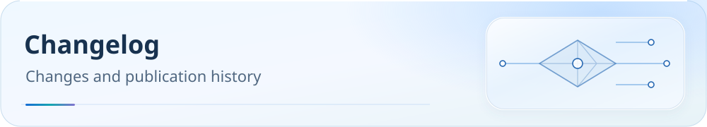

<picture>
  <source media="(max-width: 600px)" srcset="../../docs/assets/readme/page-changelog-mobile.svg">
  
</picture>

# Egern — Changelog

 [Project home](../../README.md) · [Repository documentation](../../docs/README.md)

## v6.0.21-egern.13 (2026-10-29)

- Updated graph provenance receipts. The generator recognizes core-family paths to avoid duplicate generated provenance comments. DNS, policy groups and routing were unchanged.
- See the [configuration guide](../../docs/configuration.md) for optional service projections/unified entry. No unsupported process or runtime Node-DNS fields were added to Egern.

## v6.0.21-egern.12 (2026-10-28)

- Moved Google FCM from download updates to Google services. The 15 domain and 26 IPv4 predicates, rule order and 55 policy groups were unchanged, as were other push services, DNS and fake-IP.

## v6.0.20-egern.11 (2026-10-24)

- Grouped client directories by core family, retaining configuration/documentation in client subdirectories without changing rule semantics or fields. Raw configuration URLs changed with the move, requiring existing users to reimport matching files; shared `rulesets/` asset URLs were unchanged.

## 2026-10-19 — Official documentation and version review

- Cached official release records, configuration documentation and relevant source, updating REFERENCE currency/capability boundaries. See the [review report](../../docs/upstream/2026-10-19/apple/report.md). This documentation review changed no rules, policy groups or generated payloads.

## v6.0.20-egern.10 (2026-10-16)

- Issue #187: added exact DIRECT exceptions for `szlong.weixin.qq.com`, `hklong.weixin.qq.com` and `hkshort.weixin.qq.com` in existing `scki-adfp-direct`, preventing WeChat connection endpoints from matching ad sets first.
- Did not expand to parent/child domains. `ad.weixin.qq.com` and `log.weixin.qq.com` remained blocked; other policies/rule order were unchanged.
- Continued consuming fused assets through the existing generator with native platform syntax; generated files were not hand-edited.
- See [WeChat connection review](../../docs/research/2026-10-16-wechat-issue-187.md) for evidence/limited static acceptance. Recovery on the reporter’s device still required real retesting.

## v6.0.19-egern.9 (2026-10-15)

- FIX#186: standardized repository-owned remote assets on GitHub raw HTTPS, avoiding jsDelivr repository-size limits while preserving version query parameters/native formats.
- Reused verified fused payloads without changing rule contents/order/policies. Added raw/CDN reference-detection regressions. See [rule asset delivery](../../docs/rule-asset-delivery.md) for causes, download prerequisites and official field evidence.

## v6.0.18-egern.8 (2026-10-14)

- Fixed cross-service first-match misclassification. Normalized overbroad Apple/Microsoft keywords/shared AWS/Azure/CDN suffixes, adding eight guards: game-cn, microsoft-live, microsoft-ai, intl-site, stream-jpkr, tools, social and bytedance-app. Added six ADFP records for exact CA revocation/status hosts routed directly and exact Microsoft mail international policy, totaling 35. `api.byteoversea.com` became an exact TikTok rule without broadening shared suffixes. Retained Claude Desktop `a-api`/`a-cdn` exact exceptions, QUIC/latency options and default-off ZeroTier proxy. Crisp relay was a static ASN-coverage risk inference, not an observed incident.
- Source graph v6.0.18: 525 providers / 984 source rules; generated 149 Mihomo providers / 168 main rules / 19 inline rules / 107 MRS / 78 non-empty SRS across 81 segments.

## v6.0.17-egern.7 (2026-10-13)

- Added exact `a-api.anthropic.com` and `a-cdn.anthropic.com` to existing `scki-adfp-ai`, routing hosts needed for Claude Desktop code/user-content loading through AI policy. Based on [official Desktop network requirements](https://code.claude.com/docs/en/desktop#network-access-requirements), without inferring specific `a-api` paths.
- Retained existing rule sets/native syntax. Integrated source-semantic gates, 29 ADFP exception checks, Claude service-stage inventory and file-level release-batch checks into the same release chain. See [Claude dependencies](../../docs/claude-service-dependencies.md) and [release-batch checks](../../docs/release-batch.md). No real-device failure reproduction or measurement was performed.

## v6.0.16-egern.7 (2026-10-12)

- Alongside v6.0.16, recorded source/version receipts, ordered domain-projection diffs and bidirectional existing-ADFP checks. Client conversion formats, rule order and targets retained existing implementation, with no new runtime rules. See [rule-quality ledger](../../docs/rule-quality.md).
- Reused current fused payloads, recording observable bytes/conversion receipts only. Original remote-input SHA for old assets cannot be recovered from outputs; complete historical provenance was not claimed, nor was real-device traffic measured.

## Source manifest review (2026-10-12)

- After the graph added default-off JS local ZeroTier rule exports, only `source.routing_graph_sha256` changed in the generation manifest. The default graph was identical; Egern profile/native assets/frozen snapshots retained original bytes. Client version remained v6.0.15-egern.7, with no new Egern options or rules.

## v6.0.15-egern.7 (2026-10-07)

- The CMFA default-`lazy` update refreshed only source-metadata hashes in the manifest. Egern `smart` latency behavior and client suffix were unchanged.
- Managed configuration synchronized the international-category UDP/443 option. Native smart adaptive probing was retained rather than applying auto_test intervals. Switching reused published native assets from portable compressed snapshots verified by SHA; follow-rules recalculated only affected domain portions, retaining non-domain data. Full generation refreshed neutral snapshots before outputting selected options.
- See [latency-test and QUIC options](../../docs/traffic-options.md) for switching commands, platform capabilities and verification.

## v6.0.14-egern.6 (2026-09-30)

- SYNC: rebuilt offline from CMFA v6.0.14-cmfa.7, refreshing source/profile hashes and generation manifest.
- SCOPE: official Egern proxy types do not include Mihomo named direct/reject, so Mihomo type-exclusion fields were not applied. The 125 native assets, 137 rules and 120 references were unchanged. See [follow-up research](../../docs/research/2026-09-30-routing-runtime-followup.md) for client applicability.

## v6.0.14-egern.5 (2026-09-29)

- SYNC: rebuilt native Egern rule sets, adding two exact WeChat HTTPDNS domains to provider 001 DIRECT before BlockHttpDNS.
- VERIFY: retained 125 native assets, 137 rules and 120 rule_set references.

## v6.0.13-egern.4 (2026-09-03)

- FIX-LINUXDO-CN-ROUTE: replayed native rule_set with payloads pinned to `39b9a1e`, adding only `linuxdo.org` to China-websites provider 013.
- SYNC: retained 125 native assets, 137 rules and 120 rule_set references. Restricted-sites semantics for `linux.do` in segment 059 were unchanged.

## v6.0.12-egern.3 (2026-09-01)

- FIX#181-PC: replayed native rule_set from `HEAD`-pinned payloads, adding only `login.nvidia.cn` to the first DIRECT provider. Retained 125 native assets, 137 rules and 120 rule_set references.

## v6.0.11-egern.2 (2026-08-22)

- Regenerated profile/native rule_set from CMFA v6.0.11-cmfa.3. Gemini/Accademia Gemini first-match targets became `🔍 Google 服务`; szkane AI rules were unchanged.

## v6.0.10-egern.2 (2026-08-08)

- FIX#179-NETEASE-GAME-DIRECT: regenerated the first native YAML rule_set from CMFA v6.0.10-cmfa.3. Two NetEase game hosts precede anti-AD and broad China-game rules.

## v6.0.9-egern.1 (2026-07-19)

- Regenerated the production profile from CMFA v6.0.9-cmfa.1. Generic `api.github.com` native rules moved forward to tools; two Windows process-logical rules were explicitly skipped rather than falsely claimed compatible.

## v6.0.8-egern.1 (2026-07-15)

- Native YAML rule_set synchronized China-category authoritative precedence and supported release-cache-keyed Mihomo fused-source parsing/Egern asset references.

## v6.0.7-egern.1 (2026-07-14)

- FIX#176: regenerated production profile from CMFA v6.0.7-cmfa.1. Native rule_set order puts China-domain guards before generic international CDN / `geoip_set` fallback.

## v6.0.6-egern.1 (2026-07-14)

- PLATFORM: regenerated production profile from CMFA v6.0.6-cmfa.1. Native rules explicitly skip Windows `PROCESS-NAME`; `WorkPro.exe` / `WorkProWebProcess.exe` are not emitted as incompatible rules.

## v6.0.5-egern.1 (2026-07-14)

- PLATFORM: regenerated production profile from CMFA v6.0.5-cmfa.1. Official Egern rules lack Clash-style PROCESS-NAME; WorkPro.exe remains explicitly omitted, not falsely synchronized.

## v6.0.4-egern.1 (2026-07-13)

- DIRECT-ITWDB: rebuilt production profile/native YAML sets from CMFA v6.0.4. The default direct domain set includes `itwdb.com`, covering WorkPro subdomains.

## v6.0.3-egern.1 (2026-07-12)

- SYNC: rebuilt production profile/native assets from CMFA v6.0.3-cmfa.1. Source totals were 124 fused providers / 141 rules; target deduplication/empty-asset pruning followed platform capabilities.
- AI-PRECEDENCE: inherited early AI routing for ChatGPT/OpenAI/required telemetry from CMFA fused order, before later ad/international-website segments.
- CONTRACT: generation manifests retain deterministic checks of CMFA, source graph, profile, every native YAML content hash and reference order.

## v6.0.2-egern.2 (2026-07-11)

- FIX: removed fixed `111 / 94 / 99` count snapshots from artifact contracts. Upstream changes affect global target deduplication/empty-asset pruning; fixed counts falsely rejected valid refreshes.
- VERIFY: added `rulesets/generated/egern/manifest.json`, deterministically binding CMFA, `routing-graph.js`, complete profile, native YAML assets and reference order by content hashes. Validator rejects stale profiles, missing/duplicate references and asset drift.
- BUILD: fixed generated-description cleanup so repeated generation does not accumulate comments. Profile header advanced to `v6.0.2-egern.2`.

## v6.0.2-egern.1 (2026-07-10)

- FIX: stopped silently skipping service-type `GEOIP`. ISO country codes emit native `geoip_set`, service tags expand to CIDR, and `IP-ASN` emits `asn_set`.
- NO-RESOLVE: project resolution semantics from CMFA `RULE-SET,...,no-resolve` or residual rules into top-level Egern `no_resolve: true`.
- PERF: generated from CMFA’s 113 fused providers / 130 rules. Cross-asset first-match deduplication omitted 19 empty-target references, yielding 111 main rules, 94 `rule_set` references and 99 nonempty native YAML assets, totaling about 12.94 MiB / 575,957 entries.
- PLATFORM: only `PROCESS-NAME` / `PROCESS-PATH` are explicitly skipped for missing official fields; other unknown types no longer masquerade as successful synchronization.

## v6.0.1-egern.1 (2026-07-10)

- FIX#174-related: native `provider-scki-fused-005-ad-domain.yaml` exceeded the CDN per-file budget. The generator now splits it into three ordered YAML rule_sets under an 18-MiB limit.
- SEMANTICS: all three rule_sets target `🛑 广告拦截`, evaluated consecutively at the original position. Main configuration totals become 132 rules / 115 rule_set references; the two additions only reference same-policy shards.
- VERIFY: jointly check the Egern generator, fused manifest and client remote-asset size contracts to prevent importable configurations whose remote files cannot download.

## v6.0.0-egern.1 (2026-07-09)

- FUSED-RULESETS: regenerated from fused CMFA rule order; Egern does not reference Mihomo `.mrs` directly.
- EGERN-NATIVE: emitted 118 native YAML rule sets, 130 main rules and 113 rule_set references.
- PLATFORM: official capability limits such as GEOIP / PROCESS-NAME remain explicit platform exceptions, not synchronization omissions.

## v5.4.39-egern.1 (2026-07-09)

- SYNC: regenerated from CMFA v6.0.0-cmfa.1, following mainline order of 113 fused rule-providers / 130 rules.
- EGERN-NATIVE: no direct Mihomo `.mrs` references. The generator traces upstream sources through the `.mrs` manifest, emitting 487 native YAML rule sets.
- PARITY: `独立内核系/Egern/Egern.yaml` rendered 927 main rules and 484 top-level `rule_set` entries. Two desktop `PROCESS-NAME` supplemental rules remain skipped as official capability limitations.
- VERIFY: contracts now check generated Egern `scki-*` sets rather than old supplemental-preview paths.

## v5.4.38-egern.2 (2026-07-09)

- EGERN-FORMAL: promoted `独立内核系/Egern/Egern.yaml` from Preview to a formal synchronized artifact generated in CMFA rule order.
- SYNC: synchronized 429 CMFA rule-providers / 884 rules; Egern rendered 882 main rules / 439 top-level `rule_set` entries, excluding only two officially unsupported desktop `PROCESS-NAME` supplemental rules.
- POLICY: changed regions from `auto_test` to official Egern `smart`, retaining 22 regional and 33 service groups.
- TOOLING: added `tools/generate-egern-from-cmfa.js` to map Mihomo `.mrs` sources to generated native Egern YAML. Clash Party / CMFA / OpenClash / FlClash / Stash retain `.mrs`.
- VERIFY: `tools/validate-artifact-contracts.js` now validates formal Egern artifacts rather than Preview scope.

## v5.4.38-egern.1 (2026-07-09)

- FEAT#174-EGERN: added Egern directory and `Egern.yaml` Preview.
- SCKI-SUPPLEMENTAL: added native supplemental YAML via `rulesets/supplemental/egern/*.yaml`, instead of scattered inline false-positive, Douyin, RustDesk and Google Workspace domains.
- TOOLING: added `tools/generate-egern-supplemental.js`, converting Clash classical supplemental sets into Egern `domain_suffix_set` / `domain_set` / `ip_cidr_set`.
- SCOPE: did not claim full equivalence with Mihomo’s 391 rule-providers. Complete Egern migration required a future dedicated upstream-source conversion pipeline.
