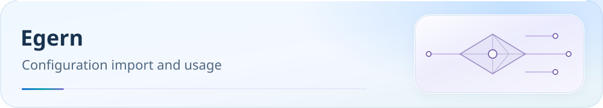

[**English**](README.md) | [中文](README.zh-CN.md)

<picture>
  <source media="(max-width: 600px)" srcset="../../docs/assets/readme/page-egern-mobile.svg">
  
</picture>

# Egern guide

An importable Egern profile with 22 native smart regional groups and 33 service groups. Replace the subscription URL first, then download native YAML rule sets and verify requests.

[](../../docs/guide/downloads.md) [](../../docs/README.md) [](#import) [](#verification)

[Before you start](#before-start) · [Download](#download) · [Import in order](#import) · [Required settings](#settings) · [Verification](#verification) · [Troubleshooting](#faq) · [Advanced reference](#reference)

> Configuration: `Egern.yaml` · **v6.0.21-egern.13**(Build 2026-10-29)
> 22 native smart regional groups + 33 service groups, following the Clash Party v6.0.21 routing baseline.

<a id="before-start"></a>


## Before you start

- Prepare Egern, your provider subscription URL and the template. This configuration contains no working nodes.
- As reviewed on 2026-10-19, stable 2.20.0 requires iOS 16+. Check other device compatibility in the [official store](https://apps.apple.com/app/egern/id1616105820).
- Egern `smart` uses its own adaptive logic, not Mihomo Smart / LightGBM. This configuration uses native `rule_set`; Mihomo compatibility does not establish `.mrs` support.

<a id="download"></a>

## Download

[](https://raw.githubusercontent.com/IvanSolis1989/Smart-Config-Kit/main/%E7%8B%AC%E7%AB%8B%E5%86%85%E6%A0%B8%E7%B3%BB/Egern/Egern.yaml)

Click to open the raw file; right-click to copy its link, or save a local copy.

**Egern YAML direct URL:**

```text
https://raw.githubusercontent.com/IvanSolis1989/Smart-Config-Kit/main/%E7%8B%AC%E7%AB%8B%E5%86%85%E6%A0%B8%E7%B3%BB/Egern/Egern.yaml
```

Download the Egern profile, import below and add your subscription.

Configuration downloads and remote-rule updates require GitHub Raw. See [download troubleshooting](../../docs/rule-asset-delivery.md). Back up local customizations because remote updates may overwrite them.

### Online selection and local import

Open the [configuration page](https://ivansolis1989.github.io/Smart-Config-Kit/) and select **Egern**, Full / Lite / Custom. No latency-test, QUIC, runtime node DNS or multiplier parameters are offered: latency selection retains native `smart`, and QUIC changes require corresponding generated rule assets.

After downloading YAML, replace subscription placeholders in `policy_groups → Subscribe → urls` as below. Import and select the profile in configuration management, then refresh subscriptions and rules.

Lite / Custom trim service groups to the selected profile; counts below describe Full. To update, refresh the page, reselect the same profile/parameters and download. Back up configuration and node customizations, then replace or reimport as above. Do not overwrite customized files with this repository’s full-configuration URL. Selection and generation are local and do not read or upload subscriptions or personal configurations. Protect subscription-bearing files and avoid publicly exposing hosted copies. See the [configuration guide](../../docs/configuration.md).

<a id="import"></a>

## Import in order

### 1. Download and replace the subscription URL

Save `Egern.yaml` locally. In your copy, replace the subscription in `policy_groups -> Subscribe -> urls`; Subscribe is the `external` entry whose `name` is `Subscribe`. Replace `https://example.com/your-subscription-url` with the real URL, preserving the Subscribe name and references from other groups.

### 2. Import and enable the profile

Import the edited YAML in Egern configuration management and select that profile. If remotely hosting it, ensure the hosted copy already contains your subscription. Exact-version menus and application import acceptance have not been completed for this guide; follow the current client interface.

### 3. Download and connect

Refresh Subscribe and confirm node and remote `rule_set` downloads complete. If GitHub Raw is unreachable, use a working proxy first. Check actual regional members, select service-group upstreams and connect. Authorize VPN when prompted on first connection.

<a id="settings"></a>

## Required settings

### Policy groups and subscriptions

The 22 native `smart` regional groups filter by node names; 33 service groups choose upstreams. Inspect expanded Subscribe nodes, then regional members. See [routing policy](../../docs/guide/routing-policy.md) for selection.

The compatible `external` subscription syntax is retained. Version 2.20.0 supports `urls` directly on basic groups, but this configuration does not currently need that migration.

### DNS and platform boundaries

DNS uses native Egern `bootstrap`, `upstreams`, `proxy_nameservers` and `forward`. Preserve the template structure and consult [official DNS documentation](https://egernapp.com/docs/configuration/dns/); do not directly copy Mihomo DNS fields.

No official field evidence establishes corresponding process-rule support, so this logic is a platform exception. Do not generalize iOS limitations to every desktop platform. See [REFERENCE](REFERENCE-Egern.md) for fields and generation evidence.

<a id="verification"></a>

## Import verification

1. Confirm this configuration is active with 22 regional and 33 service groups loaded. Check that regional groups contain working nodes.
2. Confirm the subscription and all `rule_set` downloads succeeded. An enabled connection switch does not replace download checks.
3. Visit `chat.openai.com`, `www.netflix.com` and `www.bilibili.com`; inspect request/connection logs for AI, Netflix and China-streaming matches and actual exits.
4. Complete the [DNS and post-import checklist](../../docs/guide/dns-and-verification.md#verification), including Wi-Fi / cellular switching as needed.

This repository has not completed real application import and DNS-failure acceptance. Static configuration checks do not replace device verification.

<a id="faq"></a>

## Troubleshooting

### Regional groups are empty after import?

Confirm the Subscribe placeholder is replaced, download succeeded and the format is supported by Egern. Then check regional identifiers in node names and actual smart-group members. Real subscription-expansion acceptance remains uncompleted in this repository.

### Rule sets fail to update?

Confirm references target native Egern rule assets. Check GitHub Raw connectivity and client errors using [download troubleshooting](../../docs/rule-asset-delivery.md). Do not substitute Mihomo `.mrs`.

### Is native smart LightGBM?

No. Egern uses its own health scoring and real failure feedback. Verify service availability through request logs and actual exits.

### Will updates affect subscription customizations?

Keep a backup. After downloading a new template, recheck the Subscribe URL, service selections and local edits before applying.

<a id="reference"></a>

## Advanced reference

<details>
<summary>Maintainers: generate profiles and rule assets</summary>

Maintainers update Egern profiles and native YAML rule sets through generators. Do not manually edit generated repository outputs. Users may edit their own local copies.

```bash
node tools/generate-egern-supplemental.js
node tools/generate-egern-from-cmfa.js
```

See [REFERENCE-Egern.md](REFERENCE-Egern.md) for the complete source chain and field decisions.

</details>

Official references: [Policy groups](https://egernapp.com/docs/configuration/policy_groups/) · [Rules](https://egernapp.com/docs/configuration/rules/) · [DNS](https://egernapp.com/docs/configuration/dns/). See the review linked below for official caches, version evidence and application-verification gaps.

[Routing policy](../../docs/guide/routing-policy.md) · [Client support](../../docs/guide/client-support.md) · [DNS and verification](../../docs/guide/dns-and-verification.md)

[Latency testing and QUIC](../../docs/traffic-options.md) · [WeChat troubleshooting](../../docs/research/2026-10-16-wechat-issue-187.md) · [Claude Desktop network dependencies](../../docs/claude-service-dependencies.md)

[Changelog](CHANGELOG.md) · [Official review and pending acceptance](../../docs/upstream/2026-10-19/apple/report.md) · [Support the project](../../docs/donate.md)
