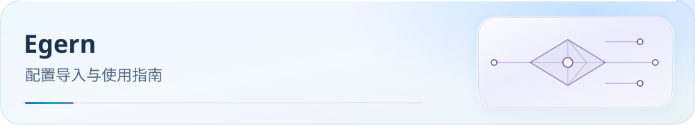

<picture>
  <source media="(max-width: 600px)" srcset="../../docs/assets/readme/page-egern-mobile.svg">
  
</picture>

# Egern 使用教程

可导入的 Egern Profile，使用 22 个原生 smart 区域组与 33 个业务组。先替换订阅地址，再下载原生 YAML 规则集并验证请求。

[](../../docs/guide/downloads.md) [](../../docs/README.md) [](#import) [](#verification)

[开始前](#before-start) · [获取配置](#download) · [顺序导入](#import) · [必要设置](#settings) · [验收](#verification) · [常见问题](#faq) · [进阶与参考](#reference)

> 配置：`Egern.yaml` · **v6.0.20-egern.11**（Build 2026-10-24）
> 22 原生 smart 区域组 + 33 业务组；跟随 Clash Party v6.0.20 分流基线。

<a id="before-start"></a>

## 开始前

- 准备 Egern、机场订阅 URL 与上方模板；本配置不含可用节点。
- 截至 2026-10-19，稳定版 2.20.0 要求 iOS 16+；其他设备兼容性以[官方商店](https://apps.apple.com/app/egern/id1616105820)为准。
- Egern `smart` 使用自身自适应逻辑，不是 Mihomo Smart / LightGBM；本配置使用原生 `rule_set`，不能据 Mihomo 兼容性推断支持 `.mrs`。

<a id="download"></a>

## 获取配置

[](https://raw.githubusercontent.com/IvanSolis1989/Smart-Config-Kit/main/%E7%8B%AC%E7%AB%8B%E5%86%85%E6%A0%B8%E7%B3%BB/Egern/Egern.yaml)

点击按钮打开 Raw 原始文件；右键按钮可复制链接，需要本地文件时可另存为。

**Egern YAML 直链：**

```text
https://raw.githubusercontent.com/IvanSolis1989/Smart-Config-Kit/main/%E7%8B%AC%E7%AB%8B%E5%86%85%E6%A0%B8%E7%B3%BB/Egern/Egern.yaml
```

下载 Egern Profile，按下文导入并接入节点订阅。

配置下载和远程规则更新需要访问 GitHub Raw；失败时参见[下载排错](../../docs/rule-asset-delivery.md)。本地定制先保留副本，远程更新可能覆盖修改。

<a id="import"></a>

## 按顺序导入

### 1. 下载并替换订阅地址

保存 `Egern.yaml` 到本地，在副本的 `policy_groups -> Subscribe -> urls` 中替换机场订阅；这里的 Subscribe 是 `external` 项中 `name: Subscribe` 的组。将 `https://example.com/your-subscription-url` 换成实际 URL，保留 Subscribe 名称与其他策略组引用。

### 2. 导入并启用 Profile

在 Egern 的配置管理中导入修改后的 YAML，并选择该 Profile。若使用自己的远程托管地址，先确保托管的是已替换订阅的副本。此教程尚未完成具体版本的菜单与 App 导入验收，以当前客户端显示为准。

### 3. 下载并连接

刷新 Subscribe，检查订阅节点与远程 `rule_set` 下载完成。GitHub Raw 不可达时，先使用可用代理下载。确认区域组实际成员，选择业务组上游，再启动连接；首次连接按系统提示授权 VPN。

<a id="settings"></a>

## 必要设置

### 策略组与订阅

22 个原生 `smart` 区域组按节点名称筛选，33 个业务组选择上游。检查 Subscribe 实际展开的节点，再检查区域组成员；策略选择参考[分流策略](../../docs/guide/routing-policy.md)。

当前保留兼容的 `external` 订阅写法。2.20.0 支持基本组直接附 `urls`，本配置暂无迁移需要。

### DNS 与平台边界

DNS 使用 Egern 原生 `bootstrap`、`upstreams`、`proxy_nameservers` 与 `forward`；保持模板结构，按[官方 DNS 文档](https://egernapp.com/docs/configuration/dns/)理解分流，不能直接复制 Mihomo DNS 字段。

进程规则缺少对应官方字段证据，相关逻辑作为平台例外；不把 iOS 限制推断为所有桌面平台能力。字段与生成依据见 [REFERENCE](REFERENCE-Egern.md)。

<a id="verification"></a>

## 导入验收

1. 确认当前启用本目录配置，22 个区域组与 33 个业务组已载入；检查区域组内确有可用节点。
2. 确认订阅与全部 `rule_set` 下载成功；连接开关开启不能代替下载检查。
3. 访问 `chat.openai.com`、`www.netflix.com`、`www.bilibili.com`，在请求或连接日志中核对 AI、Netflix、国内流媒体的命中规则与实际出口。
4. 完成[DNS 与导入后验证清单](../../docs/guide/dns-and-verification.md#verification)，按需复测 Wi-Fi / 蜂窝切换。

本仓库尚未完成该 App 的实际导入与 DNS 故障验收；静态配置检查不能替代设备上的验证。

<a id="faq"></a>

## 常见问题

### 导入后区域组为空？

先确认 Subscribe 的占位 URL 已替换，订阅成功下载且格式受 Egern 支持，再核对节点名中的地区标识和 smart 组实际成员。本仓库尚未完成真实订阅展开验收。

### 规则集无法更新？

确认配置引用的是 Egern 原生规则资产，检查 GitHub Raw 连通性与客户端错误，按[下载排错](../../docs/rule-asset-delivery.md)处理；不要替换为 Mihomo `.mrs`。

### 原生 smart 是 LightGBM 吗？

不是。Egern 使用自身健康评分与真实失败反馈；服务可用性仍应通过请求日志和实际出口验收。

### 更新配置会影响订阅定制吗？

先保留副本；下载新模板后重新检查 Subscribe 地址、业务组选择与本地修改，再应用更新。

<a id="reference"></a>

## 进阶与参考

<details>
<summary>维护者：生成 Profile 与规则资产</summary>

仓库维护通过生成器更新 Egern Profile 与原生 YAML 规则集；不要手工修改仓库生成结果。用户可编辑自己的本地副本。

```bash
node tools/generate-egern-supplemental.js
node tools/generate-egern-from-cmfa.js
```

完整来源链路与字段取舍见 [REFERENCE-Egern.md](REFERENCE-Egern.md)。

</details>

官方依据：[策略组](https://egernapp.com/docs/configuration/policy_groups/) · [规则](https://egernapp.com/docs/configuration/rules/) · [DNS](https://egernapp.com/docs/configuration/dns/)。官方缓存、版本证据与 App 验证缺口见上方复核报告。

[分流策略](../../docs/guide/routing-policy.md) · [客户端支持](../../docs/guide/client-support.md) · [DNS 与验收](../../docs/guide/dns-and-verification.md)

[测速与 QUIC](../../docs/traffic-options.md) · [微信连接排错](../../docs/research/2026-10-16-wechat-issue-187.md) · [Claude Desktop 网络依赖](../../docs/claude-service-dependencies.md)

[配置变更记录](CHANGELOG.md) · [官方资料复核与待验边界](../../docs/upstream/2026-10-19/apple/report.md) · [支持本项目](../../docs/donate.md)
