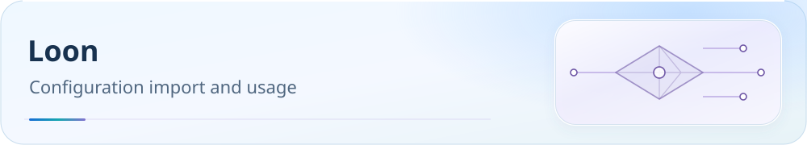

[**English**](README.md) | [中文](README.zh-CN.md)

<picture>
  <source media="(max-width: 600px)" srcset="../../docs/assets/readme/page-loon-mobile.svg">
  
</picture>

# Loon guide

Use native Loon configuration for same-source routing rules. Add node subscriptions separately; configure DNS, NameRegex and MMDB using Loon syntax.

[](../../docs/guide/downloads.md) [](../../docs/README.md) [](#import) [](#verification)

[Before you start](#before-start) · [Download](#download) · [Import in order](#import) · [Required settings](#settings) · [Verification](#verification) · [Troubleshooting](#faq) · [Advanced reference](#reference)

> Configuration: `Loon.conf` · **v6.0.21-Loon.11**(Build 2026-10-28)
> 22 regional groups (11 all-node + 11 residential) + 33 service groups, following the Clash Party v6.0.21 routing baseline.

<a id="before-start"></a>


## Before you start

Prepare Loon, your provider subscription URL and the configuration URL below. As checked on 2026-10-19, official stable 3.5.2 requires iOS 15+. The official store also permits the iOS application on Apple Silicon Macs, distinct from a standalone native Mac version. See the [historical review](../../docs/upstream/2026-10-19/apple/report.md).

- Install from the [App Store](https://apps.apple.com/app/loon/id1373567447); allow adding a VPN configuration on first connection.
- The `.conf` provides routing, not provider nodes. `[Remote Rule]` requires network downloads.
- Uses `url-test`, not Mihomo Smart / LightGBM. Plugins and MITM require separate setup.

<a id="download"></a>

## Download

[](https://raw.githubusercontent.com/IvanSolis1989/Smart-Config-Kit/main/%E7%8B%AC%E7%AB%8B%E5%86%85%E6%A0%B8%E7%B3%BB/Loon/Loon.conf)

Click to open the raw file; right-click to copy its link, or save a local copy.

**Loon CONF direct URL:**

```text
https://raw.githubusercontent.com/IvanSolis1989/Smart-Config-Kit/main/%E7%8B%AC%E7%AB%8B%E5%86%85%E6%A0%B8%E7%B3%BB/Loon/Loon.conf
```

Copy the configuration URL, import as below and add your subscription.

Configuration downloads and remote-rule updates require GitHub Raw. See [download troubleshooting](../../docs/rule-asset-delivery.md). Back up local customizations because remote updates may overwrite them.

### Online selection and local import

Open the [configuration page](https://ivansolis1989.github.io/Smart-Config-Kit/), select **Loon**, Full / Lite / Custom and optional latency-test/QUIC parameters. Disabling QUIC restricts all UDP/443, including China-based and other services. This static configuration has no runtime node DNS or multiplier adaptation.

After downloading `.conf`, host your copy at your own HTTPS address if needed. Download and enable it through configuration management’s URL entry below, then add node subscriptions in subscription management.

Lite / Custom trim service groups according to the selected profile; counts below describe Full. To update, refresh, reselect profile/parameters and download. Back up configuration and node customizations, then replace or reimport. Do not overwrite custom copies using the repository full-configuration URL. Selection and generation are local and do not read or upload subscriptions or personal configuration. See the [configuration guide](../../docs/configuration.md).

<a id="import"></a>

## Import in order

### 1. Download and enable configuration

1. Copy the configuration URL above; host a customized copy over your own HTTPS address if needed.
2. In Loon configuration management, download from URL, select and enable the configuration.
3. Confirm remote-rule downloads complete. Use a working proxy first if GitHub Raw is unreachable.

### 2. Add your provider subscription

Add your **provider subscription URL** in Loon subscription management and inspect nodes after updating. Regional filtering uses `[Remote Filter]` `NameRegex / FilterKey`; the main configuration contains no working nodes.

Your provider must supply a Loon-supported subscription format. Verify actual members of every regional group after import.

### Multiple-provider subscriptions

Add subscriptions separately, or convert/merge into a Loon-supported format. Third-party conversion services can read token-bearing subscription links; verify trust before using them.

### 3. Check and connect

Confirm remote rules/subscriptions downloaded and regional groups have working nodes. Select service upstreams, start Loon and allow VPN configuration on first launch.

<a id="settings"></a>

## Required settings

### Policy groups

Eleven regions each have all-node and residential groups, totaling 22 `url-test` groups. The 33 service groups allow manual upstream selection. Node names need regional identifiers; the configuration file is authoritative for latency-test parameters.

See [Surge service groups](../Surge/README.md#业务策略组select-手动); verify actual exits after selection.

### Native DNS fields

| Field | Use in this configuration |
|---|---|
| `dns-server` | Plain DNS accepts only system or IP values: 223.5.5.5, 119.29.29.29, 1.1.1.1, 8.8.8.8 |
| `doh-server` | AliDNS / DNSPod / Cloudflare / Google DoH URLs; do not put these in dns-server |
| `ip-mode` | Current IP-mode field; officially requires 3.2.3(754)+ |
| `hijack-dns` | DNS hijack field; officially requires 3.2.5(789)+ |
| `udp-fallback-mode` | REJECT |
| `disable-udp-ports` | 443, disables QUIC / HTTP/3 |
| `bypass-tun` | Private-network bypass; not Surge tun-excluded-routes |

Loon defaults to plain-DNS fallback after encrypted-DNS failure; disable this in the application if needed. Do not copy Surge `encrypted-dns-server`, old `ipv6` / `ipv6-enabled` or `bypass-system` fields. See [native field evidence](REFERENCE-loon-manual.md).

### MMDB database

The configuration sets the MMDB source through `geoip-url`:

```
geoip-url = https://fastly.jsdelivr.net/gh/Loyalsoldier/geoip@release/Country.mmdb
```

Check database download status after import. On failure check URL/network; an enabled configuration does not prove the database is available.

<a id="verification"></a>

## Import verification

1. Confirm this configuration is active with 22 regional and 33 service groups loaded. Check that regional groups contain working nodes.
2. Confirm subscription and all remote-rule downloads succeed. The connection switch does not replace download checks.
3. Visit `chat.openai.com`, `www.netflix.com` and `www.bilibili.com`; inspect request/connection logs for AI, Netflix and China-streaming matches and actual exits.
4. Complete the [DNS and post-import checklist](../../docs/guide/dns-and-verification.md#verification), including Wi-Fi / cellular switching as needed.

If logs have no requests, groups are empty or exits differ, continue below.

<a id="faq"></a>

## Troubleshooting

### Q1: Can I import Surge.conf into Loon directly?

Use this directory’s `Loon.conf`. DNS, `NameRegex`, ports and MMDB require Loon syntax; do not mix entire configurations from other clients.

### Q2: Need Mihomo Smart + LightGBM?

Use a compatible Mihomo Smart client. Loon `url-test` does not provide LightGBM.

### Q3: Select routes for network and service requirements?

Switch service groups such as `受限网站`, `国外网站` or `国内流媒体` in the policy panel. See [Surge route diagnostics](../Surge/README.md#q6跨境场景中国--海外怎么切换).

### Q4: Change rule-set update intervals?

Check configuration and remote-rule update settings in Loon; verify download status after refreshing.

### Q5: Use Loon plugins?

Add needed plugins in the plugin panel. Check rule/rewrite/script conflicts with existing configuration first. Configure certificates through the official process if MITM is required.

<a id="reference"></a>

## Advanced reference

<details>
<summary>Protocol support and version evidence</summary>

See [official documentation](https://nsloon.app/docs/intro/) and the [historical review](../../docs/upstream/2026-10-19/apple/report.md) for protocol/version evidence.

| Protocol | Support | Notes |
|---|:-:|---|
| **Shadowsocks (SS)** | ✅ | AEAD + SS 2022 |
| **ShadowsocksR (SSR)** | ✅ | Legacy-provider compatibility |
| **VMess** | ✅ | ws/grpc/h2 |
| **VLESS** | ✅ | Includes **REALITY** |
| **XTLS-Vision** | ✅ | |
| **Trojan** | ✅ | |
| **Hysteria v1** | ✅ | |
| **Hysteria 2** | ✅ | |
| **TUIC v5** | ✅ | |
| **WireGuard** | ✅ | As a child proxy |
| **Snell v3 / v4** | ✅ | Snell support on iOS |
| **AnyTLS / ShadowTLS** | ✅ | [Official version history](https://apps.apple.com/us/app/loon/id1373567447): AnyTLS 3.3.9 (2026-03-31); ShadowTLS 3.2.6 (2025-02-03) |
| **SOCKS5 / HTTP(S)** | ✅ | |

</details>

`[Remote Filter] NameRegex / FilterKey` filters nodes. Remote rules use this repository’s fused text, not direct Clash classical YAML, Surge-specific domainset or Mihomo `.mrs`. On iOS / tvOS, an entire logical rule containing a process condition is ignored.

`[Plugin]` combines rules, scripts and rewrites. Add `[Script]` and plugins yourself and check conflicts. Official entry points: [Loon documentation](https://nsloon.app/docs/intro/), [REFERENCE](REFERENCE-loon-manual.md).

[Loon](https://apps.apple.com/app/loon/id1373567447) · [blackmatrix7/ios_rule_script](https://github.com/blackmatrix7/ios_rule_script) · [Loyalsoldier/geoip](https://github.com/Loyalsoldier/geoip)

[Routing policy](../../docs/guide/routing-policy.md) · [Client support](../../docs/guide/client-support.md) · [DNS and verification](../../docs/guide/dns-and-verification.md)

[Latency testing and QUIC](../../docs/traffic-options.md) · [WeChat troubleshooting](../../docs/research/2026-10-16-wechat-issue-187.md) · [Claude Desktop network dependencies](../../docs/claude-service-dependencies.md)

[Changelog](CHANGELOG.md) · [Official review and pending acceptance](../../docs/upstream/2026-10-19/apple/report.md) · [Support the project](../../docs/donate.md)
