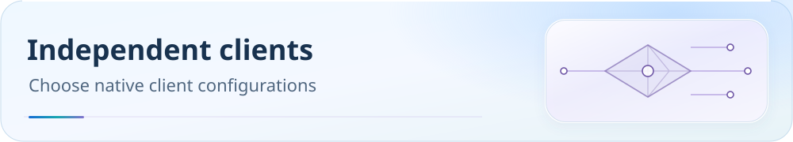

[**English**](README.md) | [中文](README.zh-CN.md)

<picture>
  <source media="(max-width: 600px)" srcset="../docs/assets/readme/page-family-independent-mobile.svg">
  
</picture>

# Independent client configurations

Native configuration entries for Shadowrocket, Surge, Loon, Quantumult X, Stash, and Egern. This is a repository maintenance category, not a claim that these applications share a core. Each guide describes its own format and import procedure.

  

Quick links: [downloads](../docs/guide/downloads.md#independent) · [documentation](../docs/README.md) · [DNS and post-import verification](../docs/guide/dns-and-verification.md)

## Client guides

- [Shadowrocket](./Shadowrocket/README.md)
- [Surge](./Surge/README.md)
- [Loon](./Loon/README.md)
- [Quantumult X](./Quantumult%20X/README.md)
- [Stash](./Stash/README.md)
- [Egern](./Egern/README.md)

Select the configuration for your actual application and load it through that application’s configuration-import interface. The shared download directory provides raw file links.
