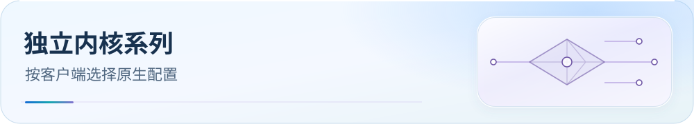

<picture>
  <source media="(max-width: 600px)" srcset="../docs/assets/readme/page-family-independent-mobile.svg">
  
</picture>

# 独立客户端配置入口

本系列收录 Shadowrocket、Surge、Loon、Quantumult X、Stash 与 Egern 的原生配置入口。它们按仓库维护分类归档，并不表示使用同一种内核；各自的配置格式与导入方式见对应教程。

  

快速导航：[配置下载](../docs/guide/downloads.md#independent) · [文档中心](../docs/README.md) · [DNS 与导入后验收](../docs/guide/dns-and-verification.md)

## 客户端教程

- [Shadowrocket（小火箭）](./Shadowrocket/README.md)
- [Surge](./Surge/README.md)
- [Loon](./Loon/README.md)
- [Quantumult X](./Quantumult%20X/README.md)
- [Stash](./Stash/README.md)
- [Egern](./Egern/README.md)

按实际使用的客户端选择配置，并从该客户端的配置导入入口加载；通用下载页提供 Raw 文件链接。
