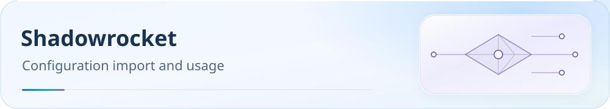

[**English**](README.md) | [中文](README.zh-CN.md)

<picture>
  <source media="(max-width: 600px)" srcset="../../docs/assets/readme/page-shadowrocket-mobile.svg">
  
</picture>

# Shadowrocket guide

Service-based routing, exit selection and ad-blocking configuration. Add configuration and node subscriptions separately, in the order below. Routing choices depend on your network and service requirements.

[](../../docs/guide/downloads.md) [](../../docs/README.md) [](#import) [](#verification)

[Preparation](#before-start) · [Download](#download) · [Import](#import) · [Settings](#settings) · [Verification](#verification) · [Troubleshooting](#faq) · [Reference](#reference)

> File: `Shadowrocket.conf` · **v6.0.21-SR.12** (Build 2026-10-28)
> 22 regional groups (11 all-node + 11 residential) and 33 service groups; Clash Party v6.0.21 routing baseline.

<a id="before-start"></a>

## Before you start

Prepare Shadowrocket, your provider subscription URL and the configuration URL below. As checked on 2026-10-19, official stable 2.2.92 requires iOS 13+. See the [official store](https://apps.apple.com/us/app/shadowrocket/id932747118) for other device compatibility.

- Install from the [App Store](https://apps.apple.com/app/shadowrocket/id932747118); allow VPN configuration on first connection.
- A provider subscription URL lists nodes. This repository's `.conf` contains routing and no working nodes.
- Regional groups use `url-test`, not Mihomo Smart / LightGBM.

<a id="download"></a>

## Download

[](https://raw.githubusercontent.com/IvanSolis1989/Smart-Config-Kit/main/%E7%8B%AC%E7%AB%8B%E5%86%85%E6%A0%B8%E7%B3%BB/Shadowrocket/Shadowrocket.conf)

Click to open the raw file, right-click to copy its URL, or save locally.

**Direct URL:**

```text
https://raw.githubusercontent.com/IvanSolis1989/Smart-Config-Kit/main/%E7%8B%AC%E7%AB%8B%E5%86%85%E6%A0%B8%E7%B3%BB/Shadowrocket/Shadowrocket.conf
```

Use this URL in Shadowrocket's configuration download entry, then add subscriptions below.

Configuration downloads and remote-rule updates require GitHub Raw access. See [download troubleshooting](../../docs/rule-asset-delivery.md). Back up local customizations before remote updates that could overwrite them.

### Online selection and local import

Open the [configuration page](https://ivansolis1989.github.io/Smart-Config-Kit/), select **Shadowrocket**, Full / Lite / Custom and optional latency-test/QUIC settings. The native all-proxy QUIC restriction covers all proxy QUIC traffic, broader than restricting only selected service rules. This static configuration has no runtime node DNS or multiplier adaptation.

Host your downloaded `.conf` privately over HTTPS if needed, then use **Config → ➕** below to download and enable it. Add provider subscriptions separately and check nodes.

Lite / Custom trim service groups; counts below describe Full. To update, refresh the page, select the same profile/parameters and download. Back up configuration and node customizations, then replace or reimport. Do not overwrite customized files using the full repository URL. Generation and selection are local and do not read or upload subscriptions or personal configuration. See the [configuration guide](../../docs/configuration.md).

<a id="import"></a>

## Import in order

### 1. Download and enable routing configuration

1. Open Shadowrocket → **Config → ➕**.
2. Paste the configuration URL and download; tap the downloaded entry and choose **Use Config**.
3. Confirm all remote RULE-SET downloads complete. Use a working proxy first if GitHub Raw is unreachable.

### 2. Add a provider subscription

Add and update your URL in **Home → Subscribe**. Menu labels may vary by version. Inspect node lists and actual regional members after import.

`policy-regex-filter` filters regions by node name. The main configuration contains no working nodes.

### Multiple-provider subscriptions

Add subscriptions separately, or convert/merge to a supported Shadowrocket format. Third-party services can read token-bearing subscription links; verify their trustworthiness first.

### 3. Select policies and connect

Check policies and rule-download status below, then connect on the home screen. Allow VPN configuration when prompted on first connection.

<a id="settings"></a>

## Required settings

### Regional and service policies

Regional classification depends on node names. After first import, inspect group members and service upstreams.

### Regional groups (url-test)

Eleven regions each have all-node and residential groups, totaling 22. Names need the corresponding regional identifiers. For empty or misclassified groups, inspect subscriptions and node names first.

### Service groups (manual select)

The 33 service groups let you select nodes or regions manually. Choose according to your network and service needs. Lowest latency does not prove streaming access or service availability.

### DNS boundaries

Existing `dns-server`, `proxy-dns-server` and `fallback-dns-server` are retained. The old help site's text and official status remain unconfirmed. Field names do not prove resolution priority, fallback order or equivalence to Mihomo `respect-rules`, independent bootstrap or `fallback-filter`. See the [historical review](../../docs/upstream/2026-10-19/apple/report.md).

### iOS and automatic connections

#### Background updates

If needed, check iOS permits Shadowrocket background refresh. Verify actual rule-download status in the client.

#### On-demand connection

Check on-demand options in client and system settings, then verify behavior after Wi-Fi / cellular switching.

#### Application connectivity problems

For a China-based application's connectivity problem, inspect request logs, matched rules and exits first. Do not infer `skip-proxy` behavior from its name or add wildcard domains blindly.

#### TUN bypass routes

Existing exclusions are in `[General]`. This is an excerpt only; do not copy the ellipsis into configuration:

```text
tun-excluded-routes = 10.0.0.0/8, 100.64.0.0/10, 127.0.0.0/8, 169.254.0.0/16, ...
```

<a id="跨境场景"></a>

### Select routes by network and service requirements

1. Inspect request logs for the destination, matched rule, service group and actual exit.
2. Compare available direct and proxy routes for the same request, recording success, latency and errors. Do not infer availability from the user’s location.
3. Check service terms, account requirements and actual exit support. A node’s regional label does not guarantee eligibility or functionality.
4. Adjust only the relevant service group, retain other policies and revalidate after network or node changes.

Names such as `🚫 受限网站`, `🌐 国外网站` and `📺 国内流媒体` are existing runtime identifiers, not recommendations aimed at a regional audience or access guarantees.

<a id="verification"></a>

## Import verification

1. Confirm this configuration is active with 22 regional and 33 service groups loaded, containing working regional nodes.
2. Confirm subscription and all remote-rule downloads succeed; the connection switch is not a download check.
3. Visit `chat.openai.com`, `www.netflix.com` and `www.bilibili.com`; check AI, Netflix and China-streaming matches and actual exits in request/connection logs.
4. Follow the [DNS and post-import checklist](../../docs/guide/dns-and-verification.md#verification), including Wi-Fi / cellular switching as needed.

For absent requests, empty groups or unexpected exits, continue below.

<a id="faq"></a>

## Troubleshooting

### Q1: Configuration downloads fail or some rule-sets are empty?

Confirm GitHub Raw connectivity. Use a working proxy if needed, then refresh failed items.

### Q2: Payment or banking applications malfunction on iOS?

Check matched rules, exits and DNS for the affected domains. See required settings above; do not substitute `skip-proxy` for direct-routing rules.

### Q3: TikTok does not play?

Select a suitable node in `🎵 TikTok`, then check rule matches and actual service availability.

### Q4: Netflix says “You seem to be using a proxy”?

Try another node in `🎥 Netflix`. Latency measurements do not prove streaming access.

### Q5: Synchronize edited configuration to Shadowrocket?

Update the hosted file, then refresh in Config. Retain a customization backup to protect against remote overwrites.

<a id="reference"></a>

## Advanced reference

<details>
<summary>Protocol support and evidence limits</summary>

The comparison below primarily uses [App Store version history](https://apps.apple.com/us/app/shadowrocket/id932747118). A complete official field manual was not obtained in this review.

| Protocol | Support | Notes |
|---|:-:|---|
| **Shadowsocks (SS)** | ✅ | Includes SS 2022 |
| **ShadowsocksR (SSR)** | ✅ | Retained support |
| **VMess** | ✅ | ws/grpc/h2 |
| **VLESS** | ✅ | **REALITY** + **XTLS-Vision** |
| **Trojan** | ✅ | + Trojan-Go |
| **Hysteria v1 / v2** | ✅ | UDP QUIC |
| **TUIC v5** | ✅ | UDP QUIC |
| **WireGuard** | ✅ | As a child proxy node |
| **Snell v3 / v4** | ✅ | Snell support on iOS |
| **AnyTLS** | ✅ | Newer versions (SR 2.2.56+) |
| **ShadowTLS** | ✅ | Newer versions |
| **Mieru** | ⚠️ | Some versions |
| **SOCKS5 / HTTP(S)** | ✅ | |

Some protocol combinations and minimum introduction versions lack official evidence. This table is not a field-by-field configuration authority. See the [historical review](../../docs/upstream/2026-10-19/apple/report.md) for version evidence and unresolved boundaries.

</details>

<details>
<summary>Configuration hosting and updates</summary>

Use the repository raw URL above directly, or host custom configuration at your own HTTPS address.

### Hosting

GitHub Raw example: `https://raw.githubusercontent.com/<user>/<repo>/main/Shadowrocket.conf`.

Use GitHub Raw for this configuration and fused rules. Changing jsDelivr subdomains does not bypass its repository-package size limit.

### Manually refresh all rule-sets

Update the current configuration in Config and check remote-rule download status.

### Automatic updates

Confirm client configuration/rule update options. Background permissions and network conditions affect updates; inspect actual results afterward.

### Diagnose failed rules

Check rule status and logs. Distinguish missing URLs, unreachable networks and parsing errors using [download troubleshooting](../../docs/rule-asset-delivery.md).

</details>

This configuration uses fused text rule sets. Do not directly apply Mihomo `.mrs` / `rule-provider`, TLS fingerprint injection or TUN process exclusions. iOS process rules do not apply. See [REFERENCE](REFERENCE-shadowrocket.md) for field evidence.

[Shadowrocket](https://apps.apple.com/app/shadowrocket/id932747118) · [blackmatrix7/ios_rule_script](https://github.com/blackmatrix7/ios_rule_script) · [szkane](https://github.com/szkane)

[Routing policy](../../docs/guide/routing-policy.md) · [Client support](../../docs/guide/client-support.md) · [DNS and verification](../../docs/guide/dns-and-verification.md)

[Latency testing and QUIC](../../docs/traffic-options.md) · [WeChat troubleshooting](../../docs/research/2026-10-16-wechat-issue-187.md) · [Claude Desktop dependencies](../../docs/claude-service-dependencies.md)

[Changelog](CHANGELOG.md) · [Official review and pending acceptance](../../docs/upstream/2026-10-19/apple/report.md) · [Support the project](../../docs/donate.md)
