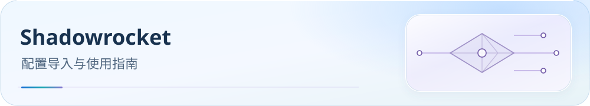

<picture>
  <source media="(max-width: 600px)" srcset="../../docs/assets/readme/page-shadowrocket-mobile.svg">
  
</picture>

# Shadowrocket（小火箭） 使用教程

为 Shadowrocket 提供国内直连、海外代理与广告拦截分流。配置与节点订阅分开接入，下面按实际操作顺序完成。

[](../../docs/guide/downloads.md) [](../../docs/README.md) [](#import) [](#verification)

[开始前](#before-start) · [获取配置](#download) · [顺序导入](#import) · [必要设置](#settings) · [验收](#verification) · [常见问题](#faq) · [进阶与参考](#reference)

> 配置：`Shadowrocket.conf` · **v6.0.20-SR.11**（Build 2026-10-24）
> 22 区域组（11 全部 + 11 家宽）+ 33 业务组；跟随 Clash Party v6.0.20 分流基线。

<a id="before-start"></a>

## 开始前

准备 Shadowrocket、机场订阅 URL 和下方配置直链。截至 2026-10-19，官方稳定版 2.2.92 要求 iOS 13+；其他设备兼容性以[官方商店](https://apps.apple.com/us/app/shadowrocket/id932747118)为准。

- 从 [App Store](https://apps.apple.com/app/shadowrocket/id932747118)安装应用；首次连接需允许添加 VPN 配置。
- 机场订阅是节点列表 URL，本仓库 `.conf` 是分流配置，不包含可用节点。
- 本配置使用 `url-test` 区域组，不提供 Mihomo Smart / LightGBM。

<a id="download"></a>

## 获取配置

[](https://raw.githubusercontent.com/IvanSolis1989/Smart-Config-Kit/main/%E7%8B%AC%E7%AB%8B%E5%86%85%E6%A0%B8%E7%B3%BB/Shadowrocket/Shadowrocket.conf)

点击按钮打开 Raw 原始文件；右键按钮可复制链接，需要本地文件时可另存为。

**Shadowrocket CONF 直链：**

```text
https://raw.githubusercontent.com/IvanSolis1989/Smart-Config-Kit/main/%E7%8B%AC%E7%AB%8B%E5%86%85%E6%A0%B8%E7%B3%BB/Shadowrocket/Shadowrocket.conf
```

复制直链到 Shadowrocket 的配置下载入口，节点订阅按下文添加。

配置下载和远程规则更新需要访问 GitHub Raw；失败时参见[下载排错](../../docs/rule-asset-delivery.md)。本地定制先保留副本，远程更新可能覆盖修改。

<a id="import"></a>

## 按顺序导入

### 1. 下载并启用分流配置

1. Shadowrocket → **配置（Config）** → **➕**。
2. 粘贴配置 URL 并下载，点击下载后的条目，选择 **使用配置（Use Config）**。
3. 检查全部远程 RULE-SET 下载完成；GitHub Raw 不可达时，先使用可用代理下载。

### 2. 添加机场订阅

在 **首页 → 子网（Subscribe）** 中添加机场订阅 URL 并更新。菜单名称可能随版本变化；导入后检查节点列表与区域组实际成员。

`policy-regex-filter` 按节点名称筛选地区，主配置不包含可用节点。

### 多机场订阅合并

可分别添加订阅；如需转换或合并，输出须为 Shadowrocket 支持的格式。第三方服务可读取含 token 的订阅链接，使用前确认服务可信。

### 3. 选择策略并连接

检查下方策略与规则下载状态，再在首页启动连接；首次连接按系统提示允许 VPN 配置。

<a id="settings"></a>

## 必要设置

### 区域与业务策略

地区分类依赖节点名称；首次导入后检查各组实际成员和业务组上游。

### 区域组（url-test 自动择优）

11 个地区各有全部节点与家宽节点组，共 22 组。节点名称需包含对应地区标识；空组或误分类先检查订阅与节点名。

### 业务组（select 手动选择）

33 个业务组供手动选择节点或区域；按所在网络及服务需求设置，不能以延迟最低代替流媒体解锁或服务可用性验证。

### DNS 边界

当前保留配置内的 `dns-server`、`proxy-dns-server` 与 `fallback-dns-server`。旧 help 站正文及其官方归属仍待确认，不能据字段名称保证解析优先级、兜底顺序，或宣称等价实现 Mihomo 的 `respect-rules`、独立 bootstrap 与 `fallback-filter`。详见[官方资料复核](../../docs/upstream/2026-10-19/apple/report.md)。

### iOS 与自动连接

#### 后台更新

需要后台更新时，检查 iOS 是否允许 Shadowrocket 后台 App 刷新；规则是否更新仍以客户端下载状态为准。

#### 按需连接

需要自动连接时，在客户端与系统设置中检查按需连接选项，并验证切换 Wi-Fi / 蜂窝后的实际行为。

#### 国内 App 异常

国内 App 异常先看请求日志、命中规则和出口；`skip-proxy` 的实际行为不能仅凭字段名称推断，避免盲目添加通配域名。

#### TUN 旁路路由

已有路由排除项见 `[General]`；以下仅为节选，勿把省略号复制进配置：

```
tun-excluded-routes = 10.0.0.0/8, 100.64.0.0/10, 127.0.0.0/8, 169.254.0.0/16, ...
```

### 跨境场景

按所在网络在策略面板切换对应业务组：

**在中国境内：**

- 🚫 受限网站（GFW）：选代理节点。
- 🌐 国外网站（含 jsDelivr / Cloudflare）：选代理。
- 📺 国内流媒体：选 DIRECT。

**在印尼或其他境外：**

- 🚫 受限网站（GFW）：选 DIRECT 直连。
- 🌐 国外网站（含 jsDelivr / Cloudflare）：选 DIRECT。
- 📺 国内流媒体：选 🇭🇰 香港回国节点。

<a id="verification"></a>

## 导入验收

1. 确认当前启用本目录配置，22 个区域组与 33 个业务组已载入；检查区域组内确有可用节点。
2. 确认订阅与全部远程规则下载成功；连接开关开启不能代替下载检查。
3. 访问 `chat.openai.com`、`www.netflix.com`、`www.bilibili.com`，在请求或连接日志中核对 AI、Netflix、国内流媒体的命中规则与实际出口。
4. 完成[DNS 与导入后验证清单](../../docs/guide/dns-and-verification.md#verification)，按需复测 Wi-Fi / 蜂窝切换。

若日志没有请求、组内为空或出口不符，继续按下方 FAQ 排查。

<a id="faq"></a>

## 常见问题

### Q1：配置下载失败 / 部分 rule-set 空白？

先确认 GitHub Raw 可达；必要时用可用代理下载，再刷新失败项。

### Q2：iOS 支付/银行 App 异常？

先核对目标域名命中的规则、出口与 DNS；参见上方必要设置，勿直接以 `skip-proxy` 代替直连规则。

### Q3：TikTok 海外版无法播放？

在“🎵 TikTok”中切换适用节点，再检查规则命中和实际服务可用性。

### Q4：Netflix 显示「You seem to be using a proxy」？

在“🎥 Netflix”组更换节点；测速延迟不能证明流媒体解锁。

### Q5：修改配置后如何同步到 SR？

更新托管文件，再在配置页刷新；保留本地定制备份，防止远程更新覆盖。

<a id="reference"></a>

## 进阶与参考

<details>
<summary>协议支持与证据边界</summary>

以下为协议对照；本轮官方来源主要是[App Store 版本历史](https://apps.apple.com/us/app/shadowrocket/id932747118)，未取得完整的官方字段手册。

| 协议 | 支持 | 说明 |
|---|:-:|---|
| **Shadowsocks (SS)** | ✅ | 含 SS 2022 |
| **ShadowsocksR (SSR)** | ✅ | 保留支持 |
| **VMess** | ✅ | ws/grpc/h2 |
| **VLESS** | ✅ | **REALITY** + **XTLS-Vision** |
| **Trojan** | ✅ | + Trojan-Go |
| **Hysteria v1 / v2** | ✅ | UDP QUIC |
| **TUIC v5** | ✅ | UDP QUIC |
| **WireGuard** | ✅ | 作为子代理节点 |
| **Snell v3 / v4** | ✅ | 少有的 iOS 客户端支持 Snell |
| **AnyTLS** | ✅ | 较新版本支持（SR 2.2.56+）|
| **ShadowTLS** | ✅ | 较新版本支持 |
| **Mieru** | ⚠️ | 部分版本支持 |
| **SOCKS5 / HTTP(S)** | ✅ | |

部分协议组合与最低引入版本仍缺官方证据，表格不作为逐字段配置依据。最新版本及待核边界见[复核报告](../../docs/upstream/2026-10-19/apple/report.md)。

</details>

<details>
<summary>配置托管与更新</summary>

直接使用上方本仓库 Raw URL；需要修改配置时，可托管到自己的 HTTPS 地址。

### 推荐托管方式

GitHub Raw 示例：`https://raw.githubusercontent.com/<user>/<repo>/main/Shadowrocket.conf`。

本仓库配置与融合规则请使用 GitHub Raw；jsDelivr 的仓库包限制不能靠更换子域名绕过。

### 手动刷新所有 rule-set

在配置页更新当前配置，并检查远程规则下载状态。

### 自动更新

在客户端确认配置与规则的更新选项；后台权限和网络条件会影响更新，完成后核对实际结果。

### 检查规则失效

检查规则状态与错误日志；区分 URL 不存在、网络不可达和解析错误，详见[下载排错](../../docs/rule-asset-delivery.md)。

</details>

本配置使用融合文本规则集，不能直接套用 Mihomo 的 `.mrs` / `rule-provider`、TLS 指纹注入或 TUN 进程排除；iOS 进程规则不适用。字段证据见 [REFERENCE](REFERENCE-shadowrocket.md)。

[Shadowrocket](https://apps.apple.com/app/shadowrocket/id932747118) · [blackmatrix7/ios_rule_script](https://github.com/blackmatrix7/ios_rule_script) · [szkane](https://github.com/szkane)

[分流策略](../../docs/guide/routing-policy.md) · [客户端支持](../../docs/guide/client-support.md) · [DNS 与验收](../../docs/guide/dns-and-verification.md)

[测速与 QUIC](../../docs/traffic-options.md) · [微信连接排错](../../docs/research/2026-10-16-wechat-issue-187.md) · [Claude Desktop 网络依赖](../../docs/claude-service-dependencies.md)

[配置变更记录](CHANGELOG.md) · [官方资料复核与待验边界](../../docs/upstream/2026-10-19/apple/report.md) · [支持本项目](../../docs/donate.md)
