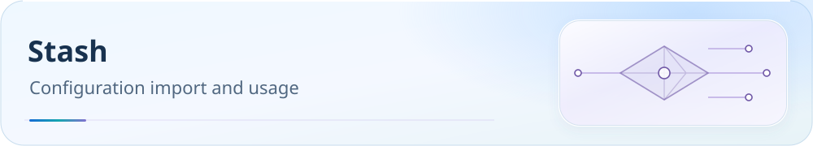

[**English**](README.md) | [中文](README.zh-CN.md)

<picture>
  <source media="(max-width: 600px)" srcset="../../docs/assets/readme/page-stash-mobile.svg">
  
</picture>

# Stash guide

YAML configuration for Stash iOS / macOS / tvOS. Replace the subscription in a local copy before importing, then verify regional groups and remote rules.

[](../../docs/guide/downloads.md) [](../../docs/README.md) [](#import) [](#verification)

[Before you start](#before-start) · [Download](#download) · [Import in order](#import) · [Required settings](#settings) · [Verification](#verification) · [Troubleshooting](#faq) · [Advanced reference](#reference)

> Configuration: `Stash.yaml` · **v6.0.21-stash.15**(Build 2026-10-28)
> Generated from CMFA, with 22 regional and 33 service groups; no Mihomo Smart / LightGBM.

<a id="before-start"></a>


## Before you start

- Prepare an installed Stash client and a provider subscription compatible with Stash / Clash. Template URLs are placeholders.
- As checked on 2026-10-19, stable iOS 3.6.4 requires iOS 16+, and Mac 4.3.3 requires macOS 12.4+. These versions do not establish when individual fields were first supported.
- This configuration is generated by trimming CMFA and uses native `url-test`, without Mihomo Smart / LightGBM.

<a id="download"></a>

## Download

[](https://raw.githubusercontent.com/IvanSolis1989/Smart-Config-Kit/main/%E7%8B%AC%E7%AB%8B%E5%86%85%E6%A0%B8%E7%B3%BB/Stash/Stash.yaml)

Click to open the raw file; right-click to copy its link, or save a local copy.

**Stash YAML direct URL:**

```text
https://raw.githubusercontent.com/IvanSolis1989/Smart-Config-Kit/main/%E7%8B%AC%E7%AB%8B%E5%86%85%E6%A0%B8%E7%B3%BB/Stash/Stash.yaml
```

Download YAML, replace `proxy-providers.Subscribe.url` as below, then import.

Configuration downloads and remote-rule updates require GitHub Raw. See [download troubleshooting](../../docs/rule-asset-delivery.md). Back up local customizations because remote updates may overwrite them.

### Online selection and local import

Open the [configuration page](https://ivansolis1989.github.io/Smart-Config-Kit/), select **Stash**, Full / Lite / Custom and optional latency-test/QUIC settings. This static configuration has no runtime node DNS or multiplier adaptation. It is generated by trimming CMFA and uses native `url-test`, not Mihomo Smart / LightGBM.

After downloading YAML, replace `proxy-providers.Subscribe.url` as below. Open the local file or import from your own HTTPS address, select it, then check nodes and rules.

Lite / Custom trim service groups to the selected profile; counts below describe Full. To update, refresh the page, reselect the same profile/parameters and download. Back up configuration and node customizations, then replace or reimport as above. Do not overwrite customized files with this repository’s full-configuration URL. Selection and generation are local and do not read or upload subscriptions or personal configurations. Protect subscription-bearing files and avoid publicly exposing hosted copies. See the [configuration guide](../../docs/configuration.md).

<a id="import"></a>

## Import in order

### 1. Replace the subscription in a local copy

Download YAML, find `proxy-providers → Subscribe → url`, and replace the placeholder with your provider subscription. Initially leave other fields unchanged. Replace only the node-subscription URL, preserving policy groups and rules.

### 2. Import and select the configuration

- **Local file:** open edited YAML in iCloud / OneDrive or send it via AirDrop; choose Stash to open it, then select it in the configuration list.
- **Remote hosting:** privately host your edited copy over HTTPS. In **Settings → Configuration File → Download from URL**, enter that address, download and select it. The repository URL still contains a placeholder subscription.

Both entry points follow [official Stash quick start](https://stash.wiki/en/get-started). Translated menu labels may vary by version.

### 3. Download resources and start

Confirm the subscription and all rule-providers downloaded, check actual regional members and select service upstreams. Return home and tap Start. Authorize VPN on first launch. Use a working proxy for downloads if GitHub Raw is unreachable.

<a id="settings"></a>

## Required settings

### Policies and empty groups

Confirm 22 regional and 33 service groups. Latency-test subscriptions should contain remote proxies only. Empty Stash providers/groups default to direct routing: inspect members before use. Verify references to special outbounds such as named direct routes separately. See the [routing policy guide](../../docs/guide/routing-policy.md).

### DNS and formats

- Keep `nameserver-policy` and `fake-ip-filter`; service DNS policy is inherited from CMFA.
- Domain / ipcidr rules use MRS; mixed rules retain compatible formats.
- Output uses conservative DNS. Stash iOS/tvOS 3.6+ and Mac 4.3+ officially support encrypted `default-nameserver`, separate `proxy-server-nameserver` and DNS rule-set references, but this artifact does not enable them.
- `tolerance` uses milliseconds, but its first supported version is unconfirmed. The generator currently omits it and does not infer support for Mihomo `empty-fallback` / `exclude-type`.

<a id="verification"></a>

## Import verification

1. Confirm this configuration is active with 22 regional and 33 service groups loaded. Check that regional groups contain working nodes.
2. Confirm the subscription and all `rule-providers` downloads succeeded. An enabled connection switch does not replace download checks.
3. Visit `chat.openai.com`, `www.netflix.com` and `www.bilibili.com`; inspect request/connection logs for AI, Netflix and China-streaming matches and actual exits.
4. Complete the [DNS and post-import checklist](../../docs/guide/dns-and-verification.md#verification), including Wi-Fi / cellular switching as needed.

This repository has not completed real application import and DNS-failure acceptance. Static configuration checks do not replace device verification.

<a id="faq"></a>

## Troubleshooting

### No nodes after import?

Check that you edited `proxy-providers.Subscribe.url` in the selected configuration and replaced the example URL. Refresh the subscription and inspect download errors. Its format must be supported by Stash.

### Unexpected direct connections after starting?

Check for empty regional groups/providers first, then service selections and request logs. Empty groups default to direct; the connection switch alone is insufficient.

### Rule downloads fail or updates lose customizations?

Use [download troubleshooting](../../docs/rule-asset-delivery.md) to distinguish network and parse errors. Remote updates may overwrite local edits. Back up customizations, update and recheck subscription URLs.

<a id="reference"></a>

## Advanced reference

<details>
<summary>Maintainers: generation pipeline and files</summary>

| File | Purpose |
|---|---|
| [Stash.yaml](Stash.yaml) | Generated importable configuration |
| [REFERENCE](REFERENCE-Stash-wiki.md) | Official field evidence and trimming rationale |

The service-DNS authority is [business-dns-policy.json](../../rulesets/source/business-dns-policy.json). Synchronize CMFA first, then generate Stash. Do not manually edit generated repository outputs. Users may edit their local copies.

```bash
node tools/sync-business-dns-policy.js
node tools/generate-stash-from-cmfa.js
node tools/validate-artifact-contracts.js
```

</details>

Official references: [Quick start](https://stash.wiki/en/get-started)、[Example configuration](https://stash.wiki/en/configuration/example-config)、[Policy groups](https://stash.wiki/en/proxy-protocols/proxy-groups)、[Rule sets](https://stash.wiki/en/rules/rule-set)。

[Routing policy](../../docs/guide/routing-policy.md) · [Client support](../../docs/guide/client-support.md) · [DNS and verification](../../docs/guide/dns-and-verification.md)

[Latency testing and QUIC](../../docs/traffic-options.md) · [WeChat troubleshooting](../../docs/research/2026-10-16-wechat-issue-187.md) · [Claude Desktop network dependencies](../../docs/claude-service-dependencies.md)

[Changelog](CHANGELOG.md) · [Official review and pending acceptance](../../docs/upstream/2026-10-19/apple/report.md) · [Support the project](../../docs/donate.md)
