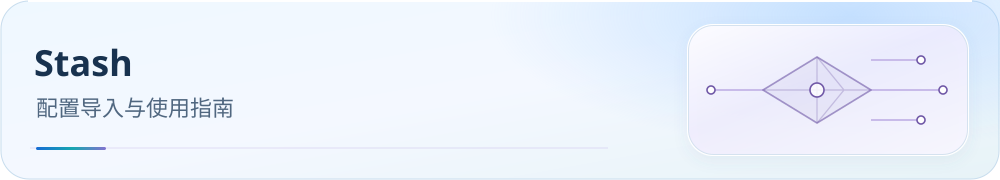

<picture>
  <source media="(max-width: 600px)" srcset="../../docs/assets/readme/page-stash-mobile.svg">
  
</picture>

# Stash 使用教程

Stash iOS / macOS / tvOS 使用的 YAML 配置。先在本地副本替换节点订阅，再导入并检查区域组与远程规则。

[](../../docs/guide/downloads.md) [](../../docs/README.md) [](#import) [](#verification)

[开始前](#before-start) · [获取配置](#download) · [顺序导入](#import) · [必要设置](#settings) · [验收](#verification) · [常见问题](#faq) · [进阶与参考](#reference)

> 配置：`Stash.yaml` · **v6.0.21-stash.15**（Build 2026-10-28）
> 由 CMFA 生成，22 区域组 + 33 业务组；不支持 Mihomo Smart / LightGBM。

<a id="before-start"></a>

## 开始前

- 准备已安装的 Stash 和机场提供的 Stash / Clash 兼容节点订阅 URL；本模板中的地址是占位符。
- 截至 2026-10-19，稳定版 iOS 3.6.4 要求 iOS 16+，Mac 4.3.3 要求 macOS 12.4+；字段最初支持版本不能据此推断。
- 本配置由 CMFA 裁剪生成，使用原生 `url-test`，不提供 Mihomo Smart / LightGBM。

<a id="download"></a>

## 获取配置

[](https://raw.githubusercontent.com/IvanSolis1989/Smart-Config-Kit/main/%E7%8B%AC%E7%AB%8B%E5%86%85%E6%A0%B8%E7%B3%BB/Stash/Stash.yaml)

点击按钮打开 Raw 原始文件；右键按钮可复制链接，需要本地文件时可另存为。

**Stash YAML 直链：**

```text
https://raw.githubusercontent.com/IvanSolis1989/Smart-Config-Kit/main/%E7%8B%AC%E7%AB%8B%E5%86%85%E6%A0%B8%E7%B3%BB/Stash/Stash.yaml
```

下载 YAML 后，按下文替换 `proxy-providers.Subscribe.url` 再导入。

配置下载和远程规则更新需要访问 GitHub Raw；失败时参见[下载排错](../../docs/rule-asset-delivery.md)。本地定制先保留副本，远程更新可能覆盖修改。

<a id="import"></a>

## 按顺序导入

### 1. 替换本地副本中的节点订阅

下载上方 YAML，找到 `proxy-providers → Subscribe → url`，将占位 URL 替换成自己的机场订阅；其他字段先保留原值。仅替换节点订阅地址，保留本配置的策略组与规则。

### 2. 导入并选中配置

- **本地文件**：在 iCloud / OneDrive 打开修改后的 YAML，或通过 AirDrop 发送文件，选择用 Stash 打开；在配置列表选中它。
- **远程托管**：把修改后的副本放到自己的 HTTPS 地址，在 **设置 → 配置文件（Configuration File）→ 从 URL 下载（Download from URL）** 填入该地址，下载后选中配置。直接使用本仓库 URL 仍含占位订阅。

两条入口依据 [Stash 官方快速开始](https://stash.wiki/en/get-started)，菜单译名可能随版本变化。

### 3. 下载资源并启动

检查节点订阅与所有 rule-providers 下载成功，确认区域组实际成员，选择业务组上游；返回首页点击 Start。首次启动按系统提示授权 VPN。GitHub Raw 不可达时，先使用可用代理完成下载。

<a id="settings"></a>

## 必要设置

### 策略与空组

确认 22 个区域组和 33 个业务组。测速订阅只应包含远端代理；Stash 空 provider 或空组会默认直连，使用前逐组检查实际成员。具名直连等特殊出站需另行确认引用。业务策略参考[分流策略指南](../../docs/guide/routing-policy.md)。

### DNS 与格式

- 保留 `nameserver-policy` 与 `fake-ip-filter`；业务 DNS policy 由 CMFA 继承。
- domain / ipcidr 规则使用 MRS，混合规则保留兼容格式。
- 现有输出采用保守 DNS。Stash iOS/tvOS 3.6+、Mac 4.3+ 已官方支持加密 `default-nameserver`、独立 `proxy-server-nameserver` 与 DNS 规则集引用，但本产物尚未启用这些能力。
- `tolerance` 单位为毫秒，最初引入版本未确认；生成器暂不保留该字段，也不推断支持 Mihomo `empty-fallback` / `exclude-type`。

<a id="verification"></a>

## 导入验收

1. 确认当前启用本目录配置，22 个区域组与 33 个业务组已载入；检查区域组内确有可用节点。
2. 确认订阅与全部 `rule-providers` 下载成功；连接开关开启不能代替下载检查。
3. 访问 `chat.openai.com`、`www.netflix.com`、`www.bilibili.com`，在请求或连接日志中核对 AI、Netflix、国内流媒体的命中规则与实际出口。
4. 完成[DNS 与导入后验证清单](../../docs/guide/dns-and-verification.md#verification)，按需复测 Wi-Fi / 蜂窝切换。

本仓库尚未完成该 App 的实际导入与 DNS 故障验收；静态配置检查不能替代设备上的验证。

<a id="faq"></a>

## 常见问题

### 导入后没有节点？

确认修改的是当前选中配置的 `proxy-providers.Subscribe.url`，地址不是示例值；刷新订阅并查看下载错误。订阅格式须为 Stash 支持的格式。

### 开启后请求意外直连？

先检查区域组和 provider 是否为空，再检查业务组选择及请求日志；空组会默认直连，不能只看连接开关。

### 规则下载失败或更新后定制丢失？

按[下载排错](../../docs/rule-asset-delivery.md)区分网络和解析错误。远程配置更新可能覆盖本地修改，先备份定制，再更新并核对订阅地址。

<a id="reference"></a>

## 进阶与参考

<details>
<summary>维护者：生成链路与文件</summary>

| 文件 | 用途 |
|---|---|
| [Stash.yaml](Stash.yaml) | 可导入的生成配置 |
| [REFERENCE](REFERENCE-Stash-wiki.md) | 官方字段依据与裁剪说明 |

业务 DNS 权威源为 [business-dns-policy.json](../../rulesets/source/business-dns-policy.json)。更新时先同步 CMFA，再生成 Stash；不要手工修改仓库生成结果。用户可编辑自己的本地副本。

```bash
node tools/sync-business-dns-policy.js
node tools/generate-stash-from-cmfa.js
node tools/validate-artifact-contracts.js
```

</details>

官方依据：[快速开始](https://stash.wiki/en/get-started)、[配置示例](https://stash.wiki/en/configuration/example-config)、[策略组](https://stash.wiki/en/proxy-protocols/proxy-groups)、[规则集](https://stash.wiki/en/rules/rule-set)。

[分流策略](../../docs/guide/routing-policy.md) · [客户端支持](../../docs/guide/client-support.md) · [DNS 与验收](../../docs/guide/dns-and-verification.md)

[测速与 QUIC](../../docs/traffic-options.md) · [微信连接排错](../../docs/research/2026-10-16-wechat-issue-187.md) · [Claude Desktop 网络依赖](../../docs/claude-service-dependencies.md)

[配置变更记录](CHANGELOG.md) · [官方资料复核与待验边界](../../docs/upstream/2026-10-19/apple/report.md) · [支持本项目](../../docs/donate.md)
